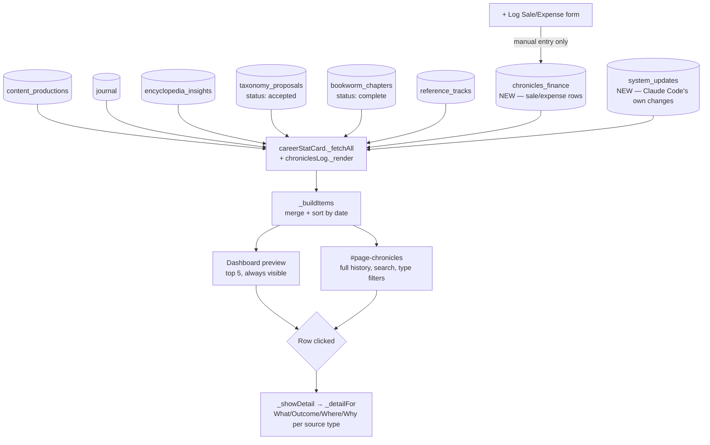
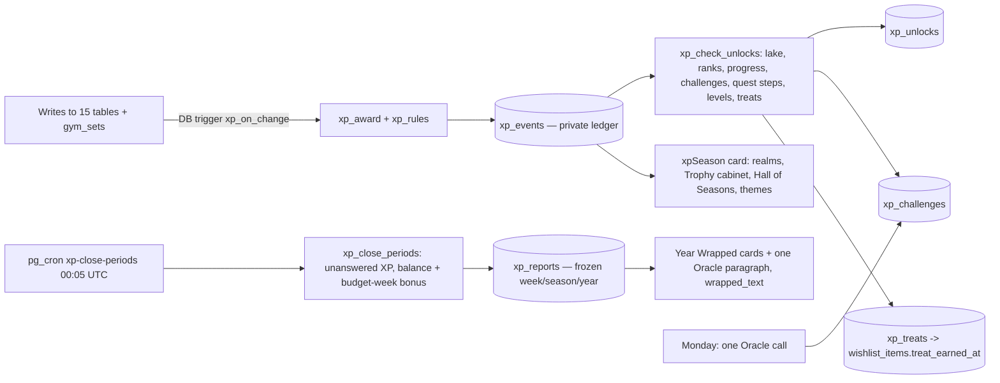

# system_flow_map — Chronicles (domain `chronicles`)
Moved here from `system_flow_map.md` on Oct 28 2026 (CK-3/4, plan "Caps and Central Kit"); text unchanged. The root file keeps cross-domain sections and links here.

## 9. The Chronicles (activity-log aggregation + finance ledger)

Real design choice, not an oversight: `chronicles_finance` feeds Chronicles' display but is deliberately **excluded** from the career-score XP/Level formula computed in the same `_fetchAll` pass — confirmed via interrogation this is a separate visibility lane. `bookworm_chapters` feeds the cumulative Growth *count* but is excluded from the streak/recent-activity date logic (its `created_at` is a bulk-insert timestamp from TOC detection, not real per-chapter completion time — would show a misleading date otherwise).

---

## 15f. XP Season Pass (Oct 13-14 2026, XP-1..8) — built, untested by Alex

Only DB triggers write `xp_events`; the client never awards XP. Private tables (`xp_*`, `outreach_log`) are read through `/api/data-write` action `read`. Year Wrapped reads the frozen year report, never live rows; "Year so far" is the live version. Migrations: `records/2026-10/xp5..xp8_migration_*.sql`.
