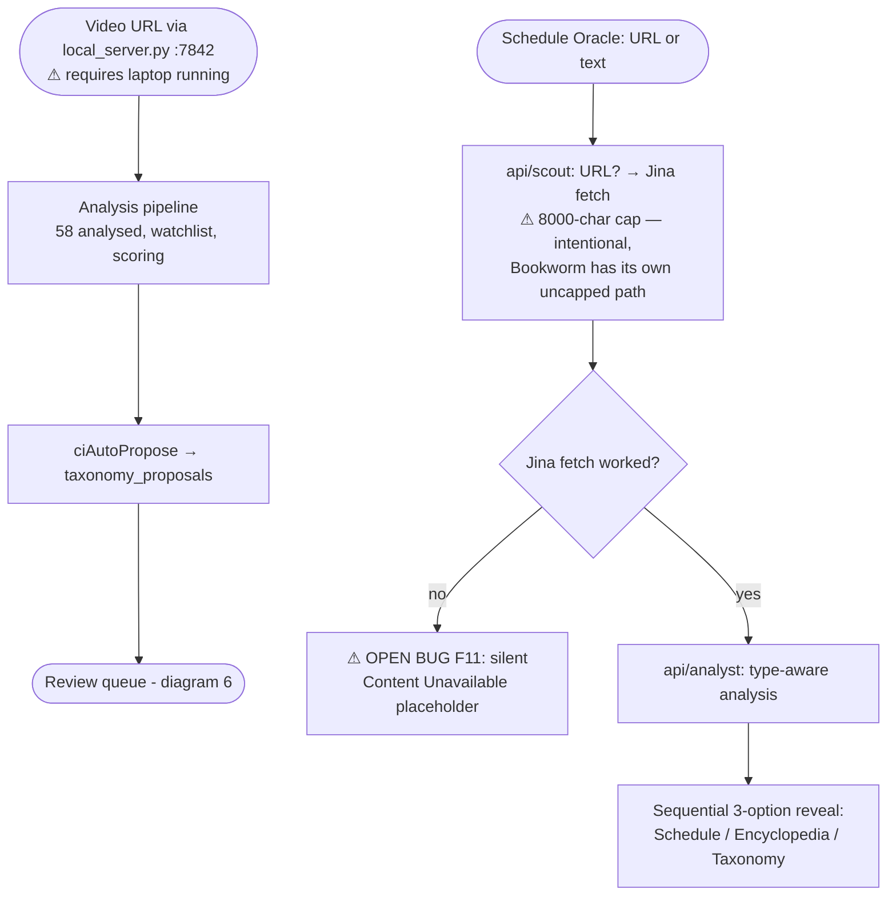
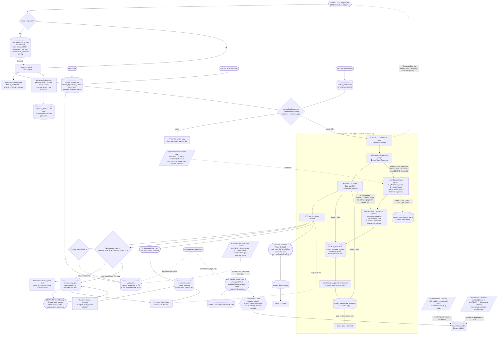
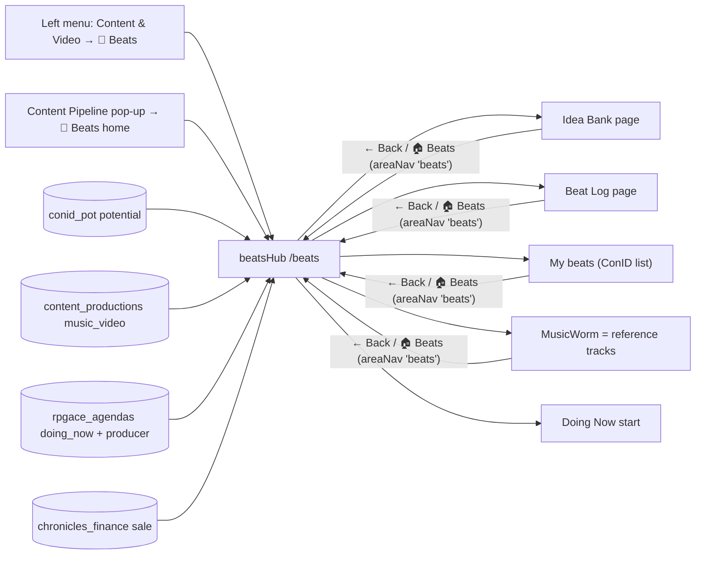
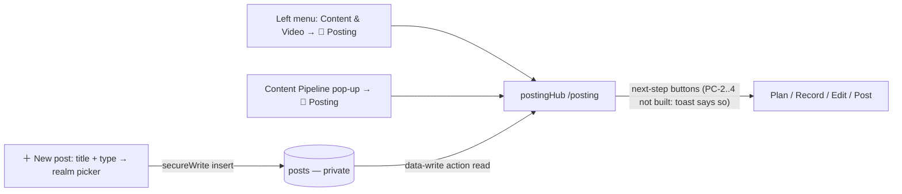
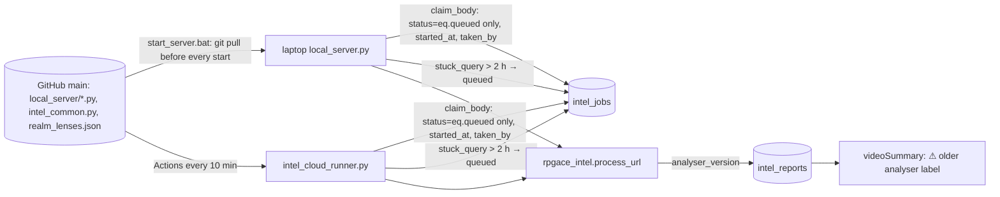
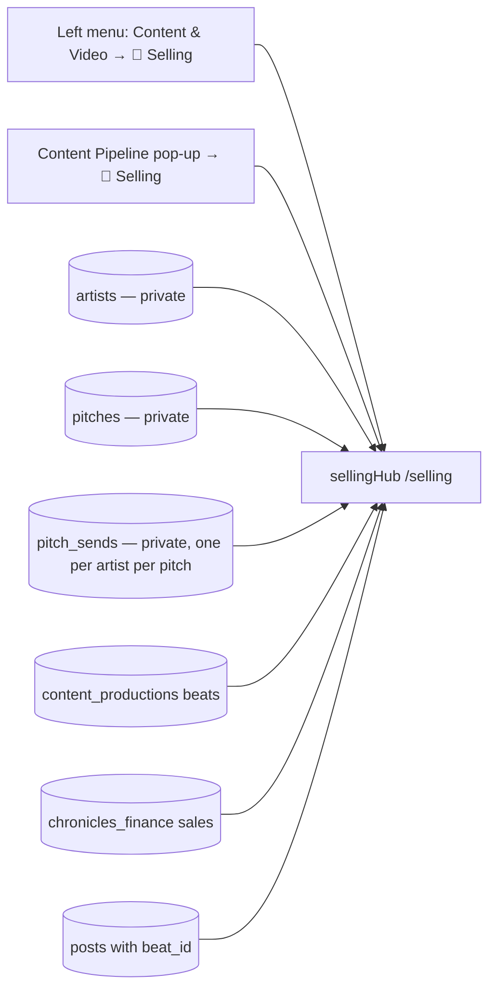

# system_flow_map — Content (domain `content`)
Moved here from `system_flow_map.md` on Oct 28 2026 (CK-3/4, plan "Caps and Central Kit"); text unchanged. The root file keeps cross-domain sections and links here.

## 7. Content Intelligence & Schedule Oracle ingestion

---

## 11. Content & Video Production Pipeline — RETIRED Oct 17 2026 (PC-6), kept below as history

**RETIRED (PC-6 of "Posting (Creator)", code deleted):** everything drawn in this section after the Beat Log save — Visual Treatment / Director Match, the 4-phase and 3-phase Production Panels, the retroactive loop, Generate Video / OpenMontage payload, Generate Captions, the OBS raw flow and the `videoPipeline` tracker — no longer exists in the app. Beats now run through §15i (Beats home) and posts through §15j (Posting home); the AI video hand-off is Posting's PC-2 path. The diagram is left as a record of the old design, not current state.

**Why this section exists:** this pipeline has been real and load-bearing since July 28 and was never drawn anywhere in this document until July 31. **Rebuilt Aug 5** after a real `/interrogation`-scoped 8-phase unification (`content_video_pipeline_unification_spec_2026-08-05.txt`, Phases A-F shipped, G-H not started) merged Beat Log / Content Pipeline / Video Pipeline into one real, chronological, looping flow — the previous diagram (a 3-phase Production Panel with no real retroactive path) was already stale the moment Phase D shipped. Per this doc's own rule — a feature isn't "done" until it moves out of the dashed/planned section into a real diagram — drawn now from real code (`rpgace_core.js`'s `beatLog`/`contentProductionLive`/`visualOracle`/`videoPipeline` modules) and a live Supabase schema read, not from a doc's claim.

**How to read this diagram — one real chronological loop, not a static map**: information enters at Beat Log (top), gets processed and transported through exactly 4 real Production Panel phases in order, and — this is the "on loop" part Alex asked to make explicit — **3 of those 4 phases can hand control straight back to an earlier real step** to regenerate output without losing any prior data (the retroactive edit-in-place mechanism, Phase E). The loop only exits forward once Phase 4 hands off to OpenMontage and a real job result (or a safe simulated one) comes back.

## 15i. Beats home (Oct 16 2026, BT-0 of "Beats (Producer)") — built, untested by Alex

Truth table: Beats home with 6 steps (Idea → Make → Mix → Log → Release → Sell), live counts, what's next, Back/🏠 on Idea Bank / Beat Log / My beats and on MusicWorm when opened from Beats — BUILT (headless-verified). BT-1: ▶ Start making on an idea (Idea Bank row or Beats home picker) → `beatsHub.logic.startMaking` → Doing Now session "Making: …" (Producer, `details.kind='beat'`, `stage='make'`, `link={kind:'conid_pot',id}`) + `conid_pot.status='making'` (badge + Making filter) — BUILT. BT-2: making + mixing sessions (`details.stage` make|mix) per idea; `beatsHub.logic.times` sums minutes per `conid_pot` id (time line on Idea Bank cards, Make/Mix step lists); stopping a making session fires `doingnow:finished` → "Ready to mix?" (start mixing now / mix later → `details.ready_to_mix` / not yet); Keep making / Start mixing on Idea Bank cards and Beats home pickers; a Producer session started from Doing Now asks "Which beat?"; running beat sessions show 🥁 Beats — BUILT. BT-3: Beat Log saves the beat already finished (`content_productions.finished_at` on insert + `stems_drive`/`stems_folder`/`stems` jsonb, `idea_id` + `making_mins`/`mixing_mins` from the idea's sessions); drive + folder required, drive prefilled from the last logged beat, stems = fixed list (Full mix WAV, Drums, 808/Bass, Melody, Chords, FX, Vocals) + add; the idea → `conid_pot.status='done'`; `xp_on_change` INSERT branch now also pays `beat_finished` when `finished_at` is set; `RPGACE.realmOf` reads music_video rows as Producer; 🥁 Log this beat (Idea Bank) / Log a finished beat (Beats home) open Beat Log filled from the idea — BUILT. BT-4: Beat Log's 🎧 Scan audio decodes the picked file on the device (`beatLog.logic.analyseFile`: decodeAudioData → OfflineAudioContext middle 60 s at 22050 Hz mono → `_analyseSamples`: FFT spectral-flux onset curve + autocorrelation for BPM folded to 70-180, chroma + Krumhansl-Kessler profiles for key/Major-Minor) → fills BPM/Key/Scale (editable, ½×/2×); no upload; the old `beat-audio` bucket upload + `beat_audio_jobs` polling are removed (10 queued rows set `retired`); `pathways.logic.loadBeats` (About a beat) and `xpSeason.logic.MS_PROOF.beat` read finished `content_productions` music_video rows instead — BUILT. BT-5: release = `content_productions.release_links` jsonb ([{place,url,added_at}], old `release_url` rows backfilled); `beatsHub.logic.releaseUpdate` (pure) validates http links, skips duplicates, sets `released_at` only on the first release (trigger pays beat_released once), keeps `release_url` = the Beatstars link (else first) as the listing; `ui.openRelease` (Beats home Release step / What's next / My beats card `🚀 Beat released` + `+ link`) then offers 🎬 Make a video (Production Panel) / 💰 Beatstars listing text — BUILT. BT-6: Reference tracks 🔎 Look up missing → next 8 `reference_tracks` with scale or genre null and `lookup_at` null → one `/api/search` type web call (Gemini, via `tripPlans.logic.webSearch`) asking one `n | key | Major/Minor | BPM | genre` line per song → `refCorpus.logic.parseLookup`/`normKey` (flats → sharps) → review list (his values kept, gaps filled, "found:" where the web disagrees) → Accept writes the row + `lookup_at`, Skip writes only `lookup_at`; a track added without scale/genre opens the same look-up for itself — BUILT. BT-8: Sell = `beatsHub.ui.openSell` (Beats home Sell step / picker, My beats `💰 Sell` on every beat, release hand-off): licence tiers `content_productions.licence_tiers` [{name, price}] (new beat starts from the last saved tiers; `price` = cheapest), 🎧 Beatstars listing text (existing generator), 💷 Log a sale → `chronicles_finance` type sale + `content_production_id` (trigger: Hustler XP 2/£, min 100), per-beat sales count/total; the Phase H deliverable-zip system is retired (client helpers + `data-write` `bundle-deliverables` branch removed; `deliverable_*` columns kept, bucket empty); Hustler milestone proof = a logged sale — BUILT. BT-7: menu = Beats with Idea Bank / Beat Log / My beats / Reference tracks (via `beatsHub.ui.go('refs')`) under it, Content Pipeline keeps Upload Workshop; `beatsHub.ui.openBeat(id)` (My beats card `data-cp-id` highlighted, else its Sell pop-up) is reached from a done idea's 🥁 Open beat and a linked sale's 🥁 Open this beat in Chronicles; Reference tracks' hand-edit Backfill popup and Beat Log's Licence Type field removed; phone-width (400px) check of Beats home + Sell/Release/Make pop-ups; Galaxy Map regenerated — BUILT. Plan Beats (Producer) BT-0..8 all built; every item yellow until Alex hand-tests.

Oracle → journal (Oct 16 2026): 📓 Save as entry under an Oracle reply → `oracleEntry` review card (split write-ups, title/date/text/realms) → journal entry (`journal.realms`, `journal.big_day`, source `oracle_entry` → journal_entry XP + ⭐ big_day 50 split) or realm mission (Doing Now just-did → 30 split) — BUILT. Oracle itself never writes or awards XP (ORACLE_SYS rule).

## 15j. Posting home (Oct 17 2026, "Posting (Creator)" PC-0..7) — built, untested by Alex

Truth table: Posting home with 6 steps (Idea → Plan → Record → Edit → Post → Results "coming later"), counts per `posts.stage`, posted this week, what's next (editing → recording → planned → idea, newest first, 5 max), ＋ New post (title + kind beat_video/tutorial/clip/studio_life + realms, Creator default) — BUILT (headless-verified). `posts` is locked (`authenticated_all` only), in `api/data-write.js`'s allowlist and `PRIVATE_READ_TABLES`; `RPGACE.realmOf('posts')` = creator. PC-1: `conid_pot.kind` beat|post (default beat, CHECK) + `post_type`; Idea Bank save pop-up and the card tag (retag pop-up) share `postingHub.ui.kindChooser`; filters 🥁 Beats / 📣 Posts; ▶ Start making only on beat ideas, ▶ Plan a post only on potential post ideas → `postingHub.logic.fromIdea` (one post per idea, kind from post_type, stage idea) + `conid_pot.status='in_post'` (📣 In Posting badge); Beats' idea reads add `kind=neq.post`; Posting's Idea step counts potential post ideas and 💡 Post ideas opens Idea Bank filtered with Posting's Back row — BUILT. PC-2: 📝 Plan it / tapping a post title → `postingHub.ui.openPlan` (hook, script, shots per `logic.STARTERS`; 🔮 Draft = one `_callGroundWorkerJSON` (700 tokens) filling the boxes only, a second tap needed to overwrite; platforms Instagram/YouTube/TikTok + ✍️ Write captions = one call (600) → `cleanCaptions` keeps ticked platforms; beat videos: beat select from `content_productions` music_video + 🤖 hand-off → `openmontage_jobs` insert (return=representation) → `posts.plan.handoff.job_id`, status line); 💾 Save / ✅ Plan done → `logic.planUpdate` (done needs hook or script + a platform; idea→planned, `planned_at` once) → `xp_on_change` posts branch pays `treatment_done` (label Post planned, 60 Creator) once — BUILT. PC-3: 🎥 Record it / ▶ Keep recording / ✂️ Edit it / Keep editing → `postingHub.logic.startSession(post, 'record'|'edit')` → `doingNow.logic.start('Recording|Editing: '+title, post.realms)` + `details {kind:'post', stage, link {kind:'posts', id}}` + `posts.stage` (`logic.stageFor`); `doingnow:finished` → `logic.addTime` (minutes → `record_mins`/`edit_mins`, `details.counted` so never twice) → record: `ui.askRecordDone` (edit now / later → stage editing / not yet); edit: `ui.askReadyToPost` (video file name + place → `posts.files.video`, `ready_at`); what's next ranks ready first (📣 Post it); Doing Now `openStart` with Creator → `ui.offerPost` (Which post?), running card 📣 Posting, `loadLinks` lists posts; plan screen files: 🎬 video + 🥁 beat (prefilled by `logic.beatFile` from `creative_docs.beat_meta.wavFile` + `stems_drive`/`stems_folder`); Beat Log `#bl-wav` (WAV file name, kept in beat_meta) — BUILT. PC-4: 📣 Post it (ready post) / + link (Post step's recent posted) → `ui.openPost(post, preset?)` (one row per planned platform not yet linked; `LINK_PLACES` YouTube/Instagram/TikTok/DistroKid/Other; `logic.placeOf` = `beatsHub.logic.placeOf`, which now knows DistroKid/HyperFollow) → `logic.savePost` → `postUpdate` (full http links, no repeats; first link → `posted_at` + stage posted) → `secureWrite posts` → idea `conid_pot.status='posted'` → beat video: `beatsHub.logic.release(beat, links)` (beat released first time); `xp_on_change` posts branch pays `video_posted` (300 Creator) once on `posted_at`; Oracle chat: `logic.patchChat` wraps `window.sendChat` (`_postingLinkPatched`), `chatLinks` finds those places in the typed message → `ui.offerLinkSave` (Save this link to a post? → `openPost` prefilled); BT-5 🎬 Make a video → `logic.fromBeat` (one open beat-video post per beat) → `openPlan` — BUILT. PC-5: ⚙️ target → `logic.saveTarget` → `xp_settings.posts_per_week` (0-14, CHECK; read via data-write `read`); `logic.weekStatus` (Mon-Sun local week of `posted_at`) → `weekLine` on Posting home (`#ph-week`) and My Day (`ui.myDayLine`, after the health card); `logic.loadDue` → `due` (behind from Thursday, hot Sat/Sun; planned ≥7 days; ready ≥2 days) → `dashDeck` Due list rows (open Posting / next step / Post it) — BUILT. Results — NOT BUILT (later plan; Alex: "results and stats would be awesome"). PC-6: old video tools retired and deleted (see §11's RETIRED note); Content Pipeline pop-up = Beats home / Posting / Idea Bank / Beat Log / My beats; My beats = beats only; Creator proof + Creator badges count `posts.posted_at` — BUILT. PC-7: `careerStatCard.logic._fetchAll` reads posted `posts` (via `tripPlans.logic.read`, slot 19) + their ideas' `conid_pot` rows → one `type:'post'` Chronicles item each (`postingHub.logic.chronicleLabel`, Beats & content section), finished Doing Now rows linked to a posted post are folded into it; the detail = `postingHub.logic.report(post, doing, idea)` (Idea / Plan / Record / Edit / Ready / Posted / Totals with dates, `logic.gap` durations, each session's minutes, clickable links) + 📣 Open this post / 🥁 Open beat; My beats cards show 📣 Video post (✓ when posted; plan or Post it screen); a beat video's plan screen has 🥁 Open beat (`beatsHub.ui.openBeat`) — BUILT.

## 15v. Videoworm: one analyser (Oct 20 2026, plan "Videoworm realm extraction" VW-0) — built, untested by Alex

Truth table: shared version/claim/stuck helpers, one-runner-per-job claim, laptop self-update, realm file found on the laptop, version on every new report, older-report label — BUILT (Python tests + headless label test). Needs Alex: one-time Git install + clone to %USERPROFILE%\\RPGACE-code (done Oct 20), start from there; spare-account cookies in the YT_COOKIES secret. VW-1 (read all of it): Whisper segments → `[m:ss]` lines (`mark_segments`), whole timed transcript to the main call (`condense_transcript`: over 6000 words the cheap model (`MECHANICAL_MODEL`) picks line numbers to keep per 2500-word part, kept lines copied word for word, fails open; then a 90k-char cap with a visible marker), 8 frames spread over the whole video (`frame_times`, 60-min cap), frame prompt follows the picked realms (`frames_prompt`; DAW/editing/thumbnail only for Creator/Producer/Hustler), visual analysis up to 4000 chars, main call timeout 180 s; `ANALYSER_VERSION` 2026-10-20.2 — BUILT (17 Python checks with Claude mocked + a real ffmpeg frame run). VW-2 (new shape): one call (6000-token ceiling) returns `realms{key: score, why, teaches, points[{text, quote, at, also}], action, quests×3}` + `how_made{summary, points, steal, avoid}` only when Creator/Producer/Hustler is picked (prompt forbids made-talk otherwise); `parse_insights` cleans it in code (unknown realms dropped, scores 1-10, ≤7 points, 3 quests XP 10-100, same point under two realms kept once under the higher score with `also`, empty realm → "nothing for this realm" (+ where its shared points went), `how_made` dropped unless asked) and stores `insights.realm_sections`/`insights.how_made`, then fills the old keys from them (`realm_scores`, `encyclopedia_entry.key_learnings` = all points, `production_techniques`/`content_strategy_insights`/`what_to_steal`/`what_to_avoid` from `how_made` only, `quests` = every realm's 3, realm = category); laptop text report + Encyclopedia article are one section per realm (`format_output`, `realm_section`, `point_line`); `ANALYSER_VERSION` 2026-10-20.3 — BUILT (17 more Python checks). Quests are still only created by a tap in the app (`pathways.logic.addQuest`). VW-3 (proof in code): `parse_insights(raw, realms, source)` with source = the ORIGINAL full timed transcript (`generate_oracle_insights(..., full_transcript=timed)`; the condensed one only goes in the prompt) → `transcript_words` (word list + each word's line time) → `find_quote` (≥4 words; exact run first, else best same-length window sharing ≥half its words with difflib ratio ≥0.85) → `verify_points` drops unmatched points (realm + `how_made`), sets `at` from the matched line, counts `dropped`; a realm left with no points says "nothing for this realm"; `insights.quotes_checked`; laptop report shows "N more thrown out"; prompt says on-screen-only things are not points (Alex left the choice to me: dropped); `ANALYSER_VERSION` 2026-10-20.4 — BUILT (14 checks incl. a 20k-word speed check, VW-1/VW-2 suites re-run). VW-4 (what you see): `pathways.ui.realmSections(report)` (shared) renders `insights.realm_sections` + `how_made` — realm header score/why, teaches, points with quote + `▶ m:ss` link (`pathways.logic.timeUrl`: YouTube watch/shorts/youtu.be → `watch?v=ID&t=Ns`, other sites open the video), dropped count, Try this, `pathways.ui.questCard(report, realm)` (one of the realm's 3 ideas at a time via `logic.questIndexes`, 🎲 steps with no AI call, + Add → `logic.addQuest(report, flatIndex)`, remembers added); Videoworm: `videoSummary.ui._proseHtml` returns a `.vs-realm-mount` for new-style reports (old boxes hidden) and `_render` → `_mountRealms` fills it; Encyclopedia posts: `pathways.ui.articleActions` folds the sections into `details.pw-realms-fold` ("🧭 By realm") instead of RI-7's quest list; reports without `realm_sections` render exactly as before — BUILT (18 headless checks + phone screenshot). VW-5 (where the points go): `rpgace_intel.py` no longer POSTs `encyclopedia` (anon-key write had failed since the July 24 RLS flip and skipped the watchlist push); `encyclopediaPosts.ensureArticles` → `articleFromReport` uses `realmIdeas(r)` for realm-section reports: article markdown per realm + cards `summary`, `point` (text — "quote" (m:ss), `realms:[k]`), `try` (`realms:[k]`), `made`; `_saveArticle` writes each card's own realms (else the article's); `cardLabel(d)` heads cards "🍳 Chef · Key point"; Life Library `feedVideos` → `shelveByRealm(videoRow(r), r, phylumRealms())` (best realm's first phylum, `shelf_by='realm'`, CHECK widened) — older reports keep the keyword shelf; `RPGACE.realmKnowledge` adds `points` from `encyclopedia_insights` `idea_section=point` per realm → Knows line "N video points" — BUILT (11 headless checks; Python suites re-run). Weekly realm report counts — NOT built (Knows line only). VW-6 (re-run replaces): `rpgace_intel.py` DELETEs `intel_reports?url=eq.<url>` (anon_all) before inserting the new report (own try, never blocks the insert); `encyclopediaPosts.ensureArticles` treats an article older than its video's newest report as stale → `_replaceOld` (skips when any card has `saved_at`; else `secureWrite` delete of its `encyclopedia_insights` then the `encyclopedia` row) → `_saveArticle`; `lifeLibrary.logic.feedVideos` re-shelves an existing intel Library item still on a keyword/no shelf (`secureWrite` update, `shelf_by='realm'`; `xp_on_input` pays on update only for a held item, so no double XP); `ANALYSER_VERSION` 2026-10-20.5 — BUILT (6 headless checks). Why: this session's Supabase connector cancels every DELETE (execute_sql and apply_migration alike), so the 9 re-runs could not be cleared by SQL. The 9 jobs (8 since Oct 18 + the cinnamon Short) re-queue by a plain UPDATE once the laptop runs .5. Run (Oct 21): all 9 re-runs complete on 2026-10-20.5 — realm sections, rebuilt article + realm point cards each, 2 points dropped by the quote check, 7 Library items moved to realm shelves (1 already right, 1 manual kept). VW-7 (logging) — BUILT; plan complete. Still needs Alex: YT_COOKIES spare account; hand-test of the new screens.

## 15k. Selling home (Oct 17 2026, "Selling (Hustler)" SH-0) — built, untested by Alex

Truth table: Selling home with two tracks — Beats for sale (List: released beats with a Beatstars link via `beatsHub.logic.linksOf`; Promote: released beats with a posted `posts` row; Sell: beats with `licence_tiers`; Paid: `chronicles_finance` type sale count + £) and Artist outreach (Find: artists; Pitch: pitches + `to_send`; Follow up: `potential_pitch` + `no_reply`; Deal: `potential_close` + `agreed_sale`; Paid: `paid` + `no`); what's next (agreed_sale → potential_close → potential_pitch ≥5 days → to_send → released unlisted beat, 5 max) — BUILT. `pitch_sends.stage` CHECK: to_send, potential_pitch, potential_close, agreed_sale, paid, no, no_reply; unique (pitch_id, artist_id). SH-1: ＋ Add artist / ✏️ Edit → `sellingHub.logic.cleanArtist` (name required, email checked, blanks null) → `saveArtist` (`secureWrite artists` insert/update, realms hustler, optional `person_id` from a People picker — People never written); 🎤 Artists list (`logic.searchArtists`, every word across name/genre/location, A–Z); profile (`logic.loadArtist`: artist + its `pitch_sends` + pitch titles; `contactLinks` turns handles into Instagram/TikTok/YouTube URLs, mailto, tel); 🗑 two-tap delete (warns with the pitch count; FK cascade removes the sends) — BUILT. SH-2: ＋ New pitch / ✏️ Edit → `logic.cleanPitch` (title + kind required, £ price parsed, beat ids deduped, max 20) → `savePitch` (`secureWrite pitches`, realms hustler); 🔮 Draft = one `phylumPath._callGroundWorkerText` call (400 tokens, `logic.draftPrompt` with the Artist Outreach rules + `postingHub.logic.beatLine`), writes `{name}`, asks before replacing; new pitch → `ui.pickArtists` → `logic.addSends` (`newSendRows`: one `to_send` row per artist, never twice; one `secureWrite` insert with an array); 📋 Copy & open → `logic.fillName` → clipboard (manual-copy box if blocked) → `logic.openLink` (Instagram/TikTok/link/email); ✅ Mark sent → `logic.markSent` (`sentUpdate`: stage potential_pitch, sent_at, channel dm/email/other) → `producerTools.logic.addOutreach` (outreach_log → Hustler XP); ✕ removes a to_send row; 🗑 two-tap pitch delete cascades sends; 📋 Pitches list (`loadPitches` + `pitchSummary`); what's next opens the pitch — BUILT. SH-3: stage buttons per send (`ui._stageButtons`) → `logic.move` (`moveUpdate`: `MOVES` table only, note, amount/terms on agreed_sale, appended to `pitch_sends.history`) / `logic.back` (`backUpdate`: undo last move or follow-up, never paid); follow-up cadence `logic.followDue` (`FOLLOW_GAPS` 5 then 7 days from `sent_at`/`last_follow_up_at`, then `GIVE_UP_DAYS` 7 → suggest no_reply); 🔁 Follow-up sweep `ui.openSweep` ← `logic.loadFollowUps` (oldest first) → `ui.copyFollowUp` (`followText` from `pitches.follow_up_message`, clipboard, `openLink`) → `markFollowed` (`followUpdate` + `producerTools.logic.addOutreach`, Hustler XP); 🔮 Draft follow-up = one `_callGroundWorkerText` (200, `followPrompt`); 💷 Paid → `logic.pay` → `beatsHub.logic.logSale` (now returns the saved row with id) → `pitch_sends` paid/paid_at/finance_id; collab → `addOutreach` kind collab; Deal tools → `captionsPanel.logic.sendPrompt` (shared with the Business tab) with pitch + pushback context; `logic.funnel`/`funnelLine` on Selling home; dashDeck Due slot r[17] = `sellingHub.logic.loadDue` (one sweep row) — BUILT. SH-4: ⚙️ Standard prices → `beatsHub.logic.loadStandard`/`saveStandard` (`xp_settings.licence_defaults`, falls back to `UK_DEFAULTS` MP3 £30/WAV £50/Trackout £100/Exclusive £500) → `beatsHub.logic.defaultTiers` pre-fills any unpriced beat's Sell screen; `sellingHub.logic.beatLists` (list/promote/sell/paid) → `ui.openBeatList` → `beatsHub.ui.openRelease` (Add link) / `ui.critique` (`logic.critiquePrompt` + `producerTools` A&R Critic via `captionsPanel.logic.sendPrompt`) / `postingHub.logic.fromBeat` → `ui.openPlan` / `beatsHub.ui.openSell` — BUILT. SH-5: `sellingHub.logic.load` also reads `xp_settings` (`monthly_income_target`) → `logic.money` (this month vs target, pace, `behind` = past the 15th and under half, `byKind` via `chronicles_finance.income_kind` or `beatsHub.logic.incomeKindOf`, best sellers via `beatsHub.logic.salesBy`) + `logic.pitchRates` (per-pitch `funnel`) → `ui.renderMoney` (`#sh-money`); 🎯 → `xpSeason.logic.setMonthlyTarget` (monthly + `revenue_target` = 12×); ＋ Other income → `beatsHub.logic.logSale` (`kind`, `item`, no beat); `beatsHub.logic.saleRow` writes `income_kind` (tier → kind, pitch Paid → `PAY_KIND`); Due slot r[17] adds `logic.loadMoneyDue`; My Day → `sellingHub.ui.myDayLine`; `xpSeason.MS_PROOF.sale` (Hustler), `beat` proof needs `stems_folder` — BUILT. SH-5b: `moneyHub` (page `money`, `RPGACE.AREAS.money`, realms hustler+steward; menu entries under Selling and Habits with `run` → `open('selling'|'wishlist')`, Selling's Money in button, Wishlist's `#wl-open-money`) → `logic.load` (private `subscriptions` via `tripPlans.logic.read`, `chronicles_finance` from the tax-year start, `xp_settings`) → `logic.model` (In from `sellingHub.logic.money`, Out = `monthlyCost` of active subs + this month's business non-subscription expenses, `due`, tax-year business rows) → `ui.render`; renewal → `logic.confirmRenewal` (once per `subscription_id`+date, `nextDate`); purchase → `logic.uploadReceipt` (`screenshotInbox.logic.upload` source `receipt`, tag `receipt`, kept) → `logic.readReceipt` (`RPGACE.utils.oracleVision`, `parseReceipt`) → `logic.addExpense` (`business`, `receipt_id`); Wishlist `_markBought(…, opts)` business/receipt; Due slot r[17] adds `moneyHub.logic.loadDue` rows with `go` — BUILT. SH-6: `captionsPanel.PLATFORMS` = Instagram/YouTube/TikTok only; `producerTools.ui.send(name, context)` → `captionsPanel.logic.sendPrompt` (Outreach tool: `sellingHub.ui.outreachTool` + `logic.outreachContext`; Playlist Psychologist: `beatsHub.ui.go('playlist')`); outreach log → `sellingHub.ui.renderLog` (`#sh-log`, `producerTools.ui.renderOutreachInto`); `producerTools.ui.open`/`openOutreach` open Selling home — BUILT. SH-7 (Oct 17 2026): deals link up both ways — a beat's Sell screen (`beatsHub.ui.openSell`) lists the pitches it is in with each artist's stage (`sellingHub.ui.beatDealsBox` ← `logic.loadBeatDeals`, `pitches.beat_ids cs.{id}`), a pitch's beats open `beatsHub.ui.openBeat(id, {sell:true})`, a People person with a linked artist shows 🎤 also an artist (`tripPlans.ui.renderPeople` → `sellingHub.ui.openArtist`), Chronicles Money shows agreed sales (`sellingHub.logic.loadAgreed` from `pitch_sends.history`, type `agreed_sale`, not money) and names pitch → artist on paid sales (`logic.saleLabel`, new pays write `item` via `logic.dealName`) — BUILT; plan complete.
