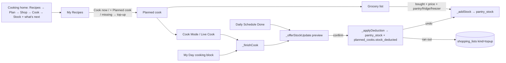
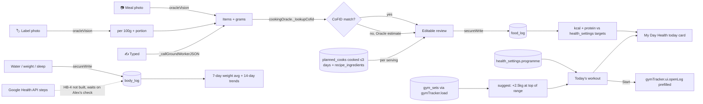
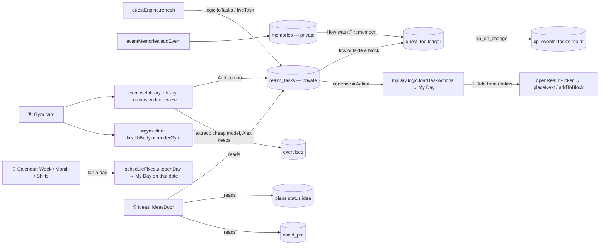
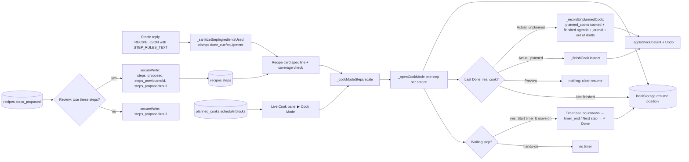

# system_flow_map — Habits (domain `habits`)
Moved here from `system_flow_map.md` on Oct 28 2026 (CK-3/4, plan "Caps and Central Kit"); text unchanged. The root file keeps cross-domain sections and links here.

## 15k. Cooking reorganisation (CR-1..6, Oct 14 2026) — built, untested by Alex

Truth table: bought → stock with location, finish → preview → deduct/undo, top-up list, journey hub, My Recipes, ← back to the previous Cooking screen, cross-links — built, headless-verified (38 checks). Cooking in servings other than the recipe's base on a planned cook — deducts base amounts (editable in the preview).

## 15i. Health & body (HB-1..3, Oct 14 2026) — built, untested by Alex

Truth table: photo/label/typed food logging with CoFID re-check, cooks per serving, targets, water/weight/sleep, trends, programme + overload + prefilled gym log, My Day card — built, headless-verified (42 checks), not hand-tested. Steps — not built (HB-4). `food_log`/`body_log`/`health_settings` are authenticated-only.

## 15ac. Day & Habits Rewire (Oct 27 2026, DR-1..12) — built, untested by Alex

Truth table: no open quests (quest_log = done-ledger), Actions = realm tasks with a cadence, Add from realms picker, one-off events → memories, Calendar without a Daily tab, one Gym page, one Ideas door, exercise library with review and combo coverage — BUILT, headless-tested (dr1 12/12, dr5 13/13, dr67 12/12, dr89 7/7, dr10 8/8, dr12 14/14). Real cheap-model read of Alex's 2 Athlete videos — NOT yet run. Gym log exercise picker suggesting from the library — NOT built. Hand-tested by Alex — none yet.

## 15d. Cook Mode (Oct 11 2026) — built, untested by Alex

The 8 recipes saved before Oct 11 have `steps_proposed` rows written directly by a Claude Code session (source data: their own steps + `recipe_ingredients`; full set in `records/2026-10/cook_mode_step_splits_2026-10-11.json`). Nothing changes for a recipe until Alex accepts its proposal.
