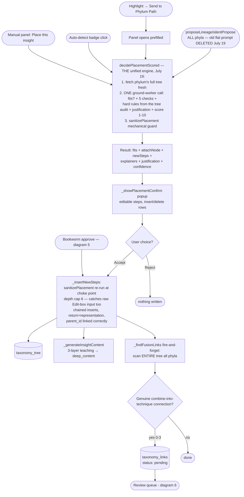
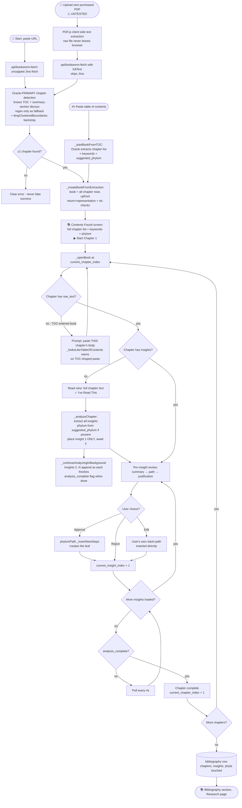
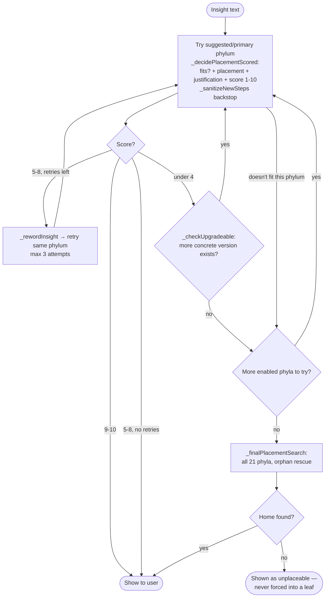
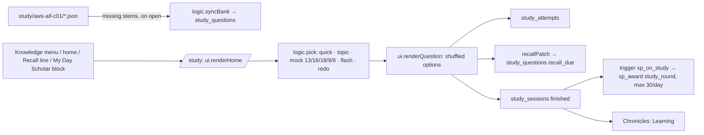

# system_flow_map — Knowledge (domain `knowledge`)
Moved here from `system_flow_map.md` on Oct 28 2026 (CK-3/4, plan "Caps and Central Kit"); text unchanged. The root file keeps cross-domain sections and links here.

## 1. Top-Level System Map

```mermaid
flowchart TD
    subgraph INPUTS[Input Surfaces]
        CHAT([Oracle chat])
        PANELS([Oracle panels: Prod/Insta/YouTube/Visual])
        CI([Content Intelligence video URL])
        SCHED([Schedule Oracle: URL/text])
        BW([Bookworm: URL / TOC paste / PDF upload])
        MANUAL([Manual: Beat Log, ConID, shifts, agendas])
        HIGHLIGHT([Text-select highlight])
    end

    subgraph PROCESS[Processing Core]
        ORACLE[callOracle / api/oracle.js<br/>+ extractor/ground-worker 2-tier for Phylum Path]
        SCAN[Shared phyla-scan<br/>oracle:response-scanned hook]
        PLACE[phylumPath.decidePlacement<br/>5-check reasoning]
        REVIEW[taxonomyReviewQueue<br/>3 card types + fusion links]
    end

    subgraph STORES[(Data)]
        TREE[(taxonomy_tree)]
        PROPS[(taxonomy_proposals)]
        LINKS[(taxonomy_links)]
        ENC[(encyclopedia)]
        CONID[(content_productions)]
        BOOKS[(bookworm_books/chapters)]
        BIB[(bibliography)]
    end

    subgraph OUTPUTS[Output Surfaces]
        DRILL([Phylum Path nav-tab drill-down])
        DASH([Dashboard widgets])
        ENCPG([Encyclopedia page])
        TAXMAP([taxonomy_map.html - live query])
    end

    CHAT --> ORACLE
    PANELS --> ORACLE
    HIGHLIGHT --> PLACE
    CI --> SCAN
    SCHED --> ORACLE
    BW --> PLACE
    ORACLE --> SCAN
    SCAN -->|badge clicked| PLACE
    PLACE -->|confirmed| TREE
    PLACE -->|staged| PROPS
    PROPS --> REVIEW
    REVIEW -->|accept| TREE
    REVIEW -->|accept fusion| LINKS
    TREE --> DRILL
    TREE --> TAXMAP
    ORACLE -->|articles| ENC
    ENC --> ENCPG
    MANUAL --> CONID
    BW --> BOOKS
    BOOKS -->|book complete| BIB
    LINKS --> DRILL
    CONID --> DASH
    BOOKS --> DASH
```

---

## 3. Phylum Path Insight Placement (the core taxonomy write path)



---

## 5. Bookworm (whole-book → taxonomy pipeline)



**Insight placement cascade inside `_analyzeChapter`** (per insight):



---

## 8. PLANNED features (dashed = not built) and where they attach

```mermaid
flowchart TD
    subgraph BUILT[Built today]
        BWPIPE[Bookworm pipeline]
        RVW[Per-insight review popups]
        TREE[(taxonomy_tree)]
        DP[decidePlacement]
        BK[(book_knowledge view<br/>July 22)]
        JE[(jargon_encyclopedia view<br/>July 22)]
        FALLBACK[Claude Code fallback lane<br/>built July 24 — real, unexercised<br/>see claude_fallback_build_plan_2026-07-24.txt]
        FBQ[(oracle_fallback_queue<br/>real table, created July 24)]
        MB2[RPGACE Fallback Drain Routine<br/>trig_01QxebLsiPMVksNSVjNECdbD, hourly]
    end

    subgraph PLANNED[Planned — attach points shown]
        CARDS[/"Live-study card list UI<br/>ConID-card pattern: per-chapter cards,<br/>edit title, status, context action.<br/>REPLACES the modal-per-step flow,<br/>calls the SAME _openBook/_renderInsightReview logic"/]
        DEBATE[/"/debate skill run on a real topic:<br/>Claude's general knowledge vs.<br/>a specific gathered tree insight —<br/>comparison only, never auto-writes"/]
        F12[/"Schedule Oracle Phase 2:<br/>carousel, two-tier session memory, auto-routing"/]
        PHYLA11[/"The REMAINING phyla through the<br/>7-step Development Framework:<br/>12, 13, 15-21. Phyla 11 + 14 cleared it<br/>July 30 and are live in ENABLED_PHYLA"/]
        EPUB[/"EPUB/other-format upload<br/>same _createBookFromExtraction path<br/>as PDF upload"/]
    end

    CARDS -.->|renders| BWPIPE
    CARDS -.->|reuses| RVW
    DP -.->|already shared by book + non-book, July 19| BWPIPE
    BK -.->|unnests, read-only| BWPIPE
    JE -.->|selects leaves, read-only| TREE
    DEBATE -.->|compares against, never writes| TREE
    PHYLA11 -.->|extends ENABLED_PHYLA| DP
    EPUB -.->|new entry point| BWPIPE
    F12 -.->|extends| SO2[Schedule Oracle]
    FALLBACK -->|catches credit-exhaustion errors from| GW[the 3 shared ground-worker functions<br/>_callExtractor/_callGroundWorkerJSON/_callGroundWorkerText]
    FALLBACK -->|queues into| FBQ
    FBQ -->|drained by| MB2
    MB2 -->|resumes via bookworm._resumeFromFallback /<br/>taxonomyTree._resumeSilentProposeFromFallback| BWPIPE
```



**Real, standing correction**: the "Taxonomy Sorting Agent" and "Claude general-knowledge audit" nodes do not appear in the PLANNED subgraph above — tracing the real call chain shows `decidePlacement` is already the one shared engine for book and non-book inputs (no separate agent is needed), and the general-knowledge audit is built around `/debate` (comparison only, gated behind an explicit human decision to ever write anything) rather than the original 3-part tree-seeding design. `book_knowledge` and `jargon_encyclopedia` — what the Sorting Agent was originally described as blocking — are both shipped, read-only Postgres views over data already written by the existing pipeline above.

**July 24 — Claude Code fallback lane, judged, confirmed, and built the same session.** Judged first via `/debate`+Council-of-5+`/5thDimension` (`openmontage_and_claude_fallback_spec_backlog_2026-07-24.txt`), then a real evidence pass + a second `/debate` on scope (`claude_fallback_build_plan_2026-07-24.txt`) before any code was written. Scoped honestly as an async/batch fallback for background AI jobs only (Bookworm chapter analysis fully wired; Content Intelligence's silent taxonomy proposals fully wired; both reuse the same 3 shared ground-worker functions per rule 3) — never a live-chat replacement, since Claude Code Remote's `create_trigger` has a real hourly-minimum interval. Reuses River IX's own already-built mechanism (a Routine reading a Supabase reservoir on its own clock, same shape as the real Morning Brief Routine) rather than inventing a new one. Moved from PLANNED to BUILT because the table, the code, and the Routine all now genuinely exist — moved here rather than left dashed, but honestly flagged as **not yet exercised against a real credit-exhaustion event** (forcing one on purpose would mean actually draining Alex's own Anthropic credits). A real pre-existing bug was found and fixed in the same pass: none of the 3 shared ground-worker functions ever checked for an API error before this — one of them (`_callGroundWorkerText`) used to silently return an empty string on ANY failure. OpenMontage, judged the same session, does NOT appear anywhere in this diagram — its verdict was adopt as a fully separate operated tool, never an RPGACE-embedded flow, so it has no attach point here at all.

---

## 15r. Study: exam practice (Oct 20 2026, studyHub) — built, untested by Alex


Truth table: page, lessons, 300-question bank, 5 round types, recall schedule, XP, Chronicles — BUILT. Questions are Claude-written, not real exam questions. Other certificates — NOT built (structure only).

## 15c. Screenshot Inbox (S1, Oct 11 2026) — built, untested by Alex

Image (in-app picker, or Android share → `sw.js` → cache `rpgace-share`) → `RPGACE.utils.resizeImage` → `/api/data-write` `screenshots/upload` (private bucket + locked `screenshots` row, status `unread`) → `RPGACE.utils.oracleVision` (one call) → `screenshots/update` (text, description, tags, kind, suggestions, status `new`; unreadable reply → `read_failed`, "Read it" retries from the stored image) → Alex taps a home: Wishlist (`wishlist_items`) / idea card (`encyclopedia_insights`, recall) / Journal (`journal`) / Recipe (Cooking Generate form) → status `routed` (or `kept`, or deleted with its image). Read paths: inbox search (`list` + Postgres full-text on a trigger-kept `search` column), Ask My Data (text only), dashboard Due count.
