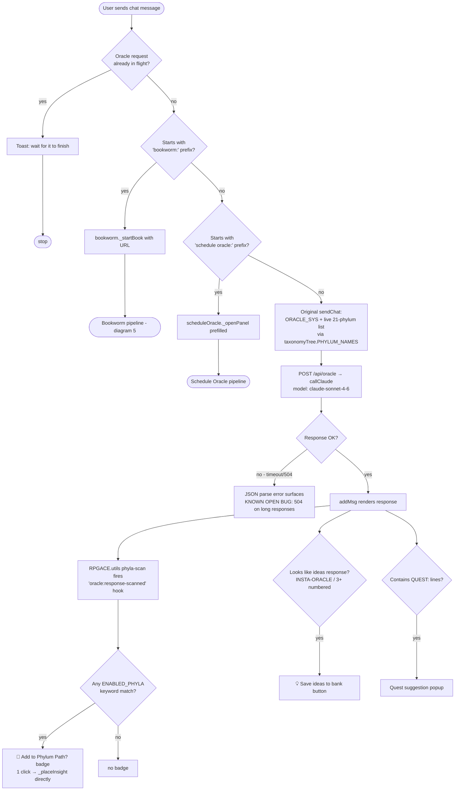

# system_flow_map — Oracle (domain `oracle`)
Moved here from `system_flow_map.md` on Oct 28 2026 (CK-3/4, plan "Caps and Central Kit"); text unchanged. The root file keeps cross-domain sections and links here.

## 2. Oracle Chat Request Flow (`main.js sendChat` + wraps)



---

## 12. Oracle Mode — Real / Dummy / Fallback Scout (`mockOracle`)

Real, hand-written pipeline doc — G56 of the ratified "RPGACE Total Systems Galaxy Map" `/CEO` plan, Alex's own ask: "using md files to explain logic of many pipeline will also benefit galaxy map." Cross-linked from `graphify-out/galaxy_map_oversight_sync.html` and `galaxy_map.html`'s own External AI unit (the L0 unit panel originally lived on a separate `galaxy_map_l0.html` page; G67 folded it into `galaxy_map.html`, and the standalone page no longer exists).

```mermaid
flowchart TD
    CLICK([Alex clicks the pinned top-right<br/>Oracle Mode switch]) --> CYCLE{Cycle to next mode}
    CYCLE -->|Real| REALM[✅ Oracle API — every send is a live call]
    CYCLE -->|Dummy| DUMMYM[🧪 Dummy Oracle — synthetic labeled reply]
    CYCLE -->|Fallback Scout| SCOUTM[📥 Fallback Scout — queues instead of calling]

    SEND([Any real send-to-Oracle call site]) --> CHECK{callOracle checks<br/>mockOracle.getMode}
    CHECK -->|real| LIVEAPI[Real POST /api/oracle → callClaude]
    CHECK -->|dummy| FAKE["🧪 [MOCK ORACLE...] synthetic reply<br/>zero API cost, real DOM/hook/Supabase<br/>wiring still exercises downstream"]
    CHECK -->|fallback| QUEUE[_queueFallback:<br/>RPGACE.sb.secureWrite to oracle_fallback_queue<br/>context.type='scout_item']
    QUEUE --> DEDUP{Exact prompt-text already<br/>pending in scout_item rows?}
    DEDUP -->|yes| ACK1[Honest "already scouted" ack<br/>— no duplicate row]
    DEDUP -->|no| ROW[(oracle_fallback_queue<br/>status: pending)]
    ROW --> ACK2["Honest ack + real live queue depth<br/>e.g. '10 items waiting'"]

    DRAIN([Daily 'RPGACE Fallback Drain' Routine<br/>Claude Code Remote trigger, hourly-min]) --> ANSWER[Answers each pending row<br/>with the plain anon key]
    ANSWER --> ROW2[(oracle_fallback_queue<br/>status: answered)]
    ROW2 --> SWEEP{_checkFallbackAnswers<br/>sweep, every 5 min}
    SWEEP --> PARSE{resumeFallbackPlacement<br/>parses the answer}
    PARSE -->|success| RESUME[Real taxonomy placement<br/>resumed from where it stalled]
    PARSE -->|malformed JSON| STUCK[/"Row stays answered,<br/>resumed_at IS NULL forever —<br/>only a console.warn, no toast.<br/>NOT fixed, a known landmine"/]

    POPUP([📥 'Scouted, Now Answered' popup<br/>dashDeck._popup]) --> ROW3[(browses every scout_item row,<br/>pending AND answered)]
```

**Real, honest limits already known and tracked elsewhere** (not restated in full, rule 8): the whole Fallback lane has never been exercised against a real credit-exhaustion event; a malformed fallback answer leaves a row silently stuck (see CLAUDE.md's own landmines section for both).

---

## 15w. Oracle Professor Mode — map, planner, gather, condense, answer, routing (Oct 21 2026, OP-1..5 — plan complete) — built, not yet wired into chat

```mermaid
flowchart LR
  q[question] --> pre{needsPlan? free small-talk check}
  pre -->|no| none[empty plan, no call]
  pre -->|yes| ppl[loadPeople: people names, signed-in read]
  ppl --> hk[Haiku planner: question + map of 31 sources + ~38 SELF_KNOWLEDGE sections]
  hk -->|JSON| clean[cleanPlan: real keys/sections only, max 4+4]
  hk -.->|error| fb[fallbackPlan: free keyword match]
  clean --> san[sanitizeTopic: strip names/places/numbers/dates/I-my]
  san --> plan[(plan: deep, sources, sections, topic)]
  fb --> plan
  plan --> gather[gather: fetchSource x4 + sections + censored topic, 20s each]
  gather --> lib{Library has it?}
  lib -->|yes| ev[(evidence: data, notes, web, errors)]
  lib -->|no| gem[/api/search web: topic only/] --> save[library_items web_lookup] --> ev
  ev --> sz{over 3000 chars?}
  sz -->|no| brief[(tagged brief)]
  sz -->|yes| cond[Haiku: tagged bullet brief, 700 tok] --> brief
  cond -.->|fails/empty| raw[raw evidence, trimmed + reason] --> brief
  brief --> opus[Opus 5.5 stream, effort medium, PROF_SYSTEM]
  opus -.->|model refused| son[Sonnet 4.6, flagged]
  opus --> ui[reply bubble + 🔎 How I know]
  son --> ui
  q2[chat 'prof:' prefix] --> q
  m[any chat message] --> own{owned elsewhere? prefix, link, trip, recipe, action}
  own -->|yes| normal[normal reply, unchanged]
  own -->|no| rt{route: small talk / short = free; else Haiku plan}
  rt -->|deep| q
  rt -->|quick| secs[normal reply + only picked app-note sections]
  ui --> cost[≈ cost line]
```



Truth: built — the map, planner, strict topic check, the 11 new Ask-my-data sources (one read path `fetchSource`) gather (OP-2), condense (OP-3) the Opus answer (OP-4) and automatic routing + cost line (OP-5). Not built — a running monthly total; analysis falling back to Orchestrator CC (idea logged, not scoped). 21 + 11 + 12 + 19 + 15 headless checks; untested by Alex (nothing visible yet).

## 17. Oracle Control — curated actions, self-aware suggestions, and the error→purple cascade (G41 + G109)

Real, hand-written pipeline doc, same day both halves shipped. Cross-linked from `interconnection_map.md`'s own new Oracle Control section and `records/2026-08/g41_oracle_control_ceo_spec_2026-08-26.txt` / `..._g109_..._2026-08-26.txt`.

```mermaid
flowchart TD
    MSG([Alex types or is on any page —<br/>overlay reachable everywhere]) --> SEND[sendChatWithImage/sendChat<br/>— the EXACT real dashboard pipeline,<br/>never a 2nd Oracle-calling path]
    SEND --> GATE{oracleAppGrounding's<br/>window.callOracle wrap —<br/>TRIGGER_KEYWORDS gate}
    GATE -->|matched| BLOCKS[Injects: registered oracle_actions list<br/>+ suggest-a-new-action instructions<br/>+ recent real error toasts]
    GATE -->|not matched| PLAIN[Ordinary reply, no Oracle Control<br/>content injected]

    BLOCKS --> REPLY{Oracle's real reply}
    REPLY -->|ends with ORACLE_ACTION: id| SCAN1[oracle:response-scanned hook<br/>— same one DIRECTOR_CHOSEN/<br/>EDL_JSON already use]
    REPLY -->|ends with ORACLE_SUGGEST_ACTION: json| SCAN2[Defensive JSON.parse<br/>— malformed trailer silently ignored]
    REPLY -->|neither| DONE0([Nothing extra happens])

    SCAN1 --> CONFIRM1[["🔮 Real confirm popup —<br/>what happens / data touched /<br/>why this path / benefit<br/>Accept · Deny"]]
    CONFIRM1 -->|Deny| CANCEL1([Toast: cancelled, nothing done])
    CONFIRM1 -->|Accept| EXEC{_execute — a real,<br/>human-coded dispatch table}
    EXEC -->|log_beat| RUNBEAT[Opens Beat Log panel,<br/>calls the REAL beatLog._submit<br/>unchanged]
    EXEC -->|any other action_id| NOTWIRED([Honest "not wired up yet"<br/>toast — the vocabulary can grow<br/>without what it can DO growing])

    SCAN2 --> CONFIRM2[["💡 Real, DISTINCT confirm popup —<br/>'Add this as a new Oracle action?'<br/>Add · No thanks"]]
    CONFIRM2 -->|No thanks| CANCEL2([Nothing written])
    CONFIRM2 -->|Add| APPROVE[secureWrite INSERT into<br/>oracle_actions — action_id<br/>slugified, never free model text]
    APPROVE --> REFRESH[oracleControl re-fetches —<br/>live on Oracle's very next call] --> EXEC

    subgraph ERR["Independent lane — real errors, not Oracle replies"]
        THROW([A real JS exception,<br/>promise rejection, or an<br/>error-colored #CC4A4A toast]) --> CAPTURE[errorLog._capture<br/>+ opts.stack]
        CAPTURE --> ATTR{_extractModule —<br/>METHOD_MODULE_MAP<br/>build-time lookup}
        ATTR -->|confident, 1 owning module| BASELINE[Look up that module's real<br/>perspective_reports baseline]
        ATTR -->|ambiguous or none| NOATTR[error_log row saved,<br/>no module cascade]
        BASELINE --> INSERTED[(error_log row —<br/>linked_perspective_id +<br/>expected_baseline attached)]
        INSERTED --> STFIND{Real smoke_test_items row<br/>for this module?}
        STFIND -->|yes| STBREAK[PATCH status='broken',<br/>real derived broken_note,<br/>linked_error_id set]
        STFIND -->|no| STOP1([Cascade stops here])
        STBREAK --> PLFIND{linked_plan_item_id<br/>set, AND its current<br/>status is genuinely green?}
        PLFIND -->|yes| PURPLE[PATCH ceo_plan_items<br/>status='purple']
        PLFIND -->|no| STOP2([Stays as-is —<br/>never a guessed regression])
        PURPLE --> RENDER2[future_integrations.html's<br/>pre-existing #purple-live<br/>renders it automatically]
    end
```

**Real, deliberate 3-gate safety structure — the whole reason this is safe to run automatically**: (1) Oracle must draft a plausible suggestion from real self-awareness data; (2) Alex must separately approve adding it to the vocabulary; (3) a human must have already coded, or must still code, a real `_execute()` branch before Accept can do anything beyond the honest fallback toast. No step can be skipped by the ones before it.

**Real, honest scope limits**, stated plainly rather than oversold: the error→purple cascade only fires for a genuine thrown exception, promise rejection, or an already-error-colored toast — a bug with no visible symptom is invisible to it, same as it always was. Module attribution covers ~95% of real distinct method names (432 of 456); the rest are correctly left unattributed, never guessed. Purple only ever fires from a real prior-`green` state — a module that was never confirmed working in the first place correctly stays wherever it already was.

---
