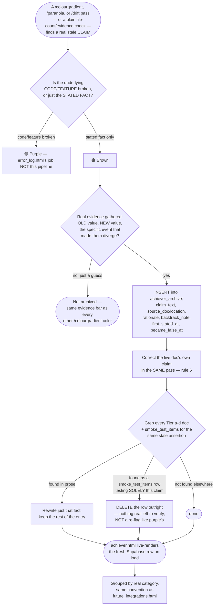

# system_flow_map — Oversight (domain `oversight`)
Moved here from `system_flow_map.md` on Oct 28 2026 (CK-3/4, plan "Caps and Central Kit"); text unchanged. The root file keeps cross-domain sections and links here.

## 13. Achiever / Brown — Stale-Claim Detection, Archival & Removal (G54)

Real, hand-written pipeline doc, written the same multi-day pass Achiever itself shipped (G54) — the freshest possible account of its own logic. Cross-linked from `achiever.html` and `future_integrations.html` (its mirror doc) directly.



**Real, load-bearing distinction, worth restating even though it's the whole point of the pipeline**: brown is the PAST-tense mirror of `future_integrations.html`'s FUTURE-tense blue/red/yellow — opposite directions in time, never merged into one destination. A claim can be true-then-false without the feature it describes ever breaking (a river count going stale when a new river is added is not a regression in any functional sense) — that gap is exactly what this pipeline exists to catch, since nothing else in the project re-derives a summary fact from its own source data automatically.

---

## 14. Total-Systems Dispatch — `openmontage_jobs` / `graphify_jobs` Queues

Real, hand-written pipeline doc — the real, asynchronous cross-repo/cross-session handoff mechanism named "Total". Cross-linked from `graphify-out/galaxy_map_orchestrator_cc.html` / `graphify-out/galaxy_map_openmontage_cc.html` (G29, real Sep 15 2026 2-page split) and the L0 map's Orchestrator CC / External AI units.

```mermaid
flowchart TD
    subgraph RPGACECC["Orchestrator CC (this session)"]
        PLAN([A real video/render job,<br/>or a real graphify/mapping task,<br/>needs an external repo's own work]) --> WRITE
    end

    WRITE[INSERT a real, queued row —<br/>never a live call, no session-to-session<br/>link exists between separate<br/>Claude Code repos] --> OMQ[(openmontage_jobs<br/>status: queued)]
    WRITE --> GJQ[(graphify_jobs<br/>a separate dispatch channel,<br/>Graphify CC's own)]

    subgraph OMCC["OpenMontage CC (separate repo/session)"]
        OMQ --> PICKUP1{Picks up the row<br/>on its own schedule<br/>— no push, polled}
        PICKUP1 --> WORK1[Real setup, pipeline choice,<br/>real render attempt OR a real,<br/>honest loud failure]
        WORK1 --> RESULT1[UPDATE the SAME row:<br/>status, output_note,<br/>real findings]
    end

    subgraph GCC["Graphify CC (separate repo/session)"]
        GJQ --> PICKUP2{Picks up the row<br/>on its own schedule}
        PICKUP2 --> WORK2[Real graphify/Obsidian analysis<br/>— e.g. global cross-repo graph,<br/>GRAPH_TREE.html]
        WORK2 --> RESULT2{output_note flagged<br/>'FOR RPGACE CC: please log'?}
        RESULT2 -->|yes| LOGME[A real, explicit read-and-log<br/>request for this session]
        RESULT2 -->|no| HISTORY[Plain job history —<br/>read for context, not<br/>necessarily logged]
    end

    RESULT1 --> STARTCHECK
    LOGME --> STARTCHECK
    HISTORY --> STARTCHECK
    STARTCHECK([Session-start check, every session:<br/>query both tables for undrained rows<br/>— CLAUDE.md's own standing rule]) --> REPORT[G7/A13's own real reporting shape:<br/>a) output report, b) infrastructure<br/>knowledge, then /drift+/paranoia<br/>against the original real goal]
    REPORT --> ITERATE{Combined a+b picture<br/>shows the real goal<br/>fully met?}
    ITERATE -->|no, real gap| NEXTDISPATCH[Feed the gap into<br/>the next real dispatch]
    ITERATE -->|yes| CLOSED([Goal genuinely closed])
```

**Real, confirmed constraint stated plainly because it's the whole reason this pipeline exists**: no live session-to-session link exists between separate Claude Code sessions in separate repos — this Supabase-queue-and-poll shape is the ONLY real channel, proven three times independently before being named "Total" (`oracle_fallback_queue`, then `openmontage_jobs`, then this same pattern again for `graphify_jobs`).

---

**The real retroactive loop, spelled out** (the 3 dashed "↩" edges above are the actual "on loop until final product" mechanism, not decoration): Phase 1's button reopens Beat Log pre-filled and routes `beatLog._submit()` through a real UPDATE branch (`_retroTarget`) instead of a fresh INSERT — editing the SAME `content_productions`/`video_jobs` rows. Phase 2's button reopens the director picker pre-selected from the structured `creative_docs.director_blend` field (not a fragile parse of rendered prose). Phase 3's button resends whatever is CURRENTLY saved in `creative_docs.script` — including manual edits made right there in Phase 3 — straight back to Oracle, skipping the picker entirely. All three genuinely mutate the existing ConID in place; none ever branches into a second ConID. This is the real mechanism behind Alex's stated purpose: reuse a beat's existing creative record to regenerate new visuals for content repurposing, without starting from zero.

**Live state**: see CLAUDE.md's own Live-numbers line for the current `content_productions`/`video_jobs`/`style_profiles`/`reference_tracks` row counts — this doc doesn't restate them since they move independently of this diagram. `openmontage_jobs`' schema includes `title`/`brief`/`beat_meta`/`status`/`output_note`/`requested_by`. `creative_docs.script`/`.director_blend`, `content_productions.deliverable_files`/`.deliverable_bundles`, and the `beat-deliverables` bucket are all real, structurally-ready fields/storage backing the 4-phase flow and deliverable bundling described above.

**Honest limit, restated because it is the single most misreadable claim in this pipeline:** RPGACE does not generate video. It tracks, briefs, and hands off. OpenMontage stays an externally-operated tool, per CLAUDE.md's own standing verdict; Phase F's "Generate Video" builds and can send a real job payload, but the freeze flag defaults OFF pending Alex's own Tier-3 paid-provider decision, and the handoff view surfaces real data — it never simulates a real render as if it were genuine (the Simulate Response tool exists specifically so a fake result is always labeled `[SIMULATED]`, never silently indistinguishable from a real one).

---

## 15b. Galaxy Map rivers replaced by app domains (Oct 11 2026, M1) — current

All rivers (live I-XII and retired XIII-XVII) are replaced by the 8 app domains each module declares in code (`domain:` key, `RPGACE.DOMAINS`). Flow: `rpgace_core.js` domain keys → `scripts/check_module_domains.py` (validates) → `graphify_river_group.py` (`RIVER_MODULES`, `_derive_domain_flows()` from real cross-module calls) → every Galaxy Map page + the Obsidian vault. Level 1 = `galaxy_map_domain.html` (old `galaxy_map_river.html` redirects). Supabase: 8 `perspective_reports` rows `scope_level='domain'`; the 12 river rows are `status='superseded'` with `superseded_by` set. §15 and §16 below are historical.

## 15. Galaxy Map Rivers XIII-XVII retired (G102, renumbered by G103 — see §16)

Real architecture change, per Alex's own confirmed answer ("all 5 and yes too"): 5 real Total-systems-category rivers — the API/Auth Layer, Skills, Oversight Docs, Session Records/Backlog, and Dev Tooling — are now marked **deprecated/merged** in `scripts/graphify_river_group.py`'s new `RIVER_RETIRED` dict — not deleted, since real code and docs still cite them by name (a live pointer, never a silent dangling reference). **Numbered XIII-XVII as of the same-day G103 rechronologize** (originally built and numbered XII-XVI — read §16 immediately below for why the numbers moved).

Real evidence for exactly these 5, no others: all 5 always had **zero** real `rpgace_core.js` modules, confirmed by direct query — every one of them was a role-DESCRIPTION of a Total-systems category, never a river of real app code the way Rivers I-XII are. That real category is now represented at finer grain by the Galaxy Map's own L0 Infra/Inter bubble system (G77-G100), which covers the same real facts per-actor instead of one river-wide note:

- River XIII (API/Auth Layer) → Supabase's own Infra/Inter system, plus each of the 6 connector L0 units (Oracle, Composio, Jina AI, Last.fm, librosa, n8n, Whisper), each showing exactly which real calls route through it.
- River XIV (Skills) → the Skills L0 unit's own real per-skill Infra/Inter breakdown (`galaxy_map_skill_network.html`).
- River XV (Oversight Docs) → the Oversight Docs L0 unit (`galaxy_map_oversight_sync.html`).
- River XVI/XVII (Session Records/Backlog, Dev Tooling) → Orchestrator CC's own unit, an honestly-flagged **partial** successor (real Total-systems dispatch history covers River XVI; the CC session that runs the dev-tooling scripts covers River XVII) — no L0 unit is a clean 1:1 match for either, stated plainly rather than force-mapped.

**What actually changed, mechanically**: a new `river_retirement_note_html(rnum)` helper (single shared source, rule 8) renders a real "⚠️ Retired — see instead" banner with live links to each river's real successor page(s). Wired into every real render site that shows a retired river's identity to a reader: Level 1's ring (a 🚫 badge on the node + a banner in its legend row), Level 2's per-river section (a full banner under the river title), the Logic Dimension page's per-river passages tab, and each retired river's own Obsidian vault note (a new `retired: true` frontmatter field + a callout block). `graphify_to_obsidian.py`'s `carries_data_flow` flag is derived from `RIVER_RETIRED` itself, never a hardcoded river-number boundary — the same "stale hardcoded river-count boundary" bug class `TOTAL_ZONES` already taught this project once, and this is what keeps the flag from drifting out of sync with the retirement list.

**Rivers 1-12 are explicitly NOT touched** — they all have real modules and are the real app-code rivers this whole hierarchy exists to describe; a river having its own L0-unit facet elsewhere (Oracle/Supabase both appear as both a live river-adjacent module set AND an L0 unit) is a real additional lens, never a reason to retire a river that still has real code in it.

Full pipeline (all 18 Galaxy Map page scripts + the Obsidian export + `obsidian_vault_to_html.py`) regenerated and re-verified (idempotency, link-integrity, tag-balance, headless-Chromium) in the same pass. `minotaur_map.html`'s "Rivers XIII-XVII — The Total System Gateway" section and `interconnection_map.md`'s own Total-systems paragraph both carry a matching real note, per each doc's own update rule (a real wing change for minotaur_map.html; a real Tier-b drift fix for interconnection_map.md).

## 16. Galaxy Map rechronologize — River XII freed for the Research & Intel Stream (G103)

Real, direct Alex correction after §15 shipped: "why didn't you rename river 17 - come on that an obvious fix, rechronologise the rivers please." §15's own retirement left the one real, live river after River XI (the Research & Intel Stream, originally numbered River XVII by the G49 split) stranded with an awkward gap where XII-XVI used to sit — closing that gap so the live river sequence stays contiguous (I-XII) is the "obvious fix."

**Real permutation applied everywhere a river number appears**: old 17 → new 12 (Research & Intel Stream, now the live sequence's own next river); old 12 → 13 (API/Auth Layer); old 13 → 14 (Skills); old 14 → 15 (Oversight Docs); old 15 → 16 (Session Records/Backlog); old 16 → 17 (Dev Tooling). Rivers 1-11 are untouched. The 5 retired categories shift one slot each to sit AFTER every real river, in their same original relative order — §15 above already reflects the final, post-renumber state.

Applied to `graphify_river_group.py`'s `RIVER_COLOR`/`RIVER_NAME`/`RIVER_MODULES`/`RIVER_ROLE_NOTE`/`RIVER_RETIRED`/`RIVER_FLOWS`/`DASHBOARD_CARDS`/`EXTERNAL_RIVER_LINKS`/`SKILL_SECONDARY_RIVER`, the `SKILL_RIVER`/`OVERSIGHT_RIVER` constants (mirrored in `galaxy_map_module.py`/`galaxy_map_river.py`/`galaxy_map_logic_dimension.py`, rule 8's own known duplication), and every live-copy text reference across those files plus `galaxy_map_l0.py`/`galaxy_map_skills.py`/`galaxy_map_skill_network.py`. **A real, raw-literal bug found and fixed, exactly the class rule 13's "two separate greps" discipline exists to catch**: `galaxy_map_skills.py`'s `_river_chip(13, ...)` had no adjacent "River N" text pattern naming the number directly — a text-only grep for "River XIII" would have found the SURROUNDING string but not necessarily flagged that the bare literal `13` needed to become `14` in lockstep; caught by deliberately checking both. The live `ceo_plan_items`/`smoke_test_items` Supabase `galaxy_river` columns (structured classifier fields) were corrected directly via SQL; narrative `evidence`/`description` text describing the OLD numbering at the time it was written is left as historical record, same precedent as the Aug 11 phylum renumber.

A real data-integrity self-check (every `RIVER_FLOWS` target label's embedded roman numeral resolves via `_river_num_from_label()` to the SAME river number `RIVER_NAME` assigns it) confirmed zero mismatches before the pipeline was regenerated. Full pipeline (18 page scripts + Obsidian export) regenerated, idempotency/link-integrity/tag-balance/headless-Chromium re-verified. `minotaur_map.html`, `interconnection_map.md`, `manual.html`, `ai_tooling_and_rules_map.md`, `system_map_spec.md`, and `CLAUDE.md` all updated to the new numbering in the same pass.

---
