# system_flow_map — Schedule (domain `schedule`)
Moved here from `system_flow_map.md` on Oct 28 2026 (CK-3/4, plan "Caps and Central Kit"); text unchanged. The root file keeps cross-domain sections and links here.

## 15e. My Day (Oct 12 2026) — built, untested by Alex

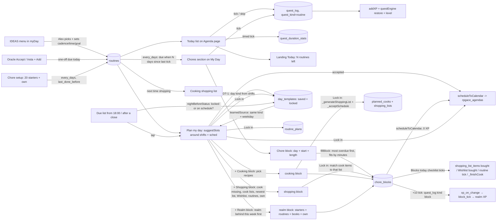

## 15h. Plans money, dates + people (TP-6/TP-7, Oct 14 2026) — built, untested by Alex

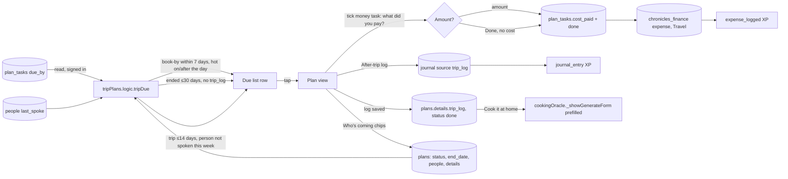

Truth table: book-by Due rows, highlight, pay prompt, single Travel expense, spent vs budget, after-trip log, Cook-at-home prefill, people chips, pre-trip people row, People tab upcoming plans — built, headless-verified (30 checks), not hand-tested. No messages are drafted; RPGACE still never books or pays.

## 15g. My Day Round 2 (Oct 14 2026) — built, untested by Alex

```mermaid
flowchart LR
  R[(routines: minimum, after_routine_id)] --> T[Today rows: zone dot, never-miss-twice, stacked waits]
  T -->|Did the minimum: half XP| QL[(quest_log)]
  QL --> RV[Sunday 18:00 review card + Due row] -->|Save| J[(journal weekly_review)] --> XP[xp_on_change journal_entry]
  SRC[(gym_sessions, planned_cooks, quest_log, content_productions, journal)] --> DS[Days since card]
  PE[(people via read)] --> DS -->|Talked today| PE
  CI[(cutback_items)] --> CUT[Cutting back + / − / None today] -->|upsert| CL[(cutback_log)]
  CL -->|pg_cron 00:10 xp_cutback_close| XPM[cutback_day → Mind XP]
  DS --> DT[doToday picks with reasons] --> MB[Morning Brief prompt]
  CRON[pg_cron hourly myday-push] --> EF[edge fn myday-push] -->|push_digest: 08:00 morning, Sun 18:00 review| PS[(push_subscriptions)] --> PH[phone] -->|tap| OPEN[/?open=myday]
  SH[Screenshot kind rota] -->|Import shifts: fromRotaJson| SS[shiftSync.replaceDates] --> RS[(rpgace_shifts)]
```

`cutback_*`, `push_subscriptions`, `push_log` are locked (authenticated only); `app_secrets` has no policies (service role only). Truth table: habit design, weekly review, days since, cut-back counters, ideas round 2, Morning Brief picks, push alerts and rota screenshot import are BUILT (headless-verified; push send verified live to a throwaway endpoint), not hand-tested.

`routines` is `anon_read_only`/`authenticated_all` and in `api/data-write.js`'s allowlist. Timers and sub-step ticks are per-device (localStorage). The old `QUESTS` template is empty; `questEngine`'s generated quests are unchanged.

## 15h. Doing Now (Oct 16 2026, DN-0/DN-1) — built, untested by Alex

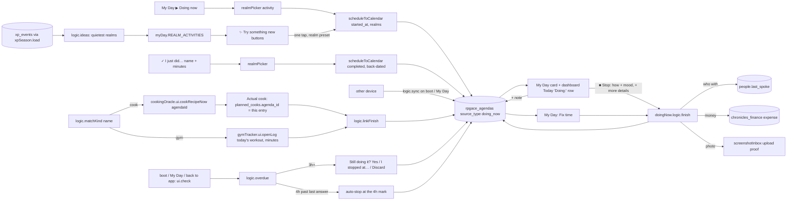

Truth table: start, note, stop (short + more details), just-did, cross-device running card, quiet-realm ideas (DN-1b), forgot-to-stop catch + 4h cap (DN-2), cook/gym matching (DN-3), repeats → routine offer + template fill (DN-4), XP (DN-5, DB trigger), Chronicles entries by realm + Sunday review block (DN-6) are BUILT (headless/DB-verified), not hand-tested. The Doing Now plan is fully built.

## 15ae. Day Log & Live Now (Oct 28 2026, DL-1..7) — built, untested by Alex

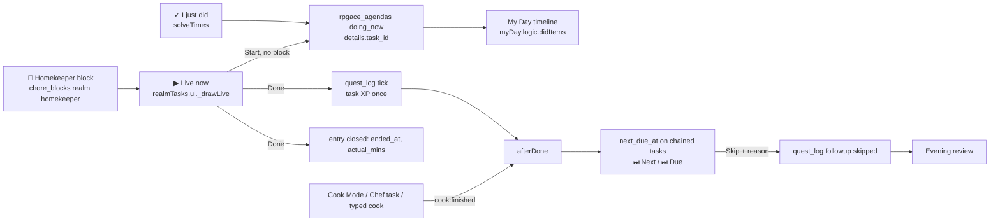

| Claim | Truth |
|---|---|
| A task done in Live now with no block shows on the timeline | ✅ `freeStart`/`freeDone` write a timed doing_now entry |
| XP is paid once | ✅ `xp_on_doing_now` skips entries with `details.task_id`; the task tick pays |
| Doing Now has its own screen | ❌ its buttons open ▶ Live now (store kept) |
| "Did this replace your block?" is asked from the new I just did | ❌ only on the typed Doing Now path (`openTypedDid`) |

## 15ad. Generic Missions (Oct 27-28 2026, GM-1..9) — built, untested by Alex

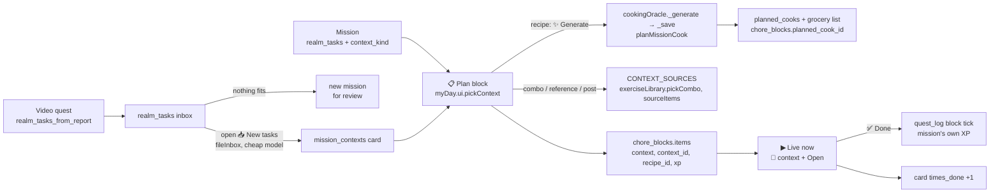

| Claim | Truth |
|---|---|
| The inbox for Chef/Athlete/Producer/Creator shows only missions | ✅ `realmTasks.logic.fileInbox` files specific video tasks as cards (status `filed`, `dup_of`) |
| Context is chosen when planning a block | ✅ `myDay.ui.pickContext` from Plan block; Decide later allowed |
| A Chef recipe becomes the block's cook without a second Schedule entry | ✅ `planMissionCook` links `planned_cooks.agenda_id` to the block's own agenda |
| A mission pays its own fixed XP | ✅ since GM-8, block items keep `earns`/`xp`; older blocks are corrected on Done |
| The other 9 realms have missions | ❌ plan "Missions Across Realms" (MR-1..6), drafted |

## 15ab. My Day timeline (Oct 21 2026, MDX-0..7) — built

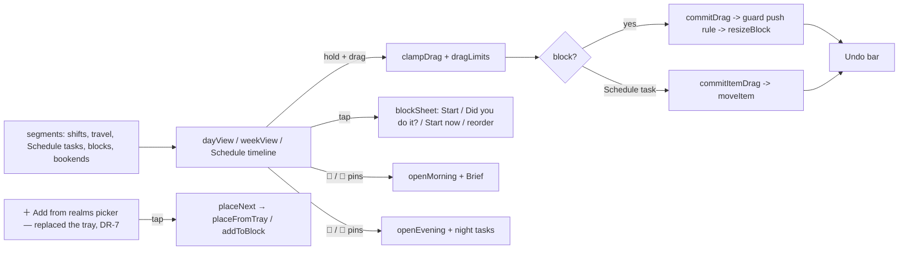

## 15u. Did blocks — planned vs did (Oct 20 2026, "My Day" MD-8) — built, untested by Alex

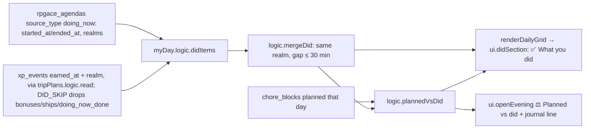
Truth table (Daily tab removed in DR-8; the Did rows now show only in My Day's day view): Did rows on the Daily Schedule (today + past), planned block alongside, planned vs did per realm on the Schedule, in the evening review and its Journal line — BUILT (md8 11/11). Stored Did blocks / editing them — NOT built (by design, worked out each time).

## 15t. My Day ↔ Daily Schedule (Oct 20 2026, "My Day" MD-7) — built, untested by Alex

Since DR-8 (Oct 27 2026) the Calendar has no Daily tab, so `renderDailyGrid` and this section's rows are no longer reachable from the menu; My Day is the day view (see §15ac).

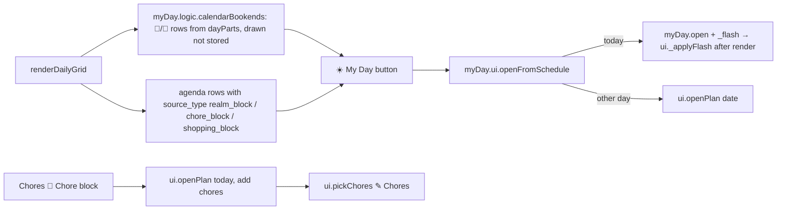
Shift clash check (Oct 20): `logic.clashWith` shared by Plan my day, the calendar's ⚠ flag and the + Add task form (warn → Use nearest free / Save anyway) — BUILT (clash test 8/8). Truth table: bookends on the calendar, ☀️ My Day links, chore block folded into Plan my day with a hand-pick, Day settings folded in Manage — BUILT (headless-verified, md7 9/9, dt4 24/24). The old separate Chore block screen (`ui.openChoreBlock`) — REMOVED (code only; no data). Did blocks (MD-8) — NOT built.

## 15s. Evening review (Oct 20 2026, "My Day" MD-6) — built, untested by Alex

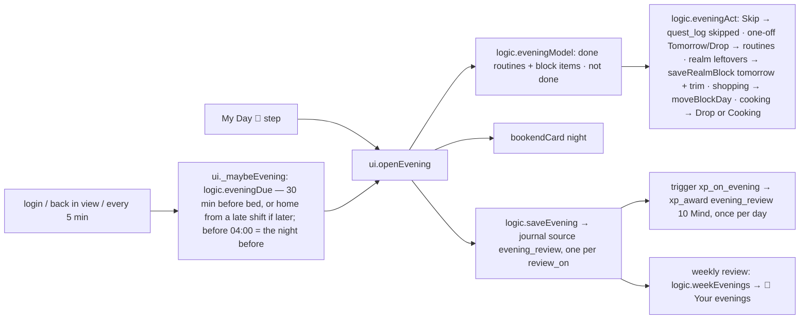
Truth table: auto-open, done/not-done lists, Tomorrow/Drop/Skip/Move all, Night tasks, one Journal line, +10 Mind once a day, evenings in the weekly review — BUILT (headless-verified, md6 test 22/22).

## 15q. Good-morning screen (Oct 20 2026, "My Day" MD-5) — built, untested by Alex

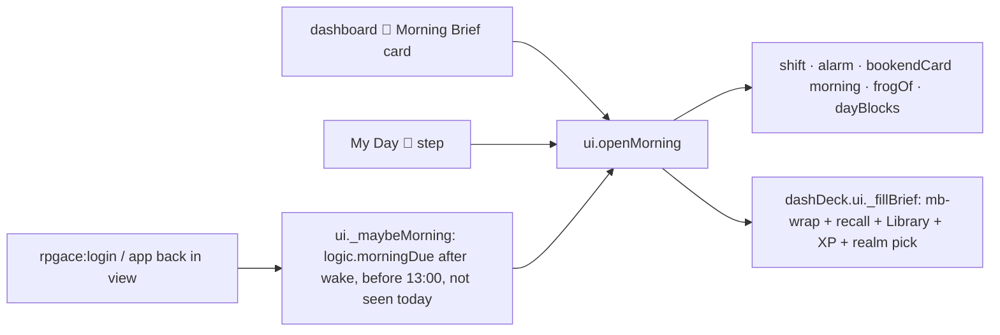
Truth table: one screen, auto-open once a day, both entry points — BUILT. Evening review — BUILT, see §15s.

## 15p. Focus timer (Oct 20 2026, "My Day" MD-4) — built, untested by Alex

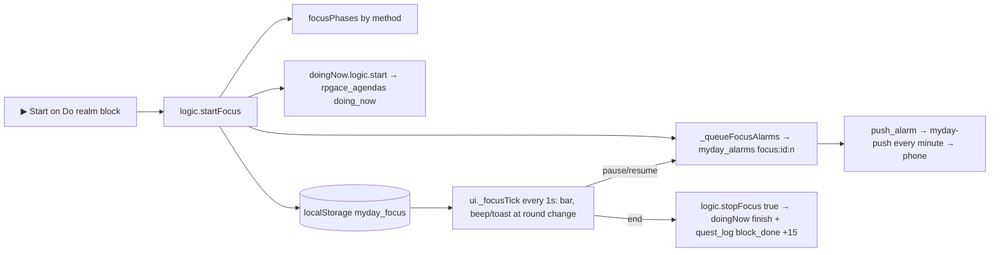
Truth table: phases, real-clock run, bar, pause/resume/stop, in-app + phone alerts, Doing Now log, +15 bonus — BUILT. Morning screen (MD-5) — NOT built.

## 15o. Plan my day fills planned blocks (Oct 20 2026, "My Day" MD-3) — built, untested by Alex

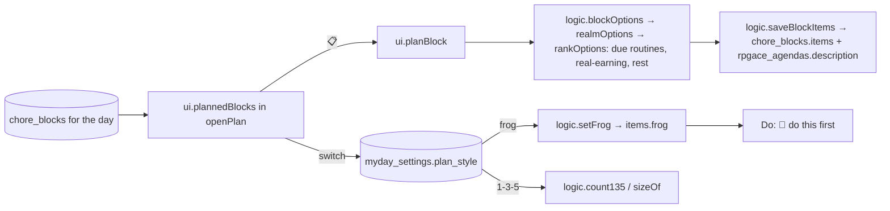
Truth table: planned blocks in Plan my day, 📋 Plan block (top 3 + more + own), frog, 1-3-5 — BUILT. Timers (MD-4) — NOT built.

## 15n. Plan week day timeline (Oct 20 2026, "My Day" MD-2) — built, untested by Alex

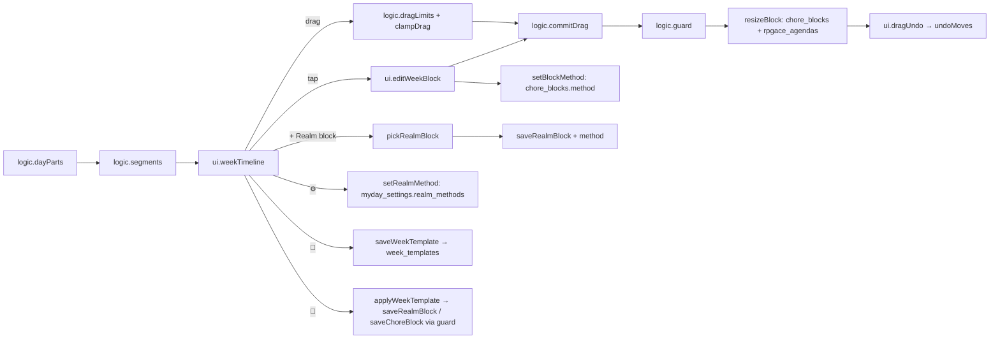
Truth table: timeline, drag/resize with neighbour limits, tap edit, remove, + realm block, guard + Undo — BUILT. Method per block/realm and week templates — BUILT (schema applied Oct 20). Timers (MD-4), Plan block (MD-3) — NOT built.

## 15m. My Day timeline, Morning/Night blocks, wake alarm (Oct 20 2026, "My Day" MD-1) — built, untested by Alex

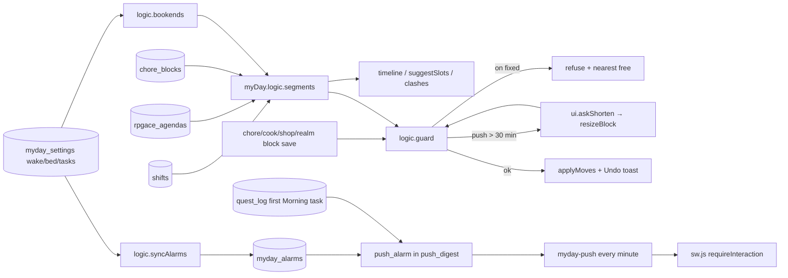
Truth table: one segments() engine, bookends, guard + push + shorten + Undo, Morning/Night editors, wake alarm (push + in-app) — BUILT. Bookends on the Schedule calendar (MD-7), drag-to-place week (MD-2) — NOT built.

## 15l. My Day home (Oct 18 2026, "My Day" MD-0) — built, untested by Alex

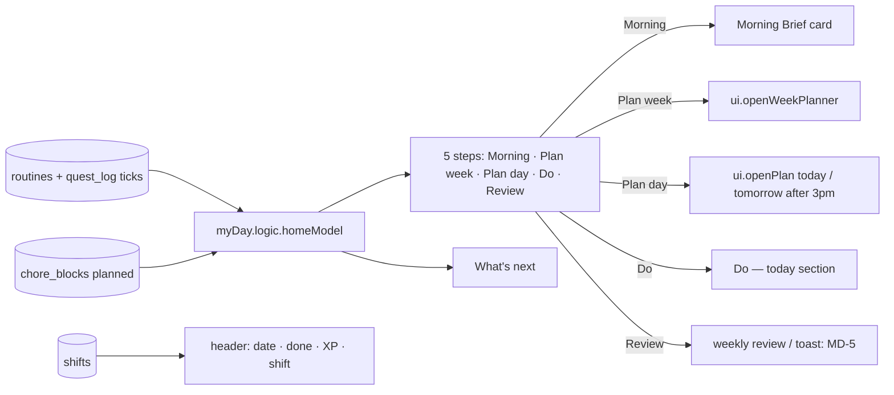
Truth table: step strip + counts + What's next + ← Back / 🏠 (`RPGACE.AREAS.myday`, hub = `myDay.open`) — BUILT; the Sunday review card became a What's next row (same ids); Plan my day / Plan weeks buttons moved into the strip (same ids). Timeline engine, drag blocks, Plan block, focus timers, Morning screen, evening review — MD-1..6, NOT built.
