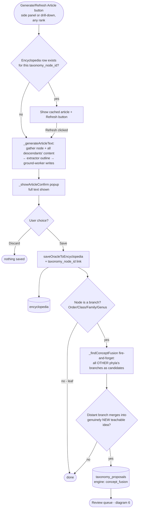
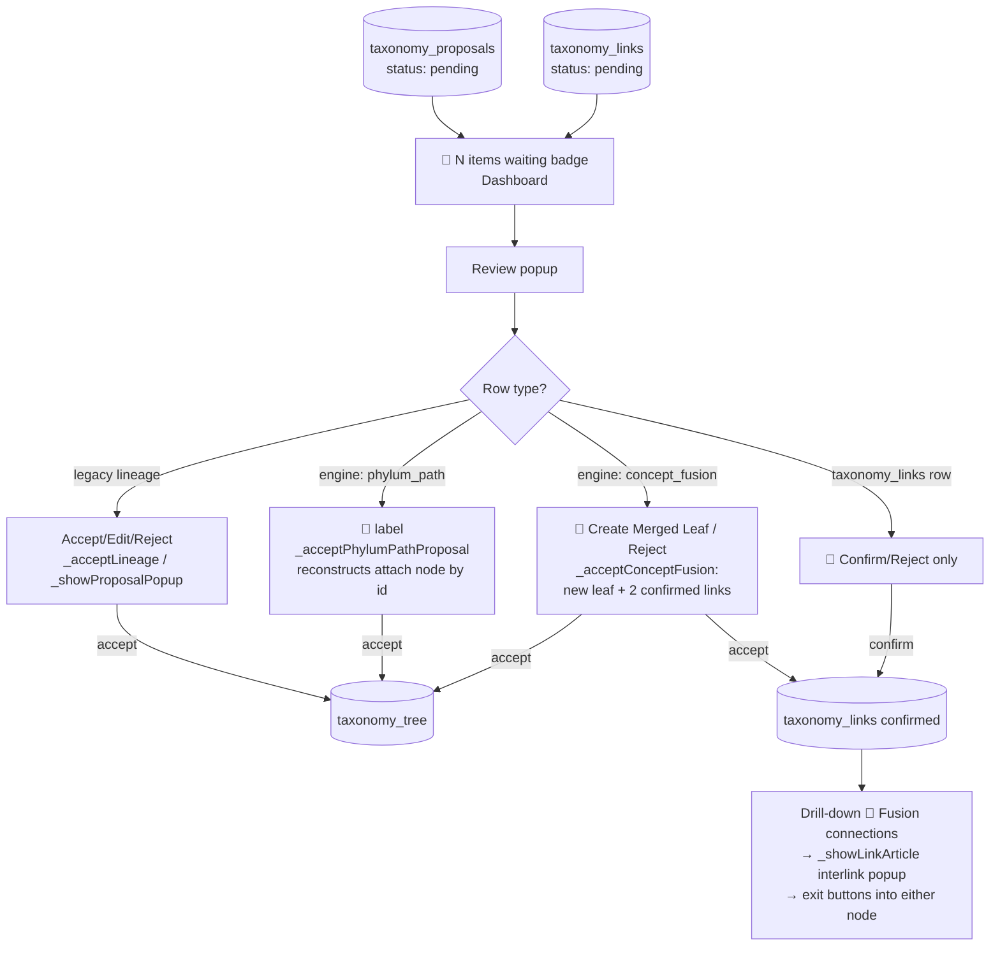
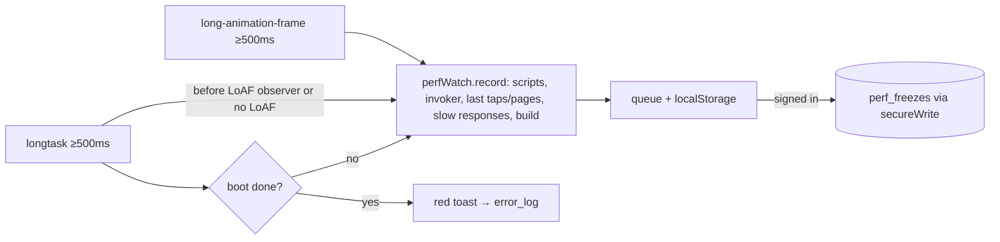
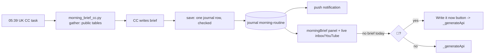
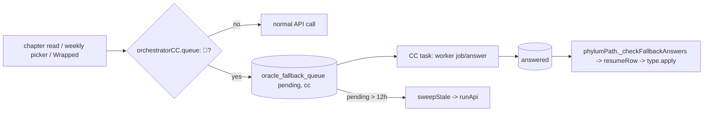
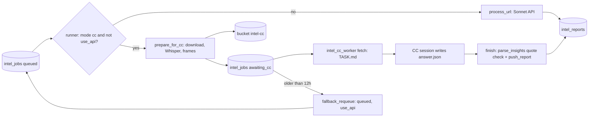

# RPGACE — System Flow Map
**The 5th Oversight doc.** Created July 17, 2026 from a full audit of all oversight files + the live codebase (`main.js`, `rpgace_core.js`, `api/*`, `index.html`). **Last re-verified Aug 14, 2026** (real `/CEO`/`/Routine` execution on the "Galaxy Map" plan's G15 prerequisite — §10 gained an Aug 14 truth-table block). Prior: Aug 13, 2026 (real `/CEO` execution on the "Galaxy Map" plan, G1-G3/G10/G12 — §10 gained an Aug 13 truth-table block). Prior: Aug 11, 2026 (real `/CEO`-framework A17 execution — §10 gained an Aug 11 truth-table block covering the massive-expansion critique doc build). Prior: Aug 6, 2026 (real `/paranoia`-shaped deduplication pass across all 5 non-CLAUDE.md oversight docs — GODMODE evidence confirmed this doc's truth table stopped at Aug 5's Phase-H block with zero mention of Aug 6's real shipped work; §10 gained an Aug 6 truth-table block. Full record: `oversight_doc_dedup_paranoia_2026-08-06.txt`). Prior re-verification: Aug 5, 2026 (Council of 5 + GODMODE/`/scope`/`/commit-archaeologist`-informed oversight sweep after Phases A-F of the Content/Video Pipeline unification — §11's diagram fully rebuilt). Before that: July 31, 2026 (module inventory re-grepped, table list rebuilt from `pg_policies`; record in `oversight_doc_audit_and_reshape_2026-07-31.txt`). This line gets bumped whenever a real re-verification pass runs, not just on creation. Diagrams are Mermaid — render on GitHub, in VS Code, or any Mermaid viewer. Every diagram follows the same convention: **rectangles = processing**, **diamonds = yes/no decisions**, **cylinders = data stores**, **stadiums = entry/exit points**, **dashed boxes = PLANNED, not built**.

## Per-domain sections (CK-3/4, Oct 28 2026)
This file keeps the cross-domain picture; each domain's own sections moved, unchanged, to its folder:
- **Oracle** → [`docs/domains/oracle/flow.md`](docs/domains/oracle/flow.md) (4 sections)
- **Content** → [`docs/domains/content/flow.md`](docs/domains/content/flow.md) (6 sections)
- **Knowledge** → [`docs/domains/knowledge/flow.md`](docs/domains/knowledge/flow.md) (6 sections)
- **Habits** → [`docs/domains/habits/flow.md`](docs/domains/habits/flow.md) (4 sections)
- **Schedule** → [`docs/domains/schedule/flow.md`](docs/domains/schedule/flow.md) (16 sections)
- **Chronicles** → [`docs/domains/chronicles/flow.md`](docs/domains/chronicles/flow.md) (2 sections)
- **Oversight** → [`docs/domains/oversight/flow.md`](docs/domains/oversight/flow.md) (5 sections)

Companion to CLAUDE.md (the operational guide). Update BOTH when architecture changes.

---

## 0. Verified Component Inventory

**The module count is a live fact, re-grepped from `rpgace_core.js`** (`grep -oP "RPGACE\.register\(\s*'\K[a-zA-Z0-9_]+"`, deduplicated) — see CLAUDE.md's own current Live-numbers line for the count rather than trusting a number restated here, since it moves independently of this doc and has gone stale more than once when trusted on its own. `myFeature` (SCHEDULE) is a real, oddly-named module — confirmed by reading its source, not a stray/test leftover.

### Domains and modules (from `rpgace_core.js` markers)

| Domain | Modules |
|---|---|
| ORACLE | youtubeOracle, tiktokOracle, prodOraclePanel, instaOraclePanel, quickActions, visualOracle, contentRepurpose, oracleAppGrounding, oracleDevBridge, oracleFetchGuard, oracleTreeGrounding, agentsIntoOracle, mockOracle, oracleProviderMode |
| LEARNING | feynman, encSync, ciAutoPropose, taxonomyReviewQueue, encTaxonomyLink, agendaReminder, scheduleOracle, intelDelete, taxonomySync, knowledgeGap, taxonomyTree, phylumPath, bookworm, encyclopediaQoL, intelBatchList, intelDedup, jargonEncyclopedia, researchTabs |
| CONFIG | config (defines `RPGACE.sb`, `RPGACE.cache`, `RPGACE.hooks`, CONFIG constants) |
| CONTENT | beatLog, refCorpus, contentProductionLive (My beats only), conidPot, videoSummary, beatsHub, postingHub (videoPipeline removed Oct 17 2026, PC-6) |
| JOURNAL | morningBrief, journalQoL |
| DASHBOARD / NAV | dashDeck, leftNav, pathRouter, chroniclesLog, careerStatCard, docsLinks, pwaInstall |
| SYSTEM | suppressQuestPopup, authGate, perfWatch, voiceInput, errorLog |
| SCHEDULE | shiftSync, myFeature, scheduleFixes |

Newer modules (`cookingOracle`, `shoppingWishlist`, `oracleControl`, and any shipped since) are tracked by CLAUDE.md's own Live-numbers line rather than backfilled into this table row-by-row — re-grep before treating this table as exhaustive.

### Serverless API (`api/`)
`oracle.js` (Claude proxy, accepts optional `model`, plus the dormant Kimi/Luna provider branch), `scout.js` (URL detect + Jina fetch, 8000-char cap), `analyst.js`, `bookworm-fetch.js` (uncapped fetch OR provided fullText → Oracle chapter detection), `composio.js`, `executor.js`, `orchestrate.js`, `data-write.js` (service-role write proxy + the `bundle-deliverables` action), `search.js`, `lastfm.js`, `auth.js` (server-side password check + shared-secret issuance, see §10's API-auth entry), `_context.js` (shared: `callClaude`, `MODEL='claude-sonnet-4-6'`, `MODEL_EXTRACTOR='claude-fable-5'`, `fetchURL`, `setCORS`, `requireAuth`, Composio `ACCOUNTS`/`TOOL_ALIASES` — the single source of truth for both).

### Supabase tables
**Tables are grouped by RLS posture below, because the posture is load-bearing** — re-query `pg_policies` directly for the current live table list and posture rather than trusting a fixed total here.

*Restricted (`anon_read_only` SELECT + `authenticated_all` — all writes must go through `/api/data-write`'s service-role proxy):* `taxonomy_tree` (recursive, parent_id/depth/path/phylum_number/node_type/explainer/deep_content/sources), `taxonomy_proposals` (staging + review, `proposed_steps.engine` tags: legacy / `phylum_path` / `concept_fusion`), `taxonomy_links` (symmetric fusion links + `link_article`), `taxonomy_nodes` (older flat store — still the home of the `f14_filmmaker_library`/`beatlog_scale_colours`/`f16_licence_terms` reference libraries), `taxonomy_decision_log`, `encyclopedia` (`taxonomy_node_id` links), `encyclopedia_insights`, `content_productions` (ConID + licence/price + `content_type` discriminator + `creative_docs` jsonb), `video_jobs` (F17 — `content_production_id` FK, `style_profile_id`, `edl`), `style_profiles` (Director Match output), `reference_tracks` (beat-matching corpus, +scale/genre/url), `conid_pot`, `bookworm_books`, `bookworm_chapters` (+keywords, suggested_phylum, analysis_complete), `bibliography`, `chronicles_finance`, `oracle_dev_suggestions`, `rpgace_agendas`, `oracle_module_anatomy` (Oracle-only per-module architecture/anatomy digest, curated by Claude Code sessions only; deliberately excluded from `api/data-write.js`'s `ALLOWED_TABLES` since nothing in the app writes to it client-side), `intel_reanalysis_pool` (Aug 27 2026 — real deleted intel reports/encyclopedia entries, backing the "delete doesn't stick" fix), `oracle_actions` (Aug 26 2026, G41 — the curated action vocabulary `oracleControl` dispatches against).

*Deliberately still `anon_all` because a real external writer needs the plain anon key — never sweep these into an RLS batch without giving that writer another path:* `journal` (Morning Brief Routine), `oracle_fallback_queue` (Fallback Drain Routine), `openmontage_jobs` (the separate OpenMontage Claude Code session), `beat_audio_jobs` (local librosa runner), `intel_jobs`/`intel_reports`/`intel_watchlist`/`intel_bibliography` (`local_server.py`, port 7842 — `intel_bibliography` is a real, unrelated table sharing a near-identical name with `bibliography`), `system_updates` (written by Claude Code sessions via MCP), `error_log`/`smoke_test_items`/`ceo_plan_items` (Sep 15 2026 — each has a real, confirmed live anon-key write from the deployed browser app; see CLAUDE.md's own landmine note).

*Views:* `book_knowledge`/`jargon_encyclopedia` (both `security_invoker`).

*Storage:* `beat-audio` bucket (Beat Log's librosa uploads, private, blanket `anon_all`); `beat-deliverables` bucket (real sellable beat deliverable files/stems/zips, private, anon INSERT/DELETE only — deliberately no anon SELECT, since raw bytes here are Alex's paid IP, not disposable analysis samples; reads only via the service-role key inside `api/data-write.js`'s `bundle-deliverables` action, or a signed URL it hands out).

#### Per-table purpose/constraint reference

*(Relocated verbatim from `manual.html`'s own "Supabase Tables" section, Sep 23 2026, Minotaur/Manual Unification M2 — manual.html retired, this is now the one authoritative per-table detail source; `ai_tooling_and_rules_map.md`'s own connector table cross-references here rather than duplicating. Content preserved as originally written; individual facts may predate later corrections logged elsewhere in this doc/CLAUDE.md — where the two disagree, the more recent, dated fact wins, per rule 1.)*

| Table | Purpose | Constraint |
|---|---|---|
| `encyclopedia` | Knowledge entries | UNIQUE(title) |
| `taxonomy_nodes` | Legacy flat gap scores | — |
| `taxonomy_tree` | Recursive lineage tree | Self-referencing parent_id |
| `taxonomy_proposals` | Staging for auto-proposals | Nothing live until accepted |
| `taxonomy_links` | Fusion links — cross-taxonomy connections, any rank/phylum | Symmetric node_a_id/node_b_id + link_insight; nothing live until confirmed |
| `taxonomy_tree` (all 21 phyla) | All 21 of 21 phyla enabled (`ENABLED_PHYLA:[1..21]`) — jargon-bucket leaves for most; Phylum 12 (Fons Educationis) rebuilt as a real 3-level deep hierarchy (6 Orders → 16 Classes → 16 leaves), the confirmed proof-of-concept for the rest. Real current phylum-number mapping (renumbered Aug 11): Fons Educationis=11, Lingua Musicae=12, Visio Cinematica=13, Contentum=14. | Fusion-link pass + hand-test for the 9 later-enabled phyla remain deferred until real Oracle/Claude API access is confirmed restored |
| `style_profiles` | (no writer since Oct 17 2026, PC-6) Director Match / Visual Treatment output parsed out of a `DIRECTOR_CHOSEN:` response trailer, linked from `video_jobs.style_profile_id` | 3 real rows as of Aug 11 (corrected from an earlier "0 rows ever" claim) — the save path has fired successfully in production; every failure point still raises a real toast |
| `beat_audio_jobs` | Async job queue for local librosa audio analysis (BPM + Major/Minor key only) paired with a `beat-audio` Storage bucket | anon_all by design — the local runner holds only the anon key. Needs `local_server.py` running |
| `beat-deliverables` (Storage bucket, no table) | Real sellable beat deliverable files (stems/wav/zips) per ConID, tracked via `content_productions.deliverable_files`/`.deliverable_bundles` | Anon INSERT/DELETE only, no SELECT — raw file bytes can only be read via the service-role key inside `api/data-write.js`'s `bundle-deliverables` action, or a signed URL |
| `openmontage_jobs` | Async handoff queue between RPGACE's Oracle, this Claude Code session, and a *separate* OpenMontage Claude Code session in a different repo. Carries a title/brief/beat_meta job payload; the external session writes `status`/`output_note` back | anon_all by design and must stay that way — the external session has no service-role key and no shared secret |
| `oracle_fallback_queue` | Where a credit-exhaustion failure in a background AI job parks itself, drained hourly by a Claude Code Remote Routine that resumes the placement | anon_all by design (the Routine writes with the plain anon key). Never exercised against a real credit-exhaustion event |
| `content_productions` | ConID tracker — the real spine of the beat-to-posted-video journey, written by three creation paths (Repurpose, Activate ConID, Beat Log) | Has a `content_type` discriminator (`tutorial` \| `music_video`), a `creative_docs` jsonb (script/director_blend/captions keys), an `updated_at` column, and `deliverable_files`/`deliverable_bundles` columns |
| `conid_pot` | Idea bank | — |
| `reference_tracks` | Artist-matching corpus for Beat Log's "find artists" step | 32 rows. `scale`/`genre`/`url` columns exist and `findMatches()` scores them, but scale/genre are still 0/32 populated — the real root cause of "beat matches are always the same"; the backfill popup requires Alex's own per-track judgment call, not an automated guess (confirmed Sep 23 2026) |
| `video_jobs` | Beat log entries + the granular file-path sub-tracker under `content_productions` | `content_production_id` FK has no cascade — ConID delete handles it explicitly. `edl` and `style_profile_id` wired |
| `sync_status` | Last run of a background sync (key `rota` = the Fourth cloud import); written via `/api/data-write`, anon read-only | PK key |
| `rpgace_shifts` | Rota. Written only through `/api/data-write` by `shiftSync.logic.replaceDates`/`pushPending` (and, from MD2-2, the Fourth cloud runner). Read by anon; `anon_read_only` + `authenticated_all` added Oct 12 2026, old `anon_all` removal awaiting Alex's approval | UNIQUE(date, start) |
| `rpgace_agendas` | Scheduled tasks, cross-device | — |
| `intel_jobs` / `intel_reports` | Content Intelligence pipeline | — |
| `intel_reanalysis_pool` | Real deleted intel reports/encyclopedia entries logged here (url/title/source_table/deleted_row_created_at/status), backing the shared suppression check that stops `local_server.py`'s own stale copy from resurfacing a deleted extraction while leaving the same URL free for a genuinely newer reanalysis. Also renders as Encyclopedia's own "🔁 Re-analysis Pool" browsable list | RLS enabled, anon_read_only + authenticated_all (writes route through `api/data-write.js`) |
| `intel_bibliography` | Source citations | Feeds future taxonomy footnotes |
| `oracle_dev_suggestions` | Oracle's suggestions flagged for a future Claude Code session (id/created_at/suggestion_text/category/status/source) | RLS enabled, restricted |
| `taxonomy_decision_log` | Append-only audit trail of every taxonomy commit (phylum_number/node_id/path/insight_text/source), written at `phylumPath._insertNewSteps`'s single choke point | RLS enabled, restricted |
| `chronicles_finance` | Real sale/expense rows (entry_date/type/category/item/amount/notes) for The Chronicles' personal-visibility finance ledger | RLS enabled, restricted |
| `system_updates` | Every real Claude Code change to RPGACE (title/summary/category), so Chronicles shows dev-side activity alongside Alex's own | RLS enabled, anon_all (Claude Code sessions write via MCP) |
| `oracle_actions` | The real, live-editable action vocabulary Oracle Control recognizes phrases against (action_id/trigger_phrases/target/data_touched/explanation fields/confirm_required). 5 rows have a real coded execution branch as of Sep 22 2026 (F0/F15): `log_beat`, `new_quests`, `draft_email`, `yt_stats`, `log_notion` — all 4 real "quickPrompt" dashboard buttons plus the Agents-page quick-actions bar dispatch through this same confirm-before-execute mechanism. A row can also arrive from Oracle's own `ORACLE_SUGGEST_ACTION:` suggestion, only once Alex approves it | RLS enabled, restricted |
| `book_knowledge` *(view)* | Real, structured, queryable book-derived knowledge: unnests `bookworm_chapters.insights` (approved only), joined with `bookworm_books` for title. Zero new writes | security_invoker view over existing RLS/permissions |
| `jargon_encyclopedia` *(view)* | Read-only glossary over real leaf-level taxonomy_tree rows (`node_type='leaf' AND status='accepted'`). Same live-query-every-load convention as `taxonomy_map.html` | security_invoker view over existing RLS/permissions |
| `recipes` / `ingredients` / `recipe_ingredients` / `ingredient_prices` (+ 4 cost/staleness/frequency views) | The real HABITS/Cooking schema (H1-H9). Ingredient price history is plain inserts, never updates (append-only) | anon_read_only + authenticated_all from creation |
| `habits_config` / `planned_cooks` / `pantry_stock` / `shopping_lists` / `shopping_list_items` | `planned_cooks` gained a real draft lifecycle Sep 16 (H12); `pantry_stock`'s PK is `(ingredient_id, location)` across Pantry/Fridge/Freezer; `shopping_list_items` gained a real `in_basket` column Sep 17 (H22) | anon_read_only + authenticated_all from creation |
| `ingredient_aliases` / `ingredient_substitution_confirmations` / `substitution_ratings` | H24, Sep 17 2026 — a permanent "declare same item" merge table; a real persistent confirm record per (ingredient, substitute) pair; an append-only post-cook substitution rating log | anon_read_only + authenticated_all from creation |
| `kitchen_equipment` | H11, Sep 16 2026 — a real owned-equipment inventory, distinct from `habits_config`'s oven/stovetop capacity and `wishlist_items`'s planned-purchase tracking | anon_read_only + authenticated_all from creation |
| `cofid_foods` | Asian ingredients/nutrition — 7,743 rows across 6 sources (UK CoFID, India IFCT, China CFCT, Japan MEXT, SE-Asia ASEAN FCD), cross-source deduped. Korea is the one remaining real gap | anon_read_only + authenticated_all from creation |
| `wishlist_items` / `wishlist_config` | Sep 14 2026 — the standalone Shopping Wishlist module's own tables, deliberately separate from HABITS' ingredient-specific shopping list. `wishlist_config` is a real single-row (`id=1`) settings table holding `budget_target` | anon_read_only + authenticated_all from creation |

### The two real hubs (confirmed in interconnection_map.md)
Everything converges on **Oracle** (`callOracle`/`sendChat`/`api/oracle.js`) and the **Taxonomy Tree** (`taxonomy_tree` + its propose/review cycle) — except SCHEDULE, which runs fully independent.

---

## 4. Article Generation + Concept Fusion



---

## 6. Review Queue (Dashboard — all pending taxonomy decisions)



---

## 10. Built vs NOT built — the truth table

### Built AND verified working (hand-tested or confirmed live)
**This section's own original July 18-31 snapshot (phyla count, fusion-link/taxonomy row counts, Bookworm's first hand-tested chapter) is archived verbatim in `CLAUDE_archive.md`** — every number in it is stale relative to CLAUDE.md's own current Live-numbers line (all 21 of 21 phyla enabled; live `taxonomy_tree`/`taxonomy_links`/`taxonomy_proposals` row counts) and to `smoke_test.html`'s own current hand-test tally, both of which supersede it as the authoritative current source.
- Phylum Path, Concept Fusion, the taxonomy review queue with all 3 proposal types + fusion-link cards, Bookworm's streaming analysis + checkpoint/resume + placement-path sanitizer, TOC-paste and PDF-upload chapter detection, Grounded Oracle (no invented phyla) with a request cross-wiring guard, and Content Intelligence end-to-end (plus cross-device sync for shifts/agendas) are all real, shipped, and code-verified.
- Current per-feature hand-test confirmation status lives in `smoke_test.html`, not here; the original hand-test rounds and root-cause debugging arcs (including Bookworm's longest debugging arc, PDF-upload chapter detection) live in `patch_notes.html`'s own dated cards, cited from the archived version of this section.

### Built but NEVER verified — treat as unconfirmed, test before building on
**This section predates HABITS, the Galaxy Map's G13-G117 build-out, and everything shipped after this doc's own last full re-verification — treat it as a real historical record of what was known-unverified at each build's own time, not a live status feed.** For CURRENT hand-test status on any given feature, `smoke_test.html`'s own Supabase-backed, Alex-hand-confirmed tally is the authoritative source (see CLAUDE.md's "Hand-testing" open fork — 27 of 99 rows confirmed as of Aug 30, 70 still unverified). Full build narrative for everything below lives in `patch_notes.html`'s own dated cards — every one of these items already cites it there, this section never re-tells the story.

- **My Day (Oct 12 2026)**: routines, Plan my day, Quest Board template removed — headless-tested only, see §15e.
- **Cook Mode (Oct 11 2026)**: one-step-per-screen cooking, step rules, and the 8 proposed step splits — headless-tested only, see §15d.
- **Bookworm**: no book has ever completed the full pipeline start to finish (structure detection is solid on both entry points; a clean chapter run through the post-retune engine is the real remaining open test). `_looksLikeTableOfContents()`'s warning heuristic has never been observed catching a real mistake. Bibliography section render has nothing to show until a book completes.
- **F16 Beatstars listing / F17 video pipeline stages / F18 auto visual treatment / highlight-to-Phylum-Path button** — real, shipped, hand-test status tracked in `smoke_test.html` (also named in CLAUDE.md's own "F16/F17/F18 hand-test sweep" open fork).
- **The real July 20-25 build cluster** — left slide-out nav drawer, the Research Lab tab-content fix (superseded: Research Lab is now fully retired, not just fixed), the dashboard command deck rebuild, `book_knowledge`/`jargon_encyclopedia` views, the `/debate` skill, n8n rota sync (F10), Oracle self-awareness + the Claude Code bridge (`oracleAppGrounding`/`oracleFetchGuard`/`oracleDevBridge`/`taxonomy_decision_log`), a real nav-lag root-cause fix, PWA installability, the Career stat card + Chronicles rebuild, the `/scope` skill + `system_updates` table, `/5thDimension`, server-side API auth (now live and independently verified, see CLAUDE.md's Security note), a real Composio account-id dedup fix, Chronicles card-only + real pushState URLs + swipeable nav + `perfWatch`, every boot-time UI injector moving onto `RPGACE.registerBootTask`, and Approach B's write-proxy (now independently confirmed live via 8 real authenticated writes) — all real, all shipped.
- **The real July 26 - Aug 14 build cluster** — Oracle 504 streaming fix, the `renderMarkdown()` XSS fix, undersized-text fixes, `videoPipeline`/`morningBrief` dashDeck migrations, the Content Pipeline overseer (`style_profiles` now holds 3 real rows, see CLAUDE.md's Video/content pipeline section), the beat-matching root-cause fix (`reference_tracks.scale`/`genre` still 0/32 populated — the backfill popup exists, hasn't been run), local librosa audio analysis, voice input (since retired Aug 30, see CLAUDE.md), popup scaffolding consolidation, Phylum 11+14 built out (since superseded — all 21 phyla are now enabled, see CLAUDE.md's Taxonomy section), Video Pipeline Slice A, the `content_type` discriminator, the Video/Content Pipeline UX pass, the director picker + reply-truncation fix, `openmontage_jobs`' first real round-trip, the OpenMontage free-GPU investigation (since paused, superseded by a paid-provider search, see CLAUDE.md), Oracle architecture/anatomy grounding, the full Aug 5 8-phase Content/Video Pipeline unification (A-H), the Aug 6 bugfix/dev-tooling block, the Aug 11 `/CEO`-framework block, the Aug 11/12 minification + Grounded-Mode block, the Aug 13 Galaxy Map G1-G15 block, and the Aug 14 main.js/hooks detection-extension block — all real, all shipped, code-verified and live on `main`.

### Claimed/discussed but NOT built — do not trust any doc that implies otherwise
- Live-study **card-list UI** (ConID-card pattern for Bookworm chapters) — explicitly deferred
- Schedule Oracle Phase 2 (F12); Circles rabbit-hole nav (folded into Phase-2 vision); dedicated case-study/reference-tracks phylum; framework passes for the **remaining** phyla — see CLAUDE.md's Taxonomy section for the current, correct phylum-number mapping and which phyla still need the deep-hierarchy treatment
- ~~`hooks.on('rpgace:ready')` ~25-site audit~~ — **closed.** A real re-audit found the sites had already been fixed incidentally over time; a fresh grep confirms exactly **one** occurrence remains in `rpgace_core.js`, and it is `RPGACE.register()`'s own canonical module-init machinery — not a bug site. The underlying `hooks.fire()` behaviour (never revisits listeners added mid-fire) is still true and still worth knowing; there is no backlog attached to it.
- **Cut-precise beat-synced video generation** — genuinely not built and not close. The EDL/storyboard's scene timing is LLM-estimated; no beat-grid or onset detection exists anywhere in the stack. "In sync with the beat" today means mood/palette-matched. Real audio beat-grid sync is confirmed as a wanted future build (Slice C), unstarted.
- **Phylum 13's full browsable taxonomy tree** — the 50 real director profiles live in the flat `taxonomy_nodes` reference table (`source='f14_filmmaker_library'`), not as tree branches — see CLAUDE.md's Taxonomy section for the current phylum number.
- **Phylum XP Ledger** — spec'd (`phylum_xp_ledger_spec_backlog_2026-07-28.txt`), still not built. `questEngine` closed the real persistence gap this item used to cite (see CLAUDE.md's own superseding correction) — the real remaining open part is a dedicated phylum-tag architecture decision only Alex can settle.
- ~~Taxonomy Sorting Agent; Claude general-knowledge audit (3 parts)~~ — **resolved**, see the "Built but NEVER verified" section above (`book_knowledge`/`jargon_encyclopedia` views + the `/debate` skill).
- ~~Server-side API authentication; `CORRECT_PW` moved server-side~~ — **BUILT and live**, see CLAUDE.md's own Security note for the current, independently-verified state.
- ~~XSS/DOM-injection audit of `innerHTML` call sites~~ — **fixed**: `main.js`'s `renderMarkdown()` (behind every Oracle chat message) injected raw response text into `innerHTML` with zero escaping — fixed via a real `_escChatHtml()` step before the markdown regex chain runs. See CLAUDE.md.
- ~~Website performance audit~~ — a real static-code audit (file sizes, gzip sizes, load order, cache headers) plus the minification fix that followed from it are genuinely done. A live Lighthouse/PageSpeed run remains a confirmed-blocked path from this environment specifically (not transient — see CLAUDE.md's Known landmines).
- ~~RLS policy redesign~~ — **BUILT, confirmed end-to-end** — see "Built" above. 17 tables flipped from permissive `USING(true)` to real `anon_read_only`/`authenticated_all` policies, verified directly against `pg_policy`, then independently confirmed live via 8 real authenticated writes through the proxy.
- **Live-grounding for RLS/security status specifically** — deliberately not built (Supabase's advisor API isn't reachable from client-side browser JS; would need a dedicated server endpoint).
- ~~`system_flow_map.md` §0's own module inventory is stale~~ — **fixed**: §0's domain table is rebuilt from a real grep of every `RPGACE.register()` call, all modules listed by name and domain, not just counted — re-grep before trusting the count, it has gone stale more than once (see §0's own live-fact caveat).

### Known open bugs — see also §11
- ~~Oracle 504 on long responses~~ — **real fix built, confirmed live**: `api/oracle.js` proxies a genuine Anthropic SSE stream (opt-in via `stream:true`), `main.js`'s `callOracle()`/`sendChat()` consume it to progressively render the reply into the existing typing-indicator bubble, `maxDuration` raised to 300. A prior attempt shipped a client-only stub with no real server support and was reverted; that dead code (`RPGACE.streamOracle`/`restoreSendChat`) is deleted rather than left neutralised.
- F11 silent "Content Unavailable" on failed Jina fetches
- `_generateNodeContent` empty-deep_content mystery (partially resolved, never re-tested)

---

## 15l. Realms on everything (Realm Inputs RI-0..10 + Realm Connectors RC-0..4, Oct 15 2026) — built, untested by Alex

```mermaid
flowchart LR
  IN[Input: video link / book / screenshots / Library add / starred answer / web lookup] --> PICK[RPGACE.realmPicker: up to 4 realms, Not now holds]
  PICK -->|realms column| ROWS[(intel_jobs / bookworm_books / screenshots / library_items)]
  PICK -->|Not now = realms {}| HELD[held inputs: asked again after sign-in]
  ROWS --> LENS[realm_lenses.json lenses → Oracle reads through chosen realms]
  LENS --> REP[(intel_reports.realm_scores + insight realms)]
  REP --> Q[pathways quest → quest_log input_quest, category = realm]
  ROWS -->|library_items realms| XPIN[xp_on_input → input_taken XP split over realms]
  MAP[realm_lenses.json phyla: 29 phyla → 13 realms] --> PP[Phylum Path grouped by realm]
  MAP --> RO[RPGACE.realmOf phylum fallback → jargon + Library carry a realm]
  RO --> KN[realmKnowledge: accepted jargon + Library per realm]
  KN --> CARD[Realm card: Taken in · Knows · ✨ Suggest quests · 🏔️ milestone]
  CARD -->|Suggest quests: 1 Oracle call| Q
  CARD -->|Propose: 1 Oracle call, 3 ideas| MS[(xp_quest_steps source knowledge)]
  MS -->|counter reached: xp_quest_check| DONE[done]
  MS -->|hand tick: line + realm proof, guard trigger| DONE
  DONE --> XPM[xp_milestone_xp: 10/20/35% of rank gap] --> TITLE[3 per tier → title in xp_unlocks]
  XPS[(xp_events)] --> BRIEF[realmBrief: Morning Brief Today's realm + reports by realm]
```

Truth table: realm picker + held inputs, realm lenses for videos/books/screenshots, input XP, input quests, Today's realm, realm reports (RI-0..10); 29 phyla mapped to realms, Phylum Path by realm, Knows line + reading XP half Scholar, quest realm icons + From links + Suggest quests, knowledge-path milestones with proof by realm and tier titles (RC-0..4) — built, headless-verified (RC tests 6/11/6/11/17 plus DB rolled-back runs). Not built: auto-proposing milestones when a realm gains knowledge (Alex chose tap-only); counters for realms with no app counter (Homekeeper, Steward, Builder) — they tick by hand.

## 15j. Freeze recorder (PS-1/PS-2, Oct 14 2026) — built, untested by Alex



Truth table: recorder, boot-phase no-alert, sign-in-gated flush — built, headless-verified (13 checks). Splitting the 1.9MB script (the only real cut to the ~690ms load block) — not built.

## 15aa. One Morning Brief (Oct 21 2026, CC-3) — built



## 15z. App prompts via Orchestrator CC (Oct 21 2026, CC-2) — built



## 15y. Videos via Orchestrator CC (Oct 21 2026, CC-1 + CC-4) — built: 2-hourly CC task at :05 (max 5 per run), 12h API fallback



## 15x. Background analysis switch (Oct 21 2026, CC-0 of "Orchestrator CC Analysis") — built, nothing routed yet

```mermaid
flowchart LR
  A[⚙ dev-status cluster 🤖/💳 row] -->|secureWrite| B[(app_settings background_analysis)]
  B -->|sb.select| C[orchestratorCC.logic.mode]
  C -.planned CC-1..4.-> D[videos / chapters / brief / challenges / Wrapped]
  C -.planned CC-4.-> E[2-hourly CC task, API after 12h]
```

## 18. "Delete doesn't stick" fix — real deletion-suppression, not a tombstone (/Routine item #1)

Real root cause: `local_server.py` (Alex's own machine, outside this repo) holds its own copy of intel report/encyclopedia source data with no concept of "this was deleted." §7 above already shows real content flowing IN from `local_server.py` via the Analysis pipeline — this diagram shows the other half: what happens when that same content is later deleted, and how the system now stops it silently flowing back in.

```mermaid
flowchart TD
    DEL([Alex deletes a report — videoSummary,<br/>or an Encyclopedia entry]) --> WHICH{Which delete path?}
    WHICH -->|intel report| DU[intelDelete._deleteUnified —<br/>deletes intel_reports row +<br/>localStorage cache]
    WHICH -->|encyclopedia entry| DE[deleteEncEntry / clearEncyclopedia —<br/>deletes encyclopedia row(s) +<br/>localStorage cache]

    DU --> HASURL1{entry has a real url?}
    DE --> HASURL2{entry has a real<br/>source_url? — plain Oracle-<br/>chat saves never do}
    HASURL1 -->|yes| LOG[logReanalysisCandidate —<br/>fire-and-forget INSERT into<br/>intel_reanalysis_pool]
    HASURL2 -->|yes| LOG
    HASURL1 -->|no| SKIP1([Nothing to log — no URL,<br/>nothing to reanalyze])
    HASURL2 -->|no| SKIP1

    LOG --> POOL[(intel_reanalysis_pool —<br/>url/title/source_table/<br/>deleted_row_created_at/status)]

    subgraph MERGE["Every later merge/fetch path"]
        POLL([syncIntelData — 30s<br/>recurring poll, forever]) --> FRO[fetchFromLocal — reads<br/>local_server.py's own<br/>UNTOUCHED files]
        PUSH([Encyclopedia's "⚡ Sync & Push"<br/>button]) --> PLS[pushLocalToSupabase —<br/>tells local_server.py to push<br/>its own files to Supabase]
        REFRESH([refreshEncyclopediaDisplay —<br/>any page load/refresh]) --> FETCH[Fetches encyclopedia<br/>table fresh]
        FRO --> MERGEFN[mergeByUrl — old logic:<br/>pure union, no concept<br/>of deletion]
        PLS --> MERGEFN
        MERGEFN --> SUPPRESS{filterReanalysisSuppressed —<br/>ONE shared helper}
        FETCH --> SUPPRESS
        POOL -.reads pending rows.-> SUPPRESS
        SUPPRESS -->|candidate same age<br/>or OLDER than deletion| DROP([Suppressed — never<br/>re-rendered or re-cached])
        SUPPRESS -->|candidate NEWER<br/>than deletion| PASS([Passes through —<br/>a genuine fresh reanalysis])
    end

    POOL --> UI[Encyclopedia's real<br/>"🔁 Re-analysis Pool" list —<br/>Alex can browse + revisit]
```

**Real, deliberate design choice, not a bug carried over from the original ask**: this is NOT a permanent per-URL ban. Alex's own correction mid-`/interrogation`: "these are just old entries that take wrong info, the info from videos and URL are still there, just the extraction is wrong." A bad extraction should never block a genuinely better one of the same URL later — hence the strict age comparison (`itemDate > deletion date`) rather than a blanket exclude-forever list.

**Real, same-day closure of what was originally a client-side-only residual**: `local_server.py`/`rpgace_intel.py` were brought into the repo (`local_server/`, Alex's own confirmed ask) later this same session, and `/push-to-supabase`'s real handler was read directly — confirming the gap was genuine, not theoretical (zero dedup, zero deletion-awareness, blindly re-POSTing every local file every call). Fixed server-side with the mirrored version of the same 2 conditions (`norm_url()`, behaviorally matching `intelDedup.normUrl`; an existing `intel_reports` row or a pending `intel_reanalysis_pool` marker at least as new as the local file's own date both skip the push). Full record: `records/2026-08/delete_doesnt_stick_tombstone_ceo_spec_2026-08-27.txt`, `local_server/README.md`.
