# RPGACE — System Flow Map
**The 5th Oversight doc.** Created July 17, 2026 from a full audit of all oversight files + the live codebase (`main.js`, `rpgace_core.js`, `api/*`, `index.html`). **Last re-verified Aug 14, 2026** (real `/CEO`/`/Routine` execution on the "Galaxy Map" plan's G15 prerequisite — §10 gained an Aug 14 truth-table block). Prior: Aug 13, 2026 (real `/CEO` execution on the "Galaxy Map" plan, G1-G3/G10/G12 — §10 gained an Aug 13 truth-table block). Prior: Aug 11, 2026 (real `/CEO`-framework A17 execution — §10 gained an Aug 11 truth-table block covering the massive-expansion critique doc build). Prior: Aug 6, 2026 (real `/paranoia`-shaped deduplication pass across all 5 non-CLAUDE.md oversight docs — GODMODE evidence confirmed this doc's truth table stopped at Aug 5's Phase-H block with zero mention of Aug 6's real shipped work; §10 gained an Aug 6 truth-table block. Full record: `oversight_doc_dedup_paranoia_2026-08-06.txt`). Prior re-verification: Aug 5, 2026 (Council of 5 + GODMODE/`/scope`/`/commit-archaeologist`-informed oversight sweep after Phases A-F of the Content/Video Pipeline unification — §11's diagram fully rebuilt). Before that: July 31, 2026 (module inventory re-grepped, table list rebuilt from `pg_policies`; record in `oversight_doc_audit_and_reshape_2026-07-31.txt`). This line gets bumped whenever a real re-verification pass runs, not just on creation. Diagrams are Mermaid — render on GitHub, in VS Code, or any Mermaid viewer. Every diagram follows the same convention: **rectangles = processing**, **diamonds = yes/no decisions**, **cylinders = data stores**, **stadiums = entry/exit points**, **dashed boxes = PLANNED, not built**.

Companion to CLAUDE.md (the operational guide). Update BOTH when architecture changes.

---

## 0. Verified Component Inventory

**The module count is a live fact, re-grepped from `rpgace_core.js`** (`grep -oP "RPGACE\.register\(\s*'\K[a-zA-Z0-9_]+"`, deduplicated) — see CLAUDE.md's own current Live-numbers line for the count rather than trusting a number restated here, since it moves independently of this doc and has gone stale more than once when trusted on its own. `myFeature` (SCHEDULE) is a real, oddly-named module — confirmed by reading its source, not a stray/test leftover.

### Domains and modules (from `rpgace_core.js` markers)

| Domain | Modules |
|---|---|
| ORACLE | youtubeOracle, tiktokOracle, prodOraclePanel, instaOraclePanel, quickActions, visualOracle, contentRepurpose, oracleAppGrounding, oracleDevBridge, oracleFetchGuard, oracleTreeGrounding, agentsIntoOracle, mockOracle, oracleProviderMode |
| LEARNING | feynman, encSync, ciAutoPropose, taxonomyReviewQueue, encTaxonomyLink, agendaReminder, scheduleOracle, intelDelete, taxonomySync, knowledgeGap, taxonomyTree, phylumPath, bookworm, encyclopediaQoL, intelBatchList, intelDedup, jargonEncyclopedia, researchTabs |
| CONFIG | config (defines `RPGACE.sb`, `RPGACE.cache`, `RPGACE.hooks`, CONFIG constants) |
| CONTENT | beatLog, refCorpus, contentProductionLive (My beats only), conidPot, videoSummary, beatsHub, postingHub (videoPipeline removed Oct 17 2026, PC-6) |
| JOURNAL | morningBrief, journalQoL |
| DASHBOARD / NAV | dashDeck, leftNav, pathRouter, chroniclesLog, careerStatCard, docsLinks, pwaInstall |
| SYSTEM | suppressQuestPopup, authGate, perfWatch, voiceInput, errorLog |
| SCHEDULE | shiftSync, myFeature, scheduleFixes |

Newer modules (`cookingOracle`, `shoppingWishlist`, `oracleControl`, and any shipped since) are tracked by CLAUDE.md's own Live-numbers line rather than backfilled into this table row-by-row — re-grep before treating this table as exhaustive.

### Serverless API (`api/`)
`oracle.js` (Claude proxy, accepts optional `model`, plus the dormant Kimi/Luna provider branch), `scout.js` (URL detect + Jina fetch, 8000-char cap), `analyst.js`, `bookworm-fetch.js` (uncapped fetch OR provided fullText → Oracle chapter detection), `composio.js`, `executor.js`, `orchestrate.js`, `data-write.js` (service-role write proxy + the `bundle-deliverables` action), `search.js`, `lastfm.js`, `auth.js` (server-side password check + shared-secret issuance, see §10's API-auth entry), `_context.js` (shared: `callClaude`, `MODEL='claude-sonnet-4-6'`, `MODEL_EXTRACTOR='claude-fable-5'`, `fetchURL`, `setCORS`, `requireAuth`, Composio `ACCOUNTS`/`TOOL_ALIASES` — the single source of truth for both).

### Supabase tables
**Tables are grouped by RLS posture below, because the posture is load-bearing** — re-query `pg_policies` directly for the current live table list and posture rather than trusting a fixed total here.

*Restricted (`anon_read_only` SELECT + `authenticated_all` — all writes must go through `/api/data-write`'s service-role proxy):* `taxonomy_tree` (recursive, parent_id/depth/path/phylum_number/node_type/explainer/deep_content/sources), `taxonomy_proposals` (staging + review, `proposed_steps.engine` tags: legacy / `phylum_path` / `concept_fusion`), `taxonomy_links` (symmetric fusion links + `link_article`), `taxonomy_nodes` (older flat store — still the home of the `f14_filmmaker_library`/`beatlog_scale_colours`/`f16_licence_terms` reference libraries), `taxonomy_decision_log`, `encyclopedia` (`taxonomy_node_id` links), `encyclopedia_insights`, `content_productions` (ConID + licence/price + `content_type` discriminator + `creative_docs` jsonb), `video_jobs` (F17 — `content_production_id` FK, `style_profile_id`, `edl`), `style_profiles` (Director Match output), `reference_tracks` (beat-matching corpus, +scale/genre/url), `conid_pot`, `bookworm_books`, `bookworm_chapters` (+keywords, suggested_phylum, analysis_complete), `bibliography`, `chronicles_finance`, `oracle_dev_suggestions`, `rpgace_agendas`, `oracle_module_anatomy` (Oracle-only per-module architecture/anatomy digest, curated by Claude Code sessions only; deliberately excluded from `api/data-write.js`'s `ALLOWED_TABLES` since nothing in the app writes to it client-side), `intel_reanalysis_pool` (Aug 27 2026 — real deleted intel reports/encyclopedia entries, backing the "delete doesn't stick" fix), `oracle_actions` (Aug 26 2026, G41 — the curated action vocabulary `oracleControl` dispatches against).

*Deliberately still `anon_all` because a real external writer needs the plain anon key — never sweep these into an RLS batch without giving that writer another path:* `journal` (Morning Brief Routine), `oracle_fallback_queue` (Fallback Drain Routine), `openmontage_jobs` (the separate OpenMontage Claude Code session), `beat_audio_jobs` (local librosa runner), `intel_jobs`/`intel_reports`/`intel_watchlist`/`intel_bibliography` (`local_server.py`, port 7842 — `intel_bibliography` is a real, unrelated table sharing a near-identical name with `bibliography`), `system_updates` (written by Claude Code sessions via MCP), `error_log`/`smoke_test_items`/`ceo_plan_items` (Sep 15 2026 — each has a real, confirmed live anon-key write from the deployed browser app; see CLAUDE.md's own landmine note).

*Views:* `book_knowledge`/`jargon_encyclopedia` (both `security_invoker`).

*Storage:* `beat-audio` bucket (Beat Log's librosa uploads, private, blanket `anon_all`); `beat-deliverables` bucket (real sellable beat deliverable files/stems/zips, private, anon INSERT/DELETE only — deliberately no anon SELECT, since raw bytes here are Alex's paid IP, not disposable analysis samples; reads only via the service-role key inside `api/data-write.js`'s `bundle-deliverables` action, or a signed URL it hands out).

#### Per-table purpose/constraint reference

*(Relocated verbatim from `manual.html`'s own "Supabase Tables" section, Sep 23 2026, Minotaur/Manual Unification M2 — manual.html retired, this is now the one authoritative per-table detail source; `ai_tooling_and_rules_map.md`'s own connector table cross-references here rather than duplicating. Content preserved as originally written; individual facts may predate later corrections logged elsewhere in this doc/CLAUDE.md — where the two disagree, the more recent, dated fact wins, per rule 1.)*

| Table | Purpose | Constraint |
|---|---|---|
| `encyclopedia` | Knowledge entries | UNIQUE(title) |
| `taxonomy_nodes` | Legacy flat gap scores | — |
| `taxonomy_tree` | Recursive lineage tree | Self-referencing parent_id |
| `taxonomy_proposals` | Staging for auto-proposals | Nothing live until accepted |
| `taxonomy_links` | Fusion links — cross-taxonomy connections, any rank/phylum | Symmetric node_a_id/node_b_id + link_insight; nothing live until confirmed |
| `taxonomy_tree` (all 21 phyla) | All 21 of 21 phyla enabled (`ENABLED_PHYLA:[1..21]`) — jargon-bucket leaves for most; Phylum 12 (Fons Educationis) rebuilt as a real 3-level deep hierarchy (6 Orders → 16 Classes → 16 leaves), the confirmed proof-of-concept for the rest. Real current phylum-number mapping (renumbered Aug 11): Fons Educationis=11, Lingua Musicae=12, Visio Cinematica=13, Contentum=14. | Fusion-link pass + hand-test for the 9 later-enabled phyla remain deferred until real Oracle/Claude API access is confirmed restored |
| `style_profiles` | (no writer since Oct 17 2026, PC-6) Director Match / Visual Treatment output parsed out of a `DIRECTOR_CHOSEN:` response trailer, linked from `video_jobs.style_profile_id` | 3 real rows as of Aug 11 (corrected from an earlier "0 rows ever" claim) — the save path has fired successfully in production; every failure point still raises a real toast |
| `beat_audio_jobs` | Async job queue for local librosa audio analysis (BPM + Major/Minor key only) paired with a `beat-audio` Storage bucket | anon_all by design — the local runner holds only the anon key. Needs `local_server.py` running |
| `beat-deliverables` (Storage bucket, no table) | Real sellable beat deliverable files (stems/wav/zips) per ConID, tracked via `content_productions.deliverable_files`/`.deliverable_bundles` | Anon INSERT/DELETE only, no SELECT — raw file bytes can only be read via the service-role key inside `api/data-write.js`'s `bundle-deliverables` action, or a signed URL |
| `openmontage_jobs` | Async handoff queue between RPGACE's Oracle, this Claude Code session, and a *separate* OpenMontage Claude Code session in a different repo. Carries a title/brief/beat_meta job payload; the external session writes `status`/`output_note` back | anon_all by design and must stay that way — the external session has no service-role key and no shared secret |
| `oracle_fallback_queue` | Where a credit-exhaustion failure in a background AI job parks itself, drained hourly by a Claude Code Remote Routine that resumes the placement | anon_all by design (the Routine writes with the plain anon key). Never exercised against a real credit-exhaustion event |
| `content_productions` | ConID tracker — the real spine of the beat-to-posted-video journey, written by three creation paths (Repurpose, Activate ConID, Beat Log) | Has a `content_type` discriminator (`tutorial` \| `music_video`), a `creative_docs` jsonb (script/director_blend/captions keys), an `updated_at` column, and `deliverable_files`/`deliverable_bundles` columns |
| `conid_pot` | Idea bank | — |
| `reference_tracks` | Artist-matching corpus for Beat Log's "find artists" step | 32 rows. `scale`/`genre`/`url` columns exist and `findMatches()` scores them, but scale/genre are still 0/32 populated — the real root cause of "beat matches are always the same"; the backfill popup requires Alex's own per-track judgment call, not an automated guess (confirmed Sep 23 2026) |
| `video_jobs` | Beat log entries + the granular file-path sub-tracker under `content_productions` | `content_production_id` FK has no cascade — ConID delete handles it explicitly. `edl` and `style_profile_id` wired |
| `sync_status` | Last run of a background sync (key `rota` = the Fourth cloud import); written via `/api/data-write`, anon read-only | PK key |
| `rpgace_shifts` | Rota. Written only through `/api/data-write` by `shiftSync.logic.replaceDates`/`pushPending` (and, from MD2-2, the Fourth cloud runner). Read by anon; `anon_read_only` + `authenticated_all` added Oct 12 2026, old `anon_all` removal awaiting Alex's approval | UNIQUE(date, start) |
| `rpgace_agendas` | Scheduled tasks, cross-device | — |
| `intel_jobs` / `intel_reports` | Content Intelligence pipeline | — |
| `intel_reanalysis_pool` | Real deleted intel reports/encyclopedia entries logged here (url/title/source_table/deleted_row_created_at/status), backing the shared suppression check that stops `local_server.py`'s own stale copy from resurfacing a deleted extraction while leaving the same URL free for a genuinely newer reanalysis. Also renders as Encyclopedia's own "🔁 Re-analysis Pool" browsable list | RLS enabled, anon_read_only + authenticated_all (writes route through `api/data-write.js`) |
| `intel_bibliography` | Source citations | Feeds future taxonomy footnotes |
| `oracle_dev_suggestions` | Oracle's suggestions flagged for a future Claude Code session (id/created_at/suggestion_text/category/status/source) | RLS enabled, restricted |
| `taxonomy_decision_log` | Append-only audit trail of every taxonomy commit (phylum_number/node_id/path/insight_text/source), written at `phylumPath._insertNewSteps`'s single choke point | RLS enabled, restricted |
| `chronicles_finance` | Real sale/expense rows (entry_date/type/category/item/amount/notes) for The Chronicles' personal-visibility finance ledger | RLS enabled, restricted |
| `system_updates` | Every real Claude Code change to RPGACE (title/summary/category), so Chronicles shows dev-side activity alongside Alex's own | RLS enabled, anon_all (Claude Code sessions write via MCP) |
| `oracle_actions` | The real, live-editable action vocabulary Oracle Control recognizes phrases against (action_id/trigger_phrases/target/data_touched/explanation fields/confirm_required). 5 rows have a real coded execution branch as of Sep 22 2026 (F0/F15): `log_beat`, `new_quests`, `draft_email`, `yt_stats`, `log_notion` — all 4 real "quickPrompt" dashboard buttons plus the Agents-page quick-actions bar dispatch through this same confirm-before-execute mechanism. A row can also arrive from Oracle's own `ORACLE_SUGGEST_ACTION:` suggestion, only once Alex approves it | RLS enabled, restricted |
| `book_knowledge` *(view)* | Real, structured, queryable book-derived knowledge: unnests `bookworm_chapters.insights` (approved only), joined with `bookworm_books` for title. Zero new writes | security_invoker view over existing RLS/permissions |
| `jargon_encyclopedia` *(view)* | Read-only glossary over real leaf-level taxonomy_tree rows (`node_type='leaf' AND status='accepted'`). Same live-query-every-load convention as `taxonomy_map.html` | security_invoker view over existing RLS/permissions |
| `recipes` / `ingredients` / `recipe_ingredients` / `ingredient_prices` (+ 4 cost/staleness/frequency views) | The real HABITS/Cooking schema (H1-H9). Ingredient price history is plain inserts, never updates (append-only) | anon_read_only + authenticated_all from creation |
| `habits_config` / `planned_cooks` / `pantry_stock` / `shopping_lists` / `shopping_list_items` | `planned_cooks` gained a real draft lifecycle Sep 16 (H12); `pantry_stock`'s PK is `(ingredient_id, location)` across Pantry/Fridge/Freezer; `shopping_list_items` gained a real `in_basket` column Sep 17 (H22) | anon_read_only + authenticated_all from creation |
| `ingredient_aliases` / `ingredient_substitution_confirmations` / `substitution_ratings` | H24, Sep 17 2026 — a permanent "declare same item" merge table; a real persistent confirm record per (ingredient, substitute) pair; an append-only post-cook substitution rating log | anon_read_only + authenticated_all from creation |
| `kitchen_equipment` | H11, Sep 16 2026 — a real owned-equipment inventory, distinct from `habits_config`'s oven/stovetop capacity and `wishlist_items`'s planned-purchase tracking | anon_read_only + authenticated_all from creation |
| `cofid_foods` | Asian ingredients/nutrition — 7,743 rows across 6 sources (UK CoFID, India IFCT, China CFCT, Japan MEXT, SE-Asia ASEAN FCD), cross-source deduped. Korea is the one remaining real gap | anon_read_only + authenticated_all from creation |
| `wishlist_items` / `wishlist_config` | Sep 14 2026 — the standalone Shopping Wishlist module's own tables, deliberately separate from HABITS' ingredient-specific shopping list. `wishlist_config` is a real single-row (`id=1`) settings table holding `budget_target` | anon_read_only + authenticated_all from creation |

### The two real hubs (confirmed in interconnection_map.md)
Everything converges on **Oracle** (`callOracle`/`sendChat`/`api/oracle.js`) and the **Taxonomy Tree** (`taxonomy_tree` + its propose/review cycle) — except SCHEDULE, which runs fully independent.

---

## 1. Top-Level System Map

```mermaid
flowchart TD
    subgraph INPUTS[Input Surfaces]
        CHAT([Oracle chat])
        PANELS([Oracle panels: Prod/Insta/YouTube/Visual])
        CI([Content Intelligence video URL])
        SCHED([Schedule Oracle: URL/text])
        BW([Bookworm: URL / TOC paste / PDF upload])
        MANUAL([Manual: Beat Log, ConID, shifts, agendas])
        HIGHLIGHT([Text-select highlight])
    end

    subgraph PROCESS[Processing Core]
        ORACLE[callOracle / api/oracle.js<br/>+ extractor/ground-worker 2-tier for Phylum Path]
        SCAN[Shared phyla-scan<br/>oracle:response-scanned hook]
        PLACE[phylumPath.decidePlacement<br/>5-check reasoning]
        REVIEW[taxonomyReviewQueue<br/>3 card types + fusion links]
    end

    subgraph STORES[(Data)]
        TREE[(taxonomy_tree)]
        PROPS[(taxonomy_proposals)]
        LINKS[(taxonomy_links)]
        ENC[(encyclopedia)]
        CONID[(content_productions)]
        BOOKS[(bookworm_books/chapters)]
        BIB[(bibliography)]
    end

    subgraph OUTPUTS[Output Surfaces]
        DRILL([Phylum Path nav-tab drill-down])
        DASH([Dashboard widgets])
        ENCPG([Encyclopedia page])
        TAXMAP([taxonomy_map.html - live query])
    end

    CHAT --> ORACLE
    PANELS --> ORACLE
    HIGHLIGHT --> PLACE
    CI --> SCAN
    SCHED --> ORACLE
    BW --> PLACE
    ORACLE --> SCAN
    SCAN -->|badge clicked| PLACE
    PLACE -->|confirmed| TREE
    PLACE -->|staged| PROPS
    PROPS --> REVIEW
    REVIEW -->|accept| TREE
    REVIEW -->|accept fusion| LINKS
    TREE --> DRILL
    TREE --> TAXMAP
    ORACLE -->|articles| ENC
    ENC --> ENCPG
    MANUAL --> CONID
    BW --> BOOKS
    BOOKS -->|book complete| BIB
    LINKS --> DRILL
    CONID --> DASH
    BOOKS --> DASH
```

---

## 2. Oracle Chat Request Flow (`main.js sendChat` + wraps)

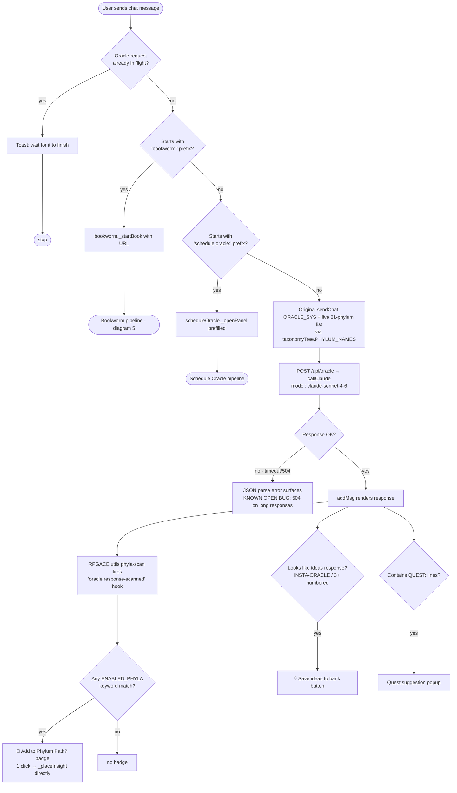

---

## 3. Phylum Path Insight Placement (the core taxonomy write path)

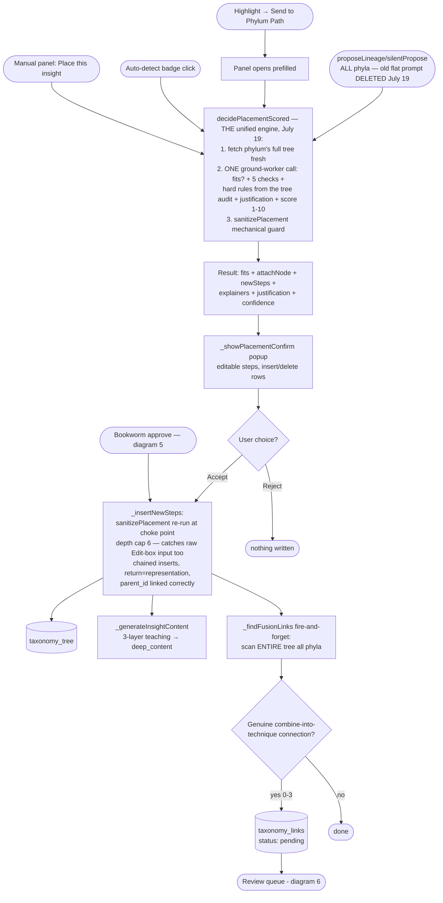

---

## 4. Article Generation + Concept Fusion


---

## 5. Bookworm (whole-book → taxonomy pipeline)

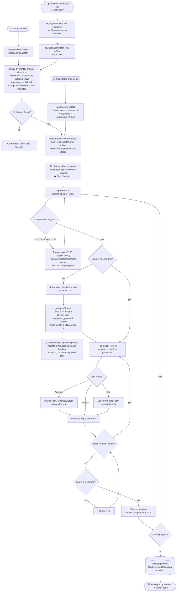

**Insight placement cascade inside `_analyzeChapter`** (per insight):

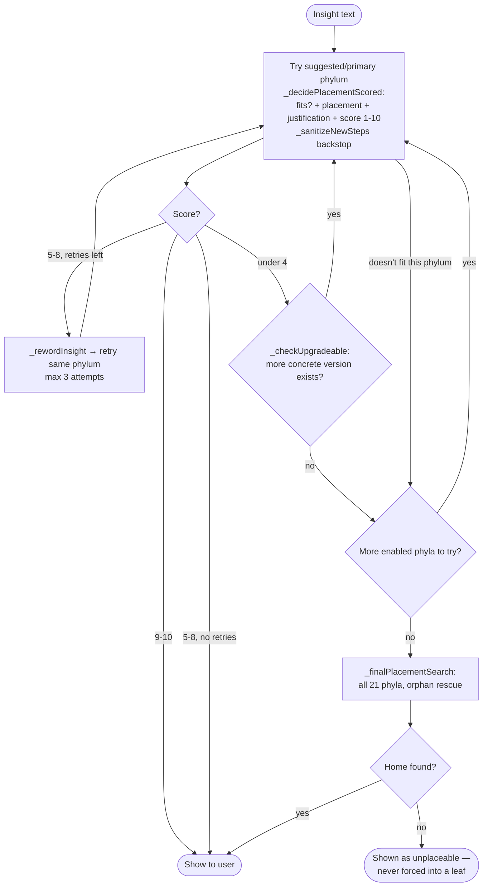

---

## 6. Review Queue (Dashboard — all pending taxonomy decisions)

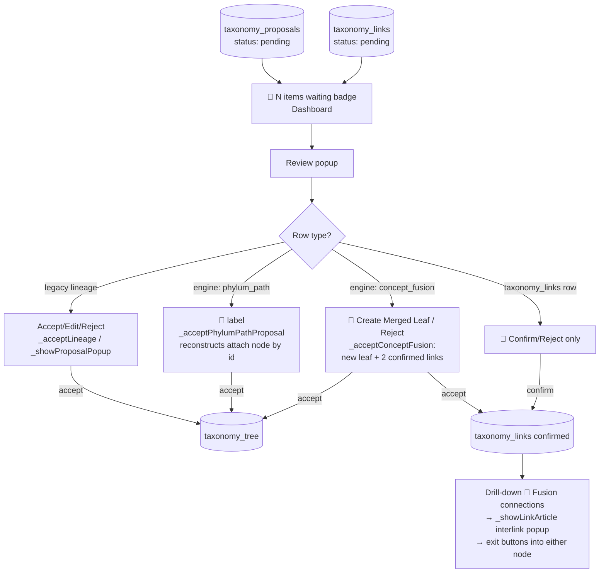

---

## 7. Content Intelligence & Schedule Oracle ingestion

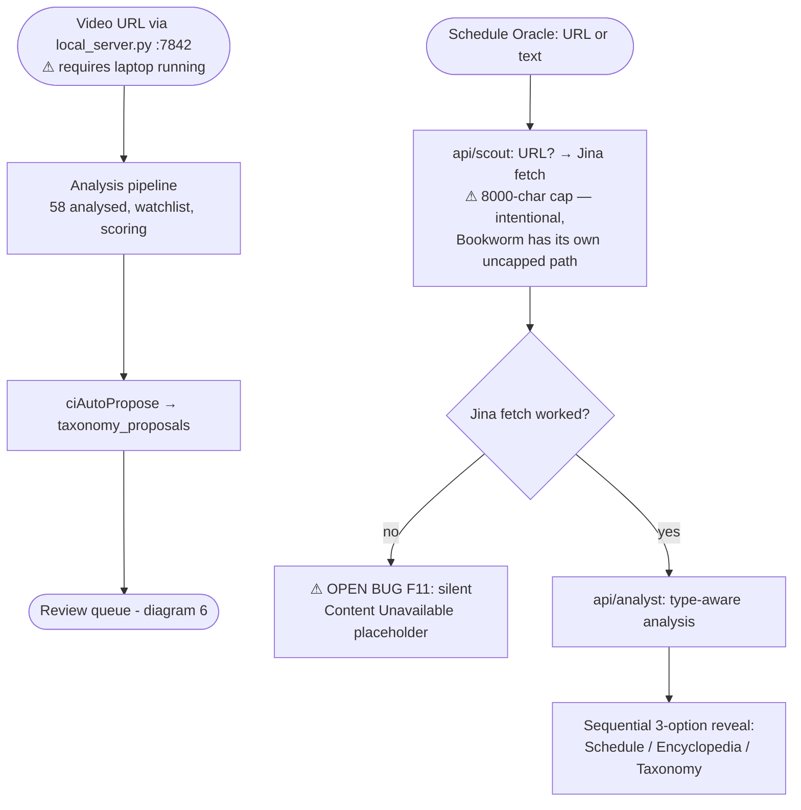

---

## 8. PLANNED features (dashed = not built) and where they attach

```mermaid
flowchart TD
    subgraph BUILT[Built today]
        BWPIPE[Bookworm pipeline]
        RVW[Per-insight review popups]
        TREE[(taxonomy_tree)]
        DP[decidePlacement]
        BK[(book_knowledge view<br/>July 22)]
        JE[(jargon_encyclopedia view<br/>July 22)]
        FALLBACK[Claude Code fallback lane<br/>built July 24 — real, unexercised<br/>see claude_fallback_build_plan_2026-07-24.txt]
        FBQ[(oracle_fallback_queue<br/>real table, created July 24)]
        MB2[RPGACE Fallback Drain Routine<br/>trig_01QxebLsiPMVksNSVjNECdbD, hourly]
    end

    subgraph PLANNED[Planned — attach points shown]
        CARDS[/"Live-study card list UI<br/>ConID-card pattern: per-chapter cards,<br/>edit title, status, context action.<br/>REPLACES the modal-per-step flow,<br/>calls the SAME _openBook/_renderInsightReview logic"/]
        DEBATE[/"/debate skill run on a real topic:<br/>Claude's general knowledge vs.<br/>a specific gathered tree insight —<br/>comparison only, never auto-writes"/]
        F12[/"Schedule Oracle Phase 2:<br/>carousel, two-tier session memory, auto-routing"/]
        PHYLA11[/"The REMAINING phyla through the<br/>7-step Development Framework:<br/>12, 13, 15-21. Phyla 11 + 14 cleared it<br/>July 30 and are live in ENABLED_PHYLA"/]
        EPUB[/"EPUB/other-format upload<br/>same _createBookFromExtraction path<br/>as PDF upload"/]
    end

    CARDS -.->|renders| BWPIPE
    CARDS -.->|reuses| RVW
    DP -.->|already shared by book + non-book, July 19| BWPIPE
    BK -.->|unnests, read-only| BWPIPE
    JE -.->|selects leaves, read-only| TREE
    DEBATE -.->|compares against, never writes| TREE
    PHYLA11 -.->|extends ENABLED_PHYLA| DP
    EPUB -.->|new entry point| BWPIPE
    F12 -.->|extends| SO2[Schedule Oracle]
    FALLBACK -->|catches credit-exhaustion errors from| GW[the 3 shared ground-worker functions<br/>_callExtractor/_callGroundWorkerJSON/_callGroundWorkerText]
    FALLBACK -->|queues into| FBQ
    FBQ -->|drained by| MB2
    MB2 -->|resumes via bookworm._resumeFromFallback /<br/>taxonomyTree._resumeSilentProposeFromFallback| BWPIPE
```

**Real, standing correction**: the "Taxonomy Sorting Agent" and "Claude general-knowledge audit" nodes do not appear in the PLANNED subgraph above — tracing the real call chain shows `decidePlacement` is already the one shared engine for book and non-book inputs (no separate agent is needed), and the general-knowledge audit is built around `/debate` (comparison only, gated behind an explicit human decision to ever write anything) rather than the original 3-part tree-seeding design. `book_knowledge` and `jargon_encyclopedia` — what the Sorting Agent was originally described as blocking — are both shipped, read-only Postgres views over data already written by the existing pipeline above.

**July 24 — Claude Code fallback lane, judged, confirmed, and built the same session.** Judged first via `/debate`+Council-of-5+`/5thDimension` (`openmontage_and_claude_fallback_spec_backlog_2026-07-24.txt`), then a real evidence pass + a second `/debate` on scope (`claude_fallback_build_plan_2026-07-24.txt`) before any code was written. Scoped honestly as an async/batch fallback for background AI jobs only (Bookworm chapter analysis fully wired; Content Intelligence's silent taxonomy proposals fully wired; both reuse the same 3 shared ground-worker functions per rule 3) — never a live-chat replacement, since Claude Code Remote's `create_trigger` has a real hourly-minimum interval. Reuses River IX's own already-built mechanism (a Routine reading a Supabase reservoir on its own clock, same shape as the real Morning Brief Routine) rather than inventing a new one. Moved from PLANNED to BUILT because the table, the code, and the Routine all now genuinely exist — moved here rather than left dashed, but honestly flagged as **not yet exercised against a real credit-exhaustion event** (forcing one on purpose would mean actually draining Alex's own Anthropic credits). A real pre-existing bug was found and fixed in the same pass: none of the 3 shared ground-worker functions ever checked for an API error before this — one of them (`_callGroundWorkerText`) used to silently return an empty string on ANY failure. OpenMontage, judged the same session, does NOT appear anywhere in this diagram — its verdict was adopt as a fully separate operated tool, never an RPGACE-embedded flow, so it has no attach point here at all.

---

## 9. The Chronicles (activity-log aggregation + finance ledger)

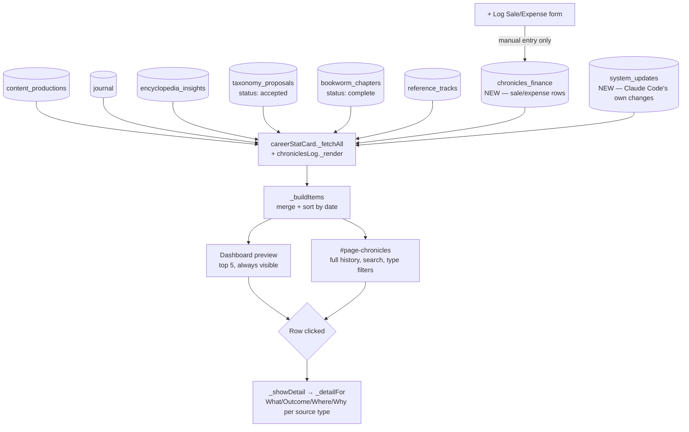

Real design choice, not an oversight: `chronicles_finance` feeds Chronicles' display but is deliberately **excluded** from the career-score XP/Level formula computed in the same `_fetchAll` pass — confirmed via interrogation this is a separate visibility lane. `bookworm_chapters` feeds the cumulative Growth *count* but is excluded from the streak/recent-activity date logic (its `created_at` is a bulk-insert timestamp from TOC detection, not real per-chapter completion time — would show a misleading date otherwise).

---

## 10. Built vs NOT built — the truth table

### Built AND verified working (hand-tested or confirmed live)
**This section's own original July 18-31 snapshot (phyla count, fusion-link/taxonomy row counts, Bookworm's first hand-tested chapter) is archived verbatim in `CLAUDE_archive.md`** — every number in it is stale relative to CLAUDE.md's own current Live-numbers line (all 21 of 21 phyla enabled; live `taxonomy_tree`/`taxonomy_links`/`taxonomy_proposals` row counts) and to `smoke_test.html`'s own current hand-test tally, both of which supersede it as the authoritative current source.
- Phylum Path, Concept Fusion, the taxonomy review queue with all 3 proposal types + fusion-link cards, Bookworm's streaming analysis + checkpoint/resume + placement-path sanitizer, TOC-paste and PDF-upload chapter detection, Grounded Oracle (no invented phyla) with a request cross-wiring guard, and Content Intelligence end-to-end (plus cross-device sync for shifts/agendas) are all real, shipped, and code-verified.
- Current per-feature hand-test confirmation status lives in `smoke_test.html`, not here; the original hand-test rounds and root-cause debugging arcs (including Bookworm's longest debugging arc, PDF-upload chapter detection) live in `patch_notes.html`'s own dated cards, cited from the archived version of this section.

### Built but NEVER verified — treat as unconfirmed, test before building on
**This section predates HABITS, the Galaxy Map's G13-G117 build-out, and everything shipped after this doc's own last full re-verification — treat it as a real historical record of what was known-unverified at each build's own time, not a live status feed.** For CURRENT hand-test status on any given feature, `smoke_test.html`'s own Supabase-backed, Alex-hand-confirmed tally is the authoritative source (see CLAUDE.md's "Hand-testing" open fork — 27 of 99 rows confirmed as of Aug 30, 70 still unverified). Full build narrative for everything below lives in `patch_notes.html`'s own dated cards — every one of these items already cites it there, this section never re-tells the story.

- **My Day (Oct 12 2026)**: routines, Plan my day, Quest Board template removed — headless-tested only, see §15e.
- **Cook Mode (Oct 11 2026)**: one-step-per-screen cooking, step rules, and the 8 proposed step splits — headless-tested only, see §15d.
- **Bookworm**: no book has ever completed the full pipeline start to finish (structure detection is solid on both entry points; a clean chapter run through the post-retune engine is the real remaining open test). `_looksLikeTableOfContents()`'s warning heuristic has never been observed catching a real mistake. Bibliography section render has nothing to show until a book completes.
- **F16 Beatstars listing / F17 video pipeline stages / F18 auto visual treatment / highlight-to-Phylum-Path button** — real, shipped, hand-test status tracked in `smoke_test.html` (also named in CLAUDE.md's own "F16/F17/F18 hand-test sweep" open fork).
- **The real July 20-25 build cluster** — left slide-out nav drawer, the Research Lab tab-content fix (superseded: Research Lab is now fully retired, not just fixed), the dashboard command deck rebuild, `book_knowledge`/`jargon_encyclopedia` views, the `/debate` skill, n8n rota sync (F10), Oracle self-awareness + the Claude Code bridge (`oracleAppGrounding`/`oracleFetchGuard`/`oracleDevBridge`/`taxonomy_decision_log`), a real nav-lag root-cause fix, PWA installability, the Career stat card + Chronicles rebuild, the `/scope` skill + `system_updates` table, `/5thDimension`, server-side API auth (now live and independently verified, see CLAUDE.md's Security note), a real Composio account-id dedup fix, Chronicles card-only + real pushState URLs + swipeable nav + `perfWatch`, every boot-time UI injector moving onto `RPGACE.registerBootTask`, and Approach B's write-proxy (now independently confirmed live via 8 real authenticated writes) — all real, all shipped.
- **The real July 26 - Aug 14 build cluster** — Oracle 504 streaming fix, the `renderMarkdown()` XSS fix, undersized-text fixes, `videoPipeline`/`morningBrief` dashDeck migrations, the Content Pipeline overseer (`style_profiles` now holds 3 real rows, see CLAUDE.md's Video/content pipeline section), the beat-matching root-cause fix (`reference_tracks.scale`/`genre` still 0/32 populated — the backfill popup exists, hasn't been run), local librosa audio analysis, voice input (since retired Aug 30, see CLAUDE.md), popup scaffolding consolidation, Phylum 11+14 built out (since superseded — all 21 phyla are now enabled, see CLAUDE.md's Taxonomy section), Video Pipeline Slice A, the `content_type` discriminator, the Video/Content Pipeline UX pass, the director picker + reply-truncation fix, `openmontage_jobs`' first real round-trip, the OpenMontage free-GPU investigation (since paused, superseded by a paid-provider search, see CLAUDE.md), Oracle architecture/anatomy grounding, the full Aug 5 8-phase Content/Video Pipeline unification (A-H), the Aug 6 bugfix/dev-tooling block, the Aug 11 `/CEO`-framework block, the Aug 11/12 minification + Grounded-Mode block, the Aug 13 Galaxy Map G1-G15 block, and the Aug 14 main.js/hooks detection-extension block — all real, all shipped, code-verified and live on `main`.

### Claimed/discussed but NOT built — do not trust any doc that implies otherwise
- Live-study **card-list UI** (ConID-card pattern for Bookworm chapters) — explicitly deferred
- Schedule Oracle Phase 2 (F12); Circles rabbit-hole nav (folded into Phase-2 vision); dedicated case-study/reference-tracks phylum; framework passes for the **remaining** phyla — see CLAUDE.md's Taxonomy section for the current, correct phylum-number mapping and which phyla still need the deep-hierarchy treatment
- ~~`hooks.on('rpgace:ready')` ~25-site audit~~ — **closed.** A real re-audit found the sites had already been fixed incidentally over time; a fresh grep confirms exactly **one** occurrence remains in `rpgace_core.js`, and it is `RPGACE.register()`'s own canonical module-init machinery — not a bug site. The underlying `hooks.fire()` behaviour (never revisits listeners added mid-fire) is still true and still worth knowing; there is no backlog attached to it.
- **Cut-precise beat-synced video generation** — genuinely not built and not close. The EDL/storyboard's scene timing is LLM-estimated; no beat-grid or onset detection exists anywhere in the stack. "In sync with the beat" today means mood/palette-matched. Real audio beat-grid sync is confirmed as a wanted future build (Slice C), unstarted.
- **Phylum 13's full browsable taxonomy tree** — the 50 real director profiles live in the flat `taxonomy_nodes` reference table (`source='f14_filmmaker_library'`), not as tree branches — see CLAUDE.md's Taxonomy section for the current phylum number.
- **Phylum XP Ledger** — spec'd (`phylum_xp_ledger_spec_backlog_2026-07-28.txt`), still not built. `questEngine` closed the real persistence gap this item used to cite (see CLAUDE.md's own superseding correction) — the real remaining open part is a dedicated phylum-tag architecture decision only Alex can settle.
- ~~Taxonomy Sorting Agent; Claude general-knowledge audit (3 parts)~~ — **resolved**, see the "Built but NEVER verified" section above (`book_knowledge`/`jargon_encyclopedia` views + the `/debate` skill).
- ~~Server-side API authentication; `CORRECT_PW` moved server-side~~ — **BUILT and live**, see CLAUDE.md's own Security note for the current, independently-verified state.
- ~~XSS/DOM-injection audit of `innerHTML` call sites~~ — **fixed**: `main.js`'s `renderMarkdown()` (behind every Oracle chat message) injected raw response text into `innerHTML` with zero escaping — fixed via a real `_escChatHtml()` step before the markdown regex chain runs. See CLAUDE.md.
- ~~Website performance audit~~ — a real static-code audit (file sizes, gzip sizes, load order, cache headers) plus the minification fix that followed from it are genuinely done. A live Lighthouse/PageSpeed run remains a confirmed-blocked path from this environment specifically (not transient — see CLAUDE.md's Known landmines).
- ~~RLS policy redesign~~ — **BUILT, confirmed end-to-end** — see "Built" above. 17 tables flipped from permissive `USING(true)` to real `anon_read_only`/`authenticated_all` policies, verified directly against `pg_policy`, then independently confirmed live via 8 real authenticated writes through the proxy.
- **Live-grounding for RLS/security status specifically** — deliberately not built (Supabase's advisor API isn't reachable from client-side browser JS; would need a dedicated server endpoint).
- ~~`system_flow_map.md` §0's own module inventory is stale~~ — **fixed**: §0's domain table is rebuilt from a real grep of every `RPGACE.register()` call, all modules listed by name and domain, not just counted — re-grep before trusting the count, it has gone stale more than once (see §0's own live-fact caveat).

### Known open bugs — see also §11
- ~~Oracle 504 on long responses~~ — **real fix built, confirmed live**: `api/oracle.js` proxies a genuine Anthropic SSE stream (opt-in via `stream:true`), `main.js`'s `callOracle()`/`sendChat()` consume it to progressively render the reply into the existing typing-indicator bubble, `maxDuration` raised to 300. A prior attempt shipped a client-only stub with no real server support and was reverted; that dead code (`RPGACE.streamOracle`/`restoreSendChat`) is deleted rather than left neutralised.
- F11 silent "Content Unavailable" on failed Jina fetches
- `_generateNodeContent` empty-deep_content mystery (partially resolved, never re-tested)

---

## 11. Content & Video Production Pipeline — RETIRED Oct 17 2026 (PC-6), kept below as history

**RETIRED (PC-6 of "Posting (Creator)", code deleted):** everything drawn in this section after the Beat Log save — Visual Treatment / Director Match, the 4-phase and 3-phase Production Panels, the retroactive loop, Generate Video / OpenMontage payload, Generate Captions, the OBS raw flow and the `videoPipeline` tracker — no longer exists in the app. Beats now run through §15i (Beats home) and posts through §15j (Posting home); the AI video hand-off is Posting's PC-2 path. The diagram is left as a record of the old design, not current state.


**Why this section exists:** this pipeline has been real and load-bearing since July 28 and was never drawn anywhere in this document until July 31. **Rebuilt Aug 5** after a real `/interrogation`-scoped 8-phase unification (`content_video_pipeline_unification_spec_2026-08-05.txt`, Phases A-F shipped, G-H not started) merged Beat Log / Content Pipeline / Video Pipeline into one real, chronological, looping flow — the previous diagram (a 3-phase Production Panel with no real retroactive path) was already stale the moment Phase D shipped. Per this doc's own rule — a feature isn't "done" until it moves out of the dashed/planned section into a real diagram — drawn now from real code (`rpgace_core.js`'s `beatLog`/`contentProductionLive`/`visualOracle`/`videoPipeline` modules) and a live Supabase schema read, not from a doc's claim.

**How to read this diagram — one real chronological loop, not a static map**: information enters at Beat Log (top), gets processed and transported through exactly 4 real Production Panel phases in order, and — this is the "on loop" part Alex asked to make explicit — **3 of those 4 phases can hand control straight back to an earlier real step** to regenerate output without losing any prior data (the retroactive edit-in-place mechanism, Phase E). The loop only exits forward once Phase 4 hands off to OpenMontage and a real job result (or a safe simulated one) comes back.

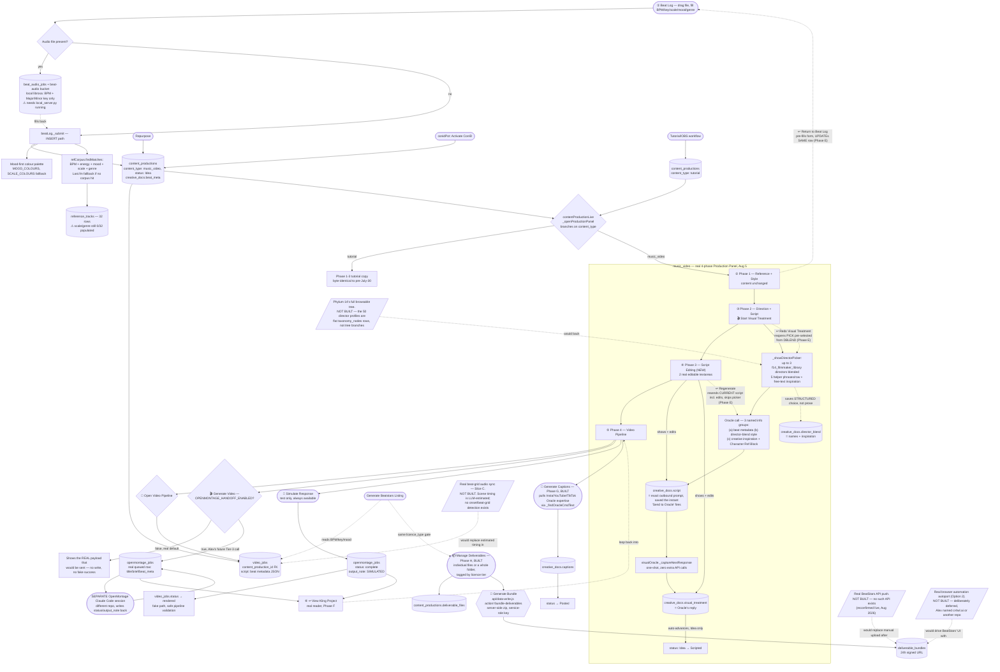

## 12. Oracle Mode — Real / Dummy / Fallback Scout (`mockOracle`)

Real, hand-written pipeline doc — G56 of the ratified "RPGACE Total Systems Galaxy Map" `/CEO` plan, Alex's own ask: "using md files to explain logic of many pipeline will also benefit galaxy map." Cross-linked from `graphify-out/galaxy_map_oversight_sync.html` and `galaxy_map.html`'s own External AI unit (the L0 unit panel originally lived on a separate `galaxy_map_l0.html` page; G67 folded it into `galaxy_map.html`, and the standalone page no longer exists).

```mermaid
flowchart TD
    CLICK([Alex clicks the pinned top-right<br/>Oracle Mode switch]) --> CYCLE{Cycle to next mode}
    CYCLE -->|Real| REALM[✅ Oracle API — every send is a live call]
    CYCLE -->|Dummy| DUMMYM[🧪 Dummy Oracle — synthetic labeled reply]
    CYCLE -->|Fallback Scout| SCOUTM[📥 Fallback Scout — queues instead of calling]

    SEND([Any real send-to-Oracle call site]) --> CHECK{callOracle checks<br/>mockOracle.getMode}
    CHECK -->|real| LIVEAPI[Real POST /api/oracle → callClaude]
    CHECK -->|dummy| FAKE["🧪 [MOCK ORACLE...] synthetic reply<br/>zero API cost, real DOM/hook/Supabase<br/>wiring still exercises downstream"]
    CHECK -->|fallback| QUEUE[_queueFallback:<br/>RPGACE.sb.secureWrite to oracle_fallback_queue<br/>context.type='scout_item']
    QUEUE --> DEDUP{Exact prompt-text already<br/>pending in scout_item rows?}
    DEDUP -->|yes| ACK1[Honest "already scouted" ack<br/>— no duplicate row]
    DEDUP -->|no| ROW[(oracle_fallback_queue<br/>status: pending)]
    ROW --> ACK2["Honest ack + real live queue depth<br/>e.g. '10 items waiting'"]

    DRAIN([Daily 'RPGACE Fallback Drain' Routine<br/>Claude Code Remote trigger, hourly-min]) --> ANSWER[Answers each pending row<br/>with the plain anon key]
    ANSWER --> ROW2[(oracle_fallback_queue<br/>status: answered)]
    ROW2 --> SWEEP{_checkFallbackAnswers<br/>sweep, every 5 min}
    SWEEP --> PARSE{resumeFallbackPlacement<br/>parses the answer}
    PARSE -->|success| RESUME[Real taxonomy placement<br/>resumed from where it stalled]
    PARSE -->|malformed JSON| STUCK[/"Row stays answered,<br/>resumed_at IS NULL forever —<br/>only a console.warn, no toast.<br/>NOT fixed, a known landmine"/]

    POPUP([📥 'Scouted, Now Answered' popup<br/>dashDeck._popup]) --> ROW3[(browses every scout_item row,<br/>pending AND answered)]
```

**Real, honest limits already known and tracked elsewhere** (not restated in full, rule 8): the whole Fallback lane has never been exercised against a real credit-exhaustion event; a malformed fallback answer leaves a row silently stuck (see CLAUDE.md's own landmines section for both).

---

## 13. Achiever / Brown — Stale-Claim Detection, Archival & Removal (G54)

Real, hand-written pipeline doc, written the same multi-day pass Achiever itself shipped (G54) — the freshest possible account of its own logic. Cross-linked from `achiever.html` and `future_integrations.html` (its mirror doc) directly.

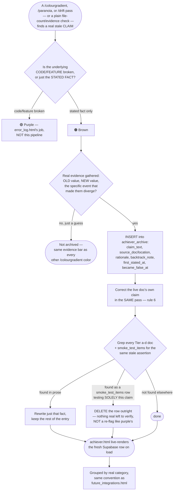

**Real, load-bearing distinction, worth restating even though it's the whole point of the pipeline**: brown is the PAST-tense mirror of `future_integrations.html`'s FUTURE-tense blue/red/yellow — opposite directions in time, never merged into one destination. A claim can be true-then-false without the feature it describes ever breaking (a river count going stale when a new river is added is not a regression in any functional sense) — that gap is exactly what this pipeline exists to catch, since nothing else in the project re-derives a summary fact from its own source data automatically.

---

## 14. Total-Systems Dispatch — `openmontage_jobs` / `graphify_jobs` Queues

Real, hand-written pipeline doc — the real, asynchronous cross-repo/cross-session handoff mechanism named "Total". Cross-linked from `graphify-out/galaxy_map_orchestrator_cc.html` / `graphify-out/galaxy_map_openmontage_cc.html` (G29, real Sep 15 2026 2-page split) and the L0 map's Orchestrator CC / External AI units.

```mermaid
flowchart TD
    subgraph RPGACECC["Orchestrator CC (this session)"]
        PLAN([A real video/render job,<br/>or a real graphify/mapping task,<br/>needs an external repo's own work]) --> WRITE
    end

    WRITE[INSERT a real, queued row —<br/>never a live call, no session-to-session<br/>link exists between separate<br/>Claude Code repos] --> OMQ[(openmontage_jobs<br/>status: queued)]
    WRITE --> GJQ[(graphify_jobs<br/>a separate dispatch channel,<br/>Graphify CC's own)]

    subgraph OMCC["OpenMontage CC (separate repo/session)"]
        OMQ --> PICKUP1{Picks up the row<br/>on its own schedule<br/>— no push, polled}
        PICKUP1 --> WORK1[Real setup, pipeline choice,<br/>real render attempt OR a real,<br/>honest loud failure]
        WORK1 --> RESULT1[UPDATE the SAME row:<br/>status, output_note,<br/>real findings]
    end

    subgraph GCC["Graphify CC (separate repo/session)"]
        GJQ --> PICKUP2{Picks up the row<br/>on its own schedule}
        PICKUP2 --> WORK2[Real graphify/Obsidian analysis<br/>— e.g. global cross-repo graph,<br/>GRAPH_TREE.html]
        WORK2 --> RESULT2{output_note flagged<br/>'FOR RPGACE CC: please log'?}
        RESULT2 -->|yes| LOGME[A real, explicit read-and-log<br/>request for this session]
        RESULT2 -->|no| HISTORY[Plain job history —<br/>read for context, not<br/>necessarily logged]
    end

    RESULT1 --> STARTCHECK
    LOGME --> STARTCHECK
    HISTORY --> STARTCHECK
    STARTCHECK([Session-start check, every session:<br/>query both tables for undrained rows<br/>— CLAUDE.md's own standing rule]) --> REPORT[G7/A13's own real reporting shape:<br/>a) output report, b) infrastructure<br/>knowledge, then /drift+/paranoia<br/>against the original real goal]
    REPORT --> ITERATE{Combined a+b picture<br/>shows the real goal<br/>fully met?}
    ITERATE -->|no, real gap| NEXTDISPATCH[Feed the gap into<br/>the next real dispatch]
    ITERATE -->|yes| CLOSED([Goal genuinely closed])
```

**Real, confirmed constraint stated plainly because it's the whole reason this pipeline exists**: no live session-to-session link exists between separate Claude Code sessions in separate repos — this Supabase-queue-and-poll shape is the ONLY real channel, proven three times independently before being named "Total" (`oracle_fallback_queue`, then `openmontage_jobs`, then this same pattern again for `graphify_jobs`).

---

**The real retroactive loop, spelled out** (the 3 dashed "↩" edges above are the actual "on loop until final product" mechanism, not decoration): Phase 1's button reopens Beat Log pre-filled and routes `beatLog._submit()` through a real UPDATE branch (`_retroTarget`) instead of a fresh INSERT — editing the SAME `content_productions`/`video_jobs` rows. Phase 2's button reopens the director picker pre-selected from the structured `creative_docs.director_blend` field (not a fragile parse of rendered prose). Phase 3's button resends whatever is CURRENTLY saved in `creative_docs.script` — including manual edits made right there in Phase 3 — straight back to Oracle, skipping the picker entirely. All three genuinely mutate the existing ConID in place; none ever branches into a second ConID. This is the real mechanism behind Alex's stated purpose: reuse a beat's existing creative record to regenerate new visuals for content repurposing, without starting from zero.

**Live state**: see CLAUDE.md's own Live-numbers line for the current `content_productions`/`video_jobs`/`style_profiles`/`reference_tracks` row counts — this doc doesn't restate them since they move independently of this diagram. `openmontage_jobs`' schema includes `title`/`brief`/`beat_meta`/`status`/`output_note`/`requested_by`. `creative_docs.script`/`.director_blend`, `content_productions.deliverable_files`/`.deliverable_bundles`, and the `beat-deliverables` bucket are all real, structurally-ready fields/storage backing the 4-phase flow and deliverable bundling described above.

**Honest limit, restated because it is the single most misreadable claim in this pipeline:** RPGACE does not generate video. It tracks, briefs, and hands off. OpenMontage stays an externally-operated tool, per CLAUDE.md's own standing verdict; Phase F's "Generate Video" builds and can send a real job payload, but the freeze flag defaults OFF pending Alex's own Tier-3 paid-provider decision, and the handoff view surfaces real data — it never simulates a real render as if it were genuine (the Simulate Response tool exists specifically so a fake result is always labeled `[SIMULATED]`, never silently indistinguishable from a real one).

---

## 15f. XP Season Pass (Oct 13-14 2026, XP-1..8) — built, untested by Alex

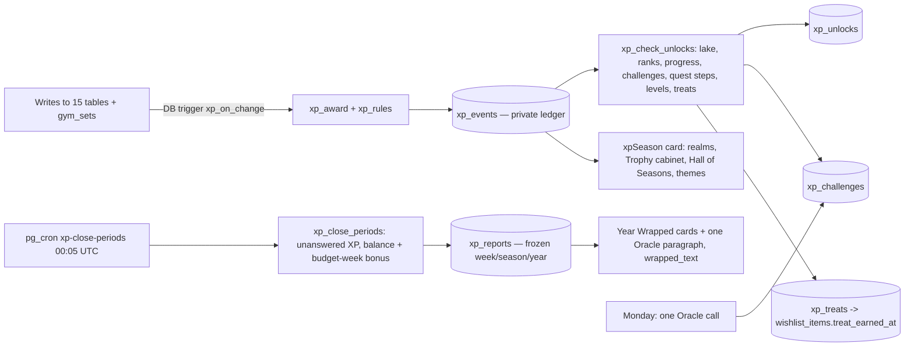

Only DB triggers write `xp_events`; the client never awards XP. Private tables (`xp_*`, `outreach_log`) are read through `/api/data-write` action `read`. Year Wrapped reads the frozen year report, never live rows; "Year so far" is the live version. Migrations: `records/2026-10/xp5..xp8_migration_*.sql`.

## 15e. My Day (Oct 12 2026) — built, untested by Alex

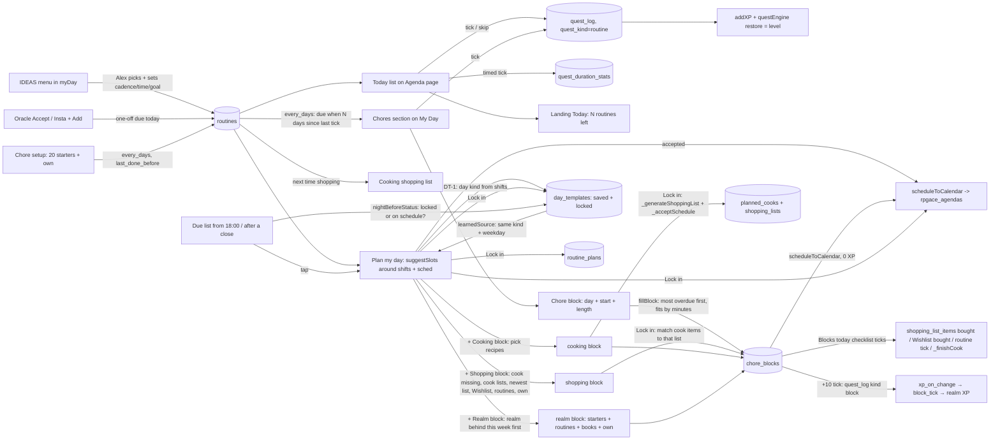

## 15l. Realms on everything (Realm Inputs RI-0..10 + Realm Connectors RC-0..4, Oct 15 2026) — built, untested by Alex

```mermaid
flowchart LR
  IN[Input: video link / book / screenshots / Library add / starred answer / web lookup] --> PICK[RPGACE.realmPicker: up to 4 realms, Not now holds]
  PICK -->|realms column| ROWS[(intel_jobs / bookworm_books / screenshots / library_items)]
  PICK -->|Not now = realms {}| HELD[held inputs: asked again after sign-in]
  ROWS --> LENS[realm_lenses.json lenses → Oracle reads through chosen realms]
  LENS --> REP[(intel_reports.realm_scores + insight realms)]
  REP --> Q[pathways quest → quest_log input_quest, category = realm]
  ROWS -->|library_items realms| XPIN[xp_on_input → input_taken XP split over realms]
  MAP[realm_lenses.json phyla: 29 phyla → 13 realms] --> PP[Phylum Path grouped by realm]
  MAP --> RO[RPGACE.realmOf phylum fallback → jargon + Library carry a realm]
  RO --> KN[realmKnowledge: accepted jargon + Library per realm]
  KN --> CARD[Realm card: Taken in · Knows · ✨ Suggest quests · 🏔️ milestone]
  CARD -->|Suggest quests: 1 Oracle call| Q
  CARD -->|Propose: 1 Oracle call, 3 ideas| MS[(xp_quest_steps source knowledge)]
  MS -->|counter reached: xp_quest_check| DONE[done]
  MS -->|hand tick: line + realm proof, guard trigger| DONE
  DONE --> XPM[xp_milestone_xp: 10/20/35% of rank gap] --> TITLE[3 per tier → title in xp_unlocks]
  XPS[(xp_events)] --> BRIEF[realmBrief: Morning Brief Today's realm + reports by realm]
```

Truth table: realm picker + held inputs, realm lenses for videos/books/screenshots, input XP, input quests, Today's realm, realm reports (RI-0..10); 29 phyla mapped to realms, Phylum Path by realm, Knows line + reading XP half Scholar, quest realm icons + From links + Suggest quests, knowledge-path milestones with proof by realm and tier titles (RC-0..4) — built, headless-verified (RC tests 6/11/6/11/17 plus DB rolled-back runs). Not built: auto-proposing milestones when a realm gains knowledge (Alex chose tap-only); counters for realms with no app counter (Homekeeper, Steward, Builder) — they tick by hand.

## 15k. Cooking reorganisation (CR-1..6, Oct 14 2026) — built, untested by Alex

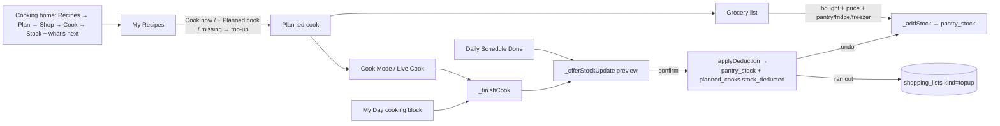

Truth table: bought → stock with location, finish → preview → deduct/undo, top-up list, journey hub, My Recipes, ← back to the previous Cooking screen, cross-links — built, headless-verified (38 checks). Cooking in servings other than the recipe's base on a planned cook — deducts base amounts (editable in the preview).

## 15j. Freeze recorder (PS-1/PS-2, Oct 14 2026) — built, untested by Alex

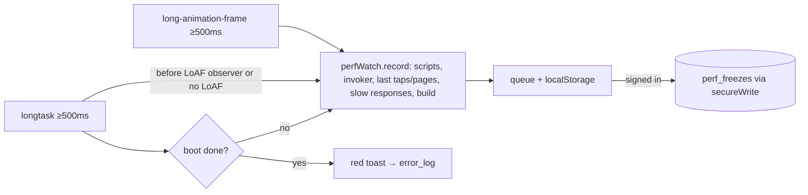

Truth table: recorder, boot-phase no-alert, sign-in-gated flush — built, headless-verified (13 checks). Splitting the 1.9MB script (the only real cut to the ~690ms load block) — not built.

## 15i. Health & body (HB-1..3, Oct 14 2026) — built, untested by Alex

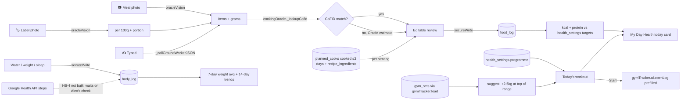

Truth table: photo/label/typed food logging with CoFID re-check, cooks per serving, targets, water/weight/sleep, trends, programme + overload + prefilled gym log, My Day card — built, headless-verified (42 checks), not hand-tested. Steps — not built (HB-4). `food_log`/`body_log`/`health_settings` are authenticated-only.

## 15h. Plans money, dates + people (TP-6/TP-7, Oct 14 2026) — built, untested by Alex

```mermaid
flowchart LR
  PT[(plan_tasks due_by)] -->|read, signed in| TD[tripPlans.logic.tripDue]
  PL[(plans: status, end_date, people, details)] --> TD
  PE[(people last_spoke)] --> TD
  TD -->|book-by within 7 days, hot on/after the day| DUE[Due list row] -->|tap| PV[Plan view]
  TD -->|ended ≤30 days, no trip_log| DUE
  TD -->|trip ≤14 days, person not spoken this week| DUE
  PV -->|tick money task: what did you pay?| MB{Amount?}
  MB -- amount --> CP[(plan_tasks.cost_paid + done)] --> FIN[(chronicles_finance expense, Travel)] --> XPE[expense_logged XP]
  MB -- Done, no cost --> CP
  PV -->|After-trip log| J[(journal source trip_log)] --> XPJ[journal_entry XP]
  PV -->|log saved| PD[(plans.details.trip_log, status done)]
  PD -->|Cook it at home| CO[cookingOracle._showGenerateForm prefilled]
  PV -->|Who's coming chips| PL
```

Truth table: book-by Due rows, highlight, pay prompt, single Travel expense, spent vs budget, after-trip log, Cook-at-home prefill, people chips, pre-trip people row, People tab upcoming plans — built, headless-verified (30 checks), not hand-tested. No messages are drafted; RPGACE still never books or pays.

## 15g. My Day Round 2 (Oct 14 2026) — built, untested by Alex

```mermaid
flowchart LR
  R[(routines: minimum, after_routine_id)] --> T[Today rows: zone dot, never-miss-twice, stacked waits]
  T -->|Did the minimum: half XP| QL[(quest_log)]
  QL --> RV[Sunday 18:00 review card + Due row] -->|Save| J[(journal weekly_review)] --> XP[xp_on_change journal_entry]
  SRC[(gym_sessions, planned_cooks, quest_log, content_productions, journal)] --> DS[Days since card]
  PE[(people via read)] --> DS -->|Talked today| PE
  CI[(cutback_items)] --> CUT[Cutting back + / − / None today] -->|upsert| CL[(cutback_log)]
  CL -->|pg_cron 00:10 xp_cutback_close| XPM[cutback_day → Mind XP]
  DS --> DT[doToday picks with reasons] --> MB[Morning Brief prompt]
  CRON[pg_cron hourly myday-push] --> EF[edge fn myday-push] -->|push_digest: 08:00 morning, Sun 18:00 review| PS[(push_subscriptions)] --> PH[phone] -->|tap| OPEN[/?open=myday]
  SH[Screenshot kind rota] -->|Import shifts: fromRotaJson| SS[shiftSync.replaceDates] --> RS[(rpgace_shifts)]
```

`cutback_*`, `push_subscriptions`, `push_log` are locked (authenticated only); `app_secrets` has no policies (service role only). Truth table: habit design, weekly review, days since, cut-back counters, ideas round 2, Morning Brief picks, push alerts and rota screenshot import are BUILT (headless-verified; push send verified live to a throwaway endpoint), not hand-tested.

`routines` is `anon_read_only`/`authenticated_all` and in `api/data-write.js`'s allowlist. Timers and sub-step ticks are per-device (localStorage). The old `QUESTS` template is empty; `questEngine`'s generated quests are unchanged.

## 15i. Beats home (Oct 16 2026, BT-0 of "Beats (Producer)") — built, untested by Alex
```mermaid
flowchart LR
  menu["Left menu: Content & Video → 🥁 Beats"] --> hub["beatsHub /beats"]
  pop["Content Pipeline pop-up → 🥁 Beats home"] --> hub
  cp[(conid_pot potential)] --> hub
  pr[(content_productions music_video)] --> hub
  ag[(rpgace_agendas doing_now + producer)] --> hub
  fin[(chronicles_finance sale)] --> hub
  hub --> ib["Idea Bank page"] & bl["Beat Log page"] & my["My beats (ConID list)"] & mw["MusicWorm = reference tracks"] & dn["Doing Now start"]
  ib & bl & my & mw -->|"← Back / 🏠 Beats (areaNav 'beats')"| hub
```
Truth table: Beats home with 6 steps (Idea → Make → Mix → Log → Release → Sell), live counts, what's next, Back/🏠 on Idea Bank / Beat Log / My beats and on MusicWorm when opened from Beats — BUILT (headless-verified). BT-1: ▶ Start making on an idea (Idea Bank row or Beats home picker) → `beatsHub.logic.startMaking` → Doing Now session "Making: …" (Producer, `details.kind='beat'`, `stage='make'`, `link={kind:'conid_pot',id}`) + `conid_pot.status='making'` (badge + Making filter) — BUILT. BT-2: making + mixing sessions (`details.stage` make|mix) per idea; `beatsHub.logic.times` sums minutes per `conid_pot` id (time line on Idea Bank cards, Make/Mix step lists); stopping a making session fires `doingnow:finished` → "Ready to mix?" (start mixing now / mix later → `details.ready_to_mix` / not yet); Keep making / Start mixing on Idea Bank cards and Beats home pickers; a Producer session started from Doing Now asks "Which beat?"; running beat sessions show 🥁 Beats — BUILT. BT-3: Beat Log saves the beat already finished (`content_productions.finished_at` on insert + `stems_drive`/`stems_folder`/`stems` jsonb, `idea_id` + `making_mins`/`mixing_mins` from the idea's sessions); drive + folder required, drive prefilled from the last logged beat, stems = fixed list (Full mix WAV, Drums, 808/Bass, Melody, Chords, FX, Vocals) + add; the idea → `conid_pot.status='done'`; `xp_on_change` INSERT branch now also pays `beat_finished` when `finished_at` is set; `RPGACE.realmOf` reads music_video rows as Producer; 🥁 Log this beat (Idea Bank) / Log a finished beat (Beats home) open Beat Log filled from the idea — BUILT. BT-4: Beat Log's 🎧 Scan audio decodes the picked file on the device (`beatLog.logic.analyseFile`: decodeAudioData → OfflineAudioContext middle 60 s at 22050 Hz mono → `_analyseSamples`: FFT spectral-flux onset curve + autocorrelation for BPM folded to 70-180, chroma + Krumhansl-Kessler profiles for key/Major-Minor) → fills BPM/Key/Scale (editable, ½×/2×); no upload; the old `beat-audio` bucket upload + `beat_audio_jobs` polling are removed (10 queued rows set `retired`); `pathways.logic.loadBeats` (About a beat) and `xpSeason.logic.MS_PROOF.beat` read finished `content_productions` music_video rows instead — BUILT. BT-5: release = `content_productions.release_links` jsonb ([{place,url,added_at}], old `release_url` rows backfilled); `beatsHub.logic.releaseUpdate` (pure) validates http links, skips duplicates, sets `released_at` only on the first release (trigger pays beat_released once), keeps `release_url` = the Beatstars link (else first) as the listing; `ui.openRelease` (Beats home Release step / What's next / My beats card `🚀 Beat released` + `+ link`) then offers 🎬 Make a video (Production Panel) / 💰 Beatstars listing text — BUILT. BT-6: Reference tracks 🔎 Look up missing → next 8 `reference_tracks` with scale or genre null and `lookup_at` null → one `/api/search` type web call (Gemini, via `tripPlans.logic.webSearch`) asking one `n | key | Major/Minor | BPM | genre` line per song → `refCorpus.logic.parseLookup`/`normKey` (flats → sharps) → review list (his values kept, gaps filled, "found:" where the web disagrees) → Accept writes the row + `lookup_at`, Skip writes only `lookup_at`; a track added without scale/genre opens the same look-up for itself — BUILT. BT-8: Sell = `beatsHub.ui.openSell` (Beats home Sell step / picker, My beats `💰 Sell` on every beat, release hand-off): licence tiers `content_productions.licence_tiers` [{name, price}] (new beat starts from the last saved tiers; `price` = cheapest), 🎧 Beatstars listing text (existing generator), 💷 Log a sale → `chronicles_finance` type sale + `content_production_id` (trigger: Hustler XP 2/£, min 100), per-beat sales count/total; the Phase H deliverable-zip system is retired (client helpers + `data-write` `bundle-deliverables` branch removed; `deliverable_*` columns kept, bucket empty); Hustler milestone proof = a logged sale — BUILT. BT-7: menu = Beats with Idea Bank / Beat Log / My beats / Reference tracks (via `beatsHub.ui.go('refs')`) under it, Content Pipeline keeps Upload Workshop; `beatsHub.ui.openBeat(id)` (My beats card `data-cp-id` highlighted, else its Sell pop-up) is reached from a done idea's 🥁 Open beat and a linked sale's 🥁 Open this beat in Chronicles; Reference tracks' hand-edit Backfill popup and Beat Log's Licence Type field removed; phone-width (400px) check of Beats home + Sell/Release/Make pop-ups; Galaxy Map regenerated — BUILT. Plan Beats (Producer) BT-0..8 all built; every item yellow until Alex hand-tests.

Oracle → journal (Oct 16 2026): 📓 Save as entry under an Oracle reply → `oracleEntry` review card (split write-ups, title/date/text/realms) → journal entry (`journal.realms`, `journal.big_day`, source `oracle_entry` → journal_entry XP + ⭐ big_day 50 split) or realm mission (Doing Now just-did → 30 split) — BUILT. Oracle itself never writes or awards XP (ORACLE_SYS rule).

## 15h. Doing Now (Oct 16 2026, DN-0/DN-1) — built, untested by Alex

```mermaid
flowchart LR
  BTN[My Day ▶ Doing now] --> RP[realmPicker activity] --> STC[scheduleToCalendar started_at, realms] --> AG[(rpgace_agendas source_type doing_now)]
  JD[✓ I just did… name + minutes] --> RP2[realmPicker] --> STC2[scheduleToCalendar completed, back-dated] --> AG
  AG --> CARD[My Day card + dashboard Today 'Doing:' row]
  CARD -->|+ note| AG
  CARD -->|■ Stop: how + mood, + more details| FIN[doingNow.logic.finish] --> AG
  FIN -->|who with| PE[(people.last_spoke)]
  FIN -->|money| CF[(chronicles_finance expense)]
  FIN -->|photo| SI[screenshotInbox upload proof]
  OTHER[other device] -->|logic.sync on boot / My Day| AG
  MK[logic.matchKind name] -->|cook| CRN[cookingOracle.ui.cookRecipeNow agendaId] --> ACT[Actual cook: planned_cooks.agenda_id = this entry] --> LF[logic.linkFinish] --> AG
  MK -->|gym| GL[gymTracker.ui.openLog today's workout, minutes] --> LF
  CHK[boot / My Day / back to app: ui.check] --> OV[logic.overdue] -->|3h+| ASK[Still doing it? Yes / I stopped at… / Discard] --> AG
  OV -->|4h past last answer| AS[auto-stop at the 4h mark] --> AG --> FIX[My Day: Fix time] --> FIN
  XE[(xp_events via xpSeason.load)] --> ID[logic.ideas: quietest realms] --> RA[myDay.REALM_ACTIVITIES] --> IB[✨ Try something new buttons] -->|one tap, realm preset| STC
```

Truth table: start, note, stop (short + more details), just-did, cross-device running card, quiet-realm ideas (DN-1b), forgot-to-stop catch + 4h cap (DN-2), cook/gym matching (DN-3), repeats → routine offer + template fill (DN-4), XP (DN-5, DB trigger), Chronicles entries by realm + Sunday review block (DN-6) are BUILT (headless/DB-verified), not hand-tested. The Doing Now plan is fully built.

## 15j. Posting home (Oct 17 2026, "Posting (Creator)" PC-0..7) — built, untested by Alex
```mermaid
flowchart LR
  menu["Left menu: Content & Video → 📣 Posting"] --> hub["postingHub /posting"]
  pop["Content Pipeline pop-up → 📣 Posting"] --> hub
  new["＋ New post: title + type → realm picker"] -->|"secureWrite insert"| posts[(posts — private)]
  posts -->|"data-write action read"| hub
  hub -->|"next-step buttons (PC-2..4 not built: toast says so)"| soon["Plan / Record / Edit / Post"]
```
Truth table: Posting home with 6 steps (Idea → Plan → Record → Edit → Post → Results "coming later"), counts per `posts.stage`, posted this week, what's next (editing → recording → planned → idea, newest first, 5 max), ＋ New post (title + kind beat_video/tutorial/clip/studio_life + realms, Creator default) — BUILT (headless-verified). `posts` is locked (`authenticated_all` only), in `api/data-write.js`'s allowlist and `PRIVATE_READ_TABLES`; `RPGACE.realmOf('posts')` = creator. PC-1: `conid_pot.kind` beat|post (default beat, CHECK) + `post_type`; Idea Bank save pop-up and the card tag (retag pop-up) share `postingHub.ui.kindChooser`; filters 🥁 Beats / 📣 Posts; ▶ Start making only on beat ideas, ▶ Plan a post only on potential post ideas → `postingHub.logic.fromIdea` (one post per idea, kind from post_type, stage idea) + `conid_pot.status='in_post'` (📣 In Posting badge); Beats' idea reads add `kind=neq.post`; Posting's Idea step counts potential post ideas and 💡 Post ideas opens Idea Bank filtered with Posting's Back row — BUILT. PC-2: 📝 Plan it / tapping a post title → `postingHub.ui.openPlan` (hook, script, shots per `logic.STARTERS`; 🔮 Draft = one `_callGroundWorkerJSON` (700 tokens) filling the boxes only, a second tap needed to overwrite; platforms Instagram/YouTube/TikTok + ✍️ Write captions = one call (600) → `cleanCaptions` keeps ticked platforms; beat videos: beat select from `content_productions` music_video + 🤖 hand-off → `openmontage_jobs` insert (return=representation) → `posts.plan.handoff.job_id`, status line); 💾 Save / ✅ Plan done → `logic.planUpdate` (done needs hook or script + a platform; idea→planned, `planned_at` once) → `xp_on_change` posts branch pays `treatment_done` (label Post planned, 60 Creator) once — BUILT. PC-3: 🎥 Record it / ▶ Keep recording / ✂️ Edit it / Keep editing → `postingHub.logic.startSession(post, 'record'|'edit')` → `doingNow.logic.start('Recording|Editing: '+title, post.realms)` + `details {kind:'post', stage, link {kind:'posts', id}}` + `posts.stage` (`logic.stageFor`); `doingnow:finished` → `logic.addTime` (minutes → `record_mins`/`edit_mins`, `details.counted` so never twice) → record: `ui.askRecordDone` (edit now / later → stage editing / not yet); edit: `ui.askReadyToPost` (video file name + place → `posts.files.video`, `ready_at`); what's next ranks ready first (📣 Post it); Doing Now `openStart` with Creator → `ui.offerPost` (Which post?), running card 📣 Posting, `loadLinks` lists posts; plan screen files: 🎬 video + 🥁 beat (prefilled by `logic.beatFile` from `creative_docs.beat_meta.wavFile` + `stems_drive`/`stems_folder`); Beat Log `#bl-wav` (WAV file name, kept in beat_meta) — BUILT. PC-4: 📣 Post it (ready post) / + link (Post step's recent posted) → `ui.openPost(post, preset?)` (one row per planned platform not yet linked; `LINK_PLACES` YouTube/Instagram/TikTok/DistroKid/Other; `logic.placeOf` = `beatsHub.logic.placeOf`, which now knows DistroKid/HyperFollow) → `logic.savePost` → `postUpdate` (full http links, no repeats; first link → `posted_at` + stage posted) → `secureWrite posts` → idea `conid_pot.status='posted'` → beat video: `beatsHub.logic.release(beat, links)` (beat released first time); `xp_on_change` posts branch pays `video_posted` (300 Creator) once on `posted_at`; Oracle chat: `logic.patchChat` wraps `window.sendChat` (`_postingLinkPatched`), `chatLinks` finds those places in the typed message → `ui.offerLinkSave` (Save this link to a post? → `openPost` prefilled); BT-5 🎬 Make a video → `logic.fromBeat` (one open beat-video post per beat) → `openPlan` — BUILT. PC-5: ⚙️ target → `logic.saveTarget` → `xp_settings.posts_per_week` (0-14, CHECK; read via data-write `read`); `logic.weekStatus` (Mon-Sun local week of `posted_at`) → `weekLine` on Posting home (`#ph-week`) and My Day (`ui.myDayLine`, after the health card); `logic.loadDue` → `due` (behind from Thursday, hot Sat/Sun; planned ≥7 days; ready ≥2 days) → `dashDeck` Due list rows (open Posting / next step / Post it) — BUILT. Results — NOT BUILT (later plan; Alex: "results and stats would be awesome"). PC-6: old video tools retired and deleted (see §11's RETIRED note); Content Pipeline pop-up = Beats home / Posting / Idea Bank / Beat Log / My beats; My beats = beats only; Creator proof + Creator badges count `posts.posted_at` — BUILT. PC-7: `careerStatCard.logic._fetchAll` reads posted `posts` (via `tripPlans.logic.read`, slot 19) + their ideas' `conid_pot` rows → one `type:'post'` Chronicles item each (`postingHub.logic.chronicleLabel`, Beats & content section), finished Doing Now rows linked to a posted post are folded into it; the detail = `postingHub.logic.report(post, doing, idea)` (Idea / Plan / Record / Edit / Ready / Posted / Totals with dates, `logic.gap` durations, each session's minutes, clickable links) + 📣 Open this post / 🥁 Open beat; My beats cards show 📣 Video post (✓ when posted; plan or Post it screen); a beat video's plan screen has 🥁 Open beat (`beatsHub.ui.openBeat`) — BUILT.

## 15ae. Day Log & Live Now (Oct 28 2026, DL-1..7) — built, untested by Alex

```mermaid
flowchart LR
  LN[▶ Live now\nrealmTasks.ui._drawLive] -->|Start, no block| E[rpgace_agendas doing_now\ndetails.task_id]
  LN -->|Done| Q[quest_log tick\ntask XP once]
  LN -->|Done| E2[entry closed: ended_at, actual_mins]
  JD[✓ I just did\nsolveTimes] --> E
  E --> TL[My Day timeline\nmyDay.logic.didItems]
  CK[Cook Mode / Chef task / typed cook] -->|cook:finished| AD[afterDone]
  Q --> AD
  AD --> NX[next_due_at on chained tasks\n⏭ Next / ⏭ Due]
  NX -->|Skip + reason| SK[quest_log followup skipped]
  SK --> EV[Evening review]
  HB[🧹 Homekeeper block\nchore_blocks realm homekeeper] --> LN
```

| Claim | Truth |
|---|---|
| A task done in Live now with no block shows on the timeline | ✅ `freeStart`/`freeDone` write a timed doing_now entry |
| XP is paid once | ✅ `xp_on_doing_now` skips entries with `details.task_id`; the task tick pays |
| Doing Now has its own screen | ❌ its buttons open ▶ Live now (store kept) |
| "Did this replace your block?" is asked from the new I just did | ❌ only on the typed Doing Now path (`openTypedDid`) |

## 15ad. Generic Missions (Oct 27-28 2026, GM-1..9) — built, untested by Alex

```mermaid
flowchart LR
  V[Video quest\nrealm_tasks_from_report] --> IN[realm_tasks inbox]
  IN -->|open 📥 New tasks\nfileInbox, cheap model| CARD[mission_contexts card]
  IN -->|nothing fits| NM[new mission\nfor review]
  M[Mission\nrealm_tasks + context_kind] --> PB[📋 Plan block\nmyDay.ui.pickContext]
  CARD --> PB
  PB -->|recipe: ✨ Generate| CO[cookingOracle._generate → _save\nplanMissionCook]
  CO --> PC[planned_cooks + grocery list\nchore_blocks.planned_cook_id]
  PB -->|combo / reference / post| SRC[CONTEXT_SOURCES\nexerciseLibrary.pickCombo, sourceItems]
  PB --> BI[chore_blocks.items\ncontext, context_id, recipe_id, xp]
  BI --> LN[▶ Live now\n🎯 context + Open]
  LN -->|✅ Done| QL[quest_log block tick\nmission's own XP]
  LN --> TD[card times_done +1]
```

| Claim | Truth |
|---|---|
| The inbox for Chef/Athlete/Producer/Creator shows only missions | ✅ `realmTasks.logic.fileInbox` files specific video tasks as cards (status `filed`, `dup_of`) |
| Context is chosen when planning a block | ✅ `myDay.ui.pickContext` from Plan block; Decide later allowed |
| A Chef recipe becomes the block's cook without a second Schedule entry | ✅ `planMissionCook` links `planned_cooks.agenda_id` to the block's own agenda |
| A mission pays its own fixed XP | ✅ since GM-8, block items keep `earns`/`xp`; older blocks are corrected on Done |
| The other 9 realms have missions | ❌ plan "Missions Across Realms" (MR-1..6), drafted |

## 15ac. Day & Habits Rewire (Oct 27 2026, DR-1..12) — built, untested by Alex

```mermaid
flowchart LR
  qe[questEngine.refresh] -->|logic.toTasks / liveTask| rt[(realm_tasks — private)]
  rt -->|cadence = Action| md[myDay.logic.loadTaskActions → My Day]
  md -->|＋ Add from realms| pick[openRealmPicker → placeNext / addToBlock]
  rt -->|tick outside a block| ql[(quest_log ledger)] -->|xp_on_change| xp[(xp_events: task's realm)]
  ev[eventMemories.addEvent] --> mem[(memories — private)] -->|How was it? remember| ql
  cal[📅 Calendar: Week / Month / Shifts] -->|tap a day| od[scheduleFixes.ui.openDay → My Day on that date]
  gym[🏋️ Gym card] --> gp[#gym-plan: healthBody.ui.renderGym] & exl[exerciseLibrary: library, combos, video review]
  exl -->|extract: cheap model, Alex keeps| ex[(exercises)]
  exl -->|Add combo| rt
  ideas[💡 Ideas: ideasDoor] -->|reads| cp[(conid_pot)] & pl[(plans status idea)] & rt
```
Truth table: no open quests (quest_log = done-ledger), Actions = realm tasks with a cadence, Add from realms picker, one-off events → memories, Calendar without a Daily tab, one Gym page, one Ideas door, exercise library with review and combo coverage — BUILT, headless-tested (dr1 12/12, dr5 13/13, dr67 12/12, dr89 7/7, dr10 8/8, dr12 14/14). Real cheap-model read of Alex's 2 Athlete videos — NOT yet run. Gym log exercise picker suggesting from the library — NOT built. Hand-tested by Alex — none yet.

## 15ab. My Day timeline (Oct 21 2026, MDX-0..7) — built

```mermaid
flowchart LR
  S[segments: shifts, travel, Schedule tasks, blocks, bookends] --> V[dayView / weekView / Schedule timeline]
  V -->|hold + drag| D[clampDrag + dragLimits] --> C{block?}
  C -->|yes| CD[commitDrag -> guard push rule -> resizeBlock] --> U[Undo bar]
  C -->|Schedule task| CI[commitItemDrag -> moveItem] --> U
  V -->|tap| SH[blockSheet: Start / Did you do it? / Start now / reorder]
  T[＋ Add from realms picker — replaced the tray, DR-7] -->|tap| P[placeNext → placeFromTray / addToBlock]
  V -->|🌅 / 🌙 pins| MB[openMorning + Brief] & EV[openEvening + night tasks]
```

## 15aa. One Morning Brief (Oct 21 2026, CC-3) — built

```mermaid
flowchart LR
  T[05:39 UK CC task] --> G[morning_brief_cc.py gather: public tables] --> W[CC writes brief] --> S[save: one journal row, checked] --> J[(journal morning-routine)]
  J --> P[push notification]
  J --> A[morningBrief panel + live inbox/YouTube]
  A -->|no brief today| B{🤖?}
  B -->|yes| BTN[Write it now button -> _generateApi]
  B -->|no| API[_generateApi]
```

## 15z. App prompts via Orchestrator CC (Oct 21 2026, CC-2) — built

```mermaid
flowchart LR
  A[chapter read / weekly picker / Wrapped] --> Q{orchestratorCC.queue: 🤖?}
  Q -->|no| API[normal API call]
  Q -->|yes| F[(oracle_fallback_queue pending, cc)] --> W[CC task: worker job/answer] --> AN[(answered)]
  AN --> S[phylumPath._checkFallbackAnswers -> resumeRow -> type.apply]
  F -->|pending > 12h| ST[sweepStale -> runApi]
```

## 15y. Videos via Orchestrator CC (Oct 21 2026, CC-1 + CC-4) — built: 2-hourly CC task at :05 (max 5 per run), 12h API fallback

```mermaid
flowchart LR
  Q[(intel_jobs queued)] --> R{runner: mode cc and not use_api?}
  R -->|no| P[process_url: Sonnet API] --> IR[(intel_reports)]
  R -->|yes| PR[prepare_for_cc: download, Whisper, frames] --> B[(bucket intel-cc)] & W[(intel_jobs awaiting_cc)]
  W --> CC[intel_cc_worker fetch: TASK.md] --> A[CC session writes answer.json] --> F[finish: parse_insights quote check + push_report] --> IR
  W -->|older than 12h| FB[fallback_requeue: queued, use_api] --> Q
```

## 15x. Background analysis switch (Oct 21 2026, CC-0 of "Orchestrator CC Analysis") — built, nothing routed yet

```mermaid
flowchart LR
  A[⚙ dev-status cluster 🤖/💳 row] -->|secureWrite| B[(app_settings background_analysis)]
  B -->|sb.select| C[orchestratorCC.logic.mode]
  C -.planned CC-1..4.-> D[videos / chapters / brief / challenges / Wrapped]
  C -.planned CC-4.-> E[2-hourly CC task, API after 12h]
```

## 15w. Oracle Professor Mode — map, planner, gather, condense, answer, routing (Oct 21 2026, OP-1..5 — plan complete) — built, not yet wired into chat

```mermaid
flowchart LR
  q[question] --> pre{needsPlan? free small-talk check}
  pre -->|no| none[empty plan, no call]
  pre -->|yes| ppl[loadPeople: people names, signed-in read]
  ppl --> hk[Haiku planner: question + map of 31 sources + ~38 SELF_KNOWLEDGE sections]
  hk -->|JSON| clean[cleanPlan: real keys/sections only, max 4+4]
  hk -.->|error| fb[fallbackPlan: free keyword match]
  clean --> san[sanitizeTopic: strip names/places/numbers/dates/I-my]
  san --> plan[(plan: deep, sources, sections, topic)]
  fb --> plan
  plan --> gather[gather: fetchSource x4 + sections + censored topic, 20s each]
  gather --> lib{Library has it?}
  lib -->|yes| ev[(evidence: data, notes, web, errors)]
  lib -->|no| gem[/api/search web: topic only/] --> save[library_items web_lookup] --> ev
  ev --> sz{over 3000 chars?}
  sz -->|no| brief[(tagged brief)]
  sz -->|yes| cond[Haiku: tagged bullet brief, 700 tok] --> brief
  cond -.->|fails/empty| raw[raw evidence, trimmed + reason] --> brief
  brief --> opus[Opus 5.5 stream, effort medium, PROF_SYSTEM]
  opus -.->|model refused| son[Sonnet 4.6, flagged]
  opus --> ui[reply bubble + 🔎 How I know]
  son --> ui
  q2[chat 'prof:' prefix] --> q
  m[any chat message] --> own{owned elsewhere? prefix, link, trip, recipe, action}
  own -->|yes| normal[normal reply, unchanged]
  own -->|no| rt{route: small talk / short = free; else Haiku plan}
  rt -->|deep| q
  rt -->|quick| secs[normal reply + only picked app-note sections]
  ui --> cost[≈ cost line]
```

Truth: built — the map, planner, strict topic check, the 11 new Ask-my-data sources (one read path `fetchSource`) gather (OP-2), condense (OP-3) the Opus answer (OP-4) and automatic routing + cost line (OP-5). Not built — a running monthly total; analysis falling back to Orchestrator CC (idea logged, not scoped). 21 + 11 + 12 + 19 + 15 headless checks; untested by Alex (nothing visible yet).

## 15v. Videoworm: one analyser (Oct 20 2026, plan "Videoworm realm extraction" VW-0) — built, untested by Alex

```mermaid
flowchart LR
  gh[(GitHub main: local_server/*.py, intel_common.py, realm_lenses.json)] -->|start_server.bat: git pull before every start| lap[laptop local_server.py]
  gh -->|Actions every 10 min| cloud[intel_cloud_runner.py]
  lap & cloud -->|claim_body: status=eq.queued only, started_at, taken_by| jobs[(intel_jobs)]
  lap & cloud -->|stuck_query > 2 h → queued| jobs
  lap & cloud --> ri[rpgace_intel.process_url] -->|analyser_version| rep[(intel_reports)]
  rep --> vs[videoSummary: ⚠ older analyser label]
```
Truth table: shared version/claim/stuck helpers, one-runner-per-job claim, laptop self-update, realm file found on the laptop, version on every new report, older-report label — BUILT (Python tests + headless label test). Needs Alex: one-time Git install + clone to %USERPROFILE%\\RPGACE-code (done Oct 20), start from there; spare-account cookies in the YT_COOKIES secret. VW-1 (read all of it): Whisper segments → `[m:ss]` lines (`mark_segments`), whole timed transcript to the main call (`condense_transcript`: over 6000 words the cheap model (`MECHANICAL_MODEL`) picks line numbers to keep per 2500-word part, kept lines copied word for word, fails open; then a 90k-char cap with a visible marker), 8 frames spread over the whole video (`frame_times`, 60-min cap), frame prompt follows the picked realms (`frames_prompt`; DAW/editing/thumbnail only for Creator/Producer/Hustler), visual analysis up to 4000 chars, main call timeout 180 s; `ANALYSER_VERSION` 2026-10-20.2 — BUILT (17 Python checks with Claude mocked + a real ffmpeg frame run). VW-2 (new shape): one call (6000-token ceiling) returns `realms{key: score, why, teaches, points[{text, quote, at, also}], action, quests×3}` + `how_made{summary, points, steal, avoid}` only when Creator/Producer/Hustler is picked (prompt forbids made-talk otherwise); `parse_insights` cleans it in code (unknown realms dropped, scores 1-10, ≤7 points, 3 quests XP 10-100, same point under two realms kept once under the higher score with `also`, empty realm → "nothing for this realm" (+ where its shared points went), `how_made` dropped unless asked) and stores `insights.realm_sections`/`insights.how_made`, then fills the old keys from them (`realm_scores`, `encyclopedia_entry.key_learnings` = all points, `production_techniques`/`content_strategy_insights`/`what_to_steal`/`what_to_avoid` from `how_made` only, `quests` = every realm's 3, realm = category); laptop text report + Encyclopedia article are one section per realm (`format_output`, `realm_section`, `point_line`); `ANALYSER_VERSION` 2026-10-20.3 — BUILT (17 more Python checks). Quests are still only created by a tap in the app (`pathways.logic.addQuest`). VW-3 (proof in code): `parse_insights(raw, realms, source)` with source = the ORIGINAL full timed transcript (`generate_oracle_insights(..., full_transcript=timed)`; the condensed one only goes in the prompt) → `transcript_words` (word list + each word's line time) → `find_quote` (≥4 words; exact run first, else best same-length window sharing ≥half its words with difflib ratio ≥0.85) → `verify_points` drops unmatched points (realm + `how_made`), sets `at` from the matched line, counts `dropped`; a realm left with no points says "nothing for this realm"; `insights.quotes_checked`; laptop report shows "N more thrown out"; prompt says on-screen-only things are not points (Alex left the choice to me: dropped); `ANALYSER_VERSION` 2026-10-20.4 — BUILT (14 checks incl. a 20k-word speed check, VW-1/VW-2 suites re-run). VW-4 (what you see): `pathways.ui.realmSections(report)` (shared) renders `insights.realm_sections` + `how_made` — realm header score/why, teaches, points with quote + `▶ m:ss` link (`pathways.logic.timeUrl`: YouTube watch/shorts/youtu.be → `watch?v=ID&t=Ns`, other sites open the video), dropped count, Try this, `pathways.ui.questCard(report, realm)` (one of the realm's 3 ideas at a time via `logic.questIndexes`, 🎲 steps with no AI call, + Add → `logic.addQuest(report, flatIndex)`, remembers added); Videoworm: `videoSummary.ui._proseHtml` returns a `.vs-realm-mount` for new-style reports (old boxes hidden) and `_render` → `_mountRealms` fills it; Encyclopedia posts: `pathways.ui.articleActions` folds the sections into `details.pw-realms-fold` ("🧭 By realm") instead of RI-7's quest list; reports without `realm_sections` render exactly as before — BUILT (18 headless checks + phone screenshot). VW-5 (where the points go): `rpgace_intel.py` no longer POSTs `encyclopedia` (anon-key write had failed since the July 24 RLS flip and skipped the watchlist push); `encyclopediaPosts.ensureArticles` → `articleFromReport` uses `realmIdeas(r)` for realm-section reports: article markdown per realm + cards `summary`, `point` (text — "quote" (m:ss), `realms:[k]`), `try` (`realms:[k]`), `made`; `_saveArticle` writes each card's own realms (else the article's); `cardLabel(d)` heads cards "🍳 Chef · Key point"; Life Library `feedVideos` → `shelveByRealm(videoRow(r), r, phylumRealms())` (best realm's first phylum, `shelf_by='realm'`, CHECK widened) — older reports keep the keyword shelf; `RPGACE.realmKnowledge` adds `points` from `encyclopedia_insights` `idea_section=point` per realm → Knows line "N video points" — BUILT (11 headless checks; Python suites re-run). Weekly realm report counts — NOT built (Knows line only). VW-6 (re-run replaces): `rpgace_intel.py` DELETEs `intel_reports?url=eq.<url>` (anon_all) before inserting the new report (own try, never blocks the insert); `encyclopediaPosts.ensureArticles` treats an article older than its video's newest report as stale → `_replaceOld` (skips when any card has `saved_at`; else `secureWrite` delete of its `encyclopedia_insights` then the `encyclopedia` row) → `_saveArticle`; `lifeLibrary.logic.feedVideos` re-shelves an existing intel Library item still on a keyword/no shelf (`secureWrite` update, `shelf_by='realm'`; `xp_on_input` pays on update only for a held item, so no double XP); `ANALYSER_VERSION` 2026-10-20.5 — BUILT (6 headless checks). Why: this session's Supabase connector cancels every DELETE (execute_sql and apply_migration alike), so the 9 re-runs could not be cleared by SQL. The 9 jobs (8 since Oct 18 + the cinnamon Short) re-queue by a plain UPDATE once the laptop runs .5. Run (Oct 21): all 9 re-runs complete on 2026-10-20.5 — realm sections, rebuilt article + realm point cards each, 2 points dropped by the quote check, 7 Library items moved to realm shelves (1 already right, 1 manual kept). VW-7 (logging) — BUILT; plan complete. Still needs Alex: YT_COOKIES spare account; hand-test of the new screens.

## 15u. Did blocks — planned vs did (Oct 20 2026, "My Day" MD-8) — built, untested by Alex

```mermaid
flowchart LR
  dn[rpgace_agendas source_type doing_now: started_at/ended_at, realms] --> items[myDay.logic.didItems]
  xp[xp_events earned_at + realm, via tripPlans.logic.read; DID_SKIP drops bonuses/ships/doing_now_done] --> items
  items --> merge[logic.mergeDid: same realm, gap ≤ 30 min]
  cb[chore_blocks planned that day] --> vs[logic.plannedVsDid]
  merge --> vs
  merge --> grid[renderDailyGrid → ui.didSection: ✅ What you did]
  vs --> grid
  vs --> eve[ui.openEvening ⚖ Planned vs did + journal line]
```
Truth table (Daily tab removed in DR-8; the Did rows now show only in My Day's day view): Did rows on the Daily Schedule (today + past), planned block alongside, planned vs did per realm on the Schedule, in the evening review and its Journal line — BUILT (md8 11/11). Stored Did blocks / editing them — NOT built (by design, worked out each time).

## 15t. My Day ↔ Daily Schedule (Oct 20 2026, "My Day" MD-7) — built, untested by Alex

Since DR-8 (Oct 27 2026) the Calendar has no Daily tab, so `renderDailyGrid` and this section's rows are no longer reachable from the menu; My Day is the day view (see §15ac).

```mermaid
flowchart LR
  grid[renderDailyGrid] --> bk[myDay.logic.calendarBookends: 🌅/🌙 rows from dayParts, drawn not stored]
  grid --> ag[agenda rows with source_type realm_block / chore_block / shopping_block]
  bk & ag --> btn[☀️ My Day button] --> ofs[myDay.ui.openFromSchedule]
  ofs -->|today| open[myDay.open + _flash → ui._applyFlash after render]
  ofs -->|other day| plan[ui.openPlan date]
  chores[Chores 🧹 Chore block] --> plan2[ui.openPlan today, add chores] --> pick[ui.pickChores ✎ Chores]
```
Shift clash check (Oct 20): `logic.clashWith` shared by Plan my day, the calendar's ⚠ flag and the + Add task form (warn → Use nearest free / Save anyway) — BUILT (clash test 8/8). Truth table: bookends on the calendar, ☀️ My Day links, chore block folded into Plan my day with a hand-pick, Day settings folded in Manage — BUILT (headless-verified, md7 9/9, dt4 24/24). The old separate Chore block screen (`ui.openChoreBlock`) — REMOVED (code only; no data). Did blocks (MD-8) — NOT built.

## 15s. Evening review (Oct 20 2026, "My Day" MD-6) — built, untested by Alex

```mermaid
flowchart LR
  t[login / back in view / every 5 min] --> me[ui._maybeEvening: logic.eveningDue — 30 min before bed, or home from a late shift if later; before 04:00 = the night before]
  step[My Day 🌙 step] --> oe
  me --> oe[ui.openEvening]
  oe --> mod[logic.eveningModel: done routines + block items · not done]
  mod --> act[logic.eveningAct: Skip → quest_log skipped · one-off Tomorrow/Drop → routines · realm leftovers → saveRealmBlock tomorrow + trim · shopping → moveBlockDay · cooking → Drop or Cooking]
  oe --> night[bookendCard night]
  oe --> save[logic.saveEvening → journal source evening_review, one per review_on]
  save --> xp[trigger xp_on_evening → xp_award evening_review 10 Mind, once per day]
  save --> wk[weekly review: logic.weekEvenings → 🌙 Your evenings]
```
Truth table: auto-open, done/not-done lists, Tomorrow/Drop/Skip/Move all, Night tasks, one Journal line, +10 Mind once a day, evenings in the weekly review — BUILT (headless-verified, md6 test 22/22).

## 15r. Study: exam practice (Oct 20 2026, studyHub) — built, untested by Alex

```mermaid
flowchart LR
  files[study/aws-aif-c01/*.json] -->|missing stems, on open| sync[logic.syncBank → study_questions]
  open[Knowledge menu / home / Recall line / My Day Scholar block] --> page[/study: ui.renderHome/]
  page --> pick[logic.pick: quick · topic · mock 13/16/18/9/9 · flash · redo]
  pick --> run[ui.renderQuestion: shuffled options]
  run --> att[study_attempts] & rec[recallPatch → study_questions.recall_due]
  run --> fin[study_sessions finished] --> xp[trigger xp_on_study → xp_award study_round, max 30/day]
  fin --> chron[Chronicles: Learning]
```
Truth table: page, lessons, 300-question bank, 5 round types, recall schedule, XP, Chronicles — BUILT. Questions are Claude-written, not real exam questions. Other certificates — NOT built (structure only).

## 15q. Good-morning screen (Oct 20 2026, "My Day" MD-5) — built, untested by Alex

```mermaid
flowchart LR
  login[rpgace:login / app back in view] --> mm[ui._maybeMorning: logic.morningDue after wake, before 13:00, not seen today]
  card[dashboard 🌅 Morning Brief card] --> om
  step[My Day 🌅 step] --> om
  mm --> om[ui.openMorning]
  om --> day[shift · alarm · bookendCard morning · frogOf · dayBlocks]
  om --> fb[dashDeck.ui._fillBrief: mb-wrap + recall + Library + XP + realm pick]
```
Truth table: one screen, auto-open once a day, both entry points — BUILT. Evening review — BUILT, see §15s.

## 15p. Focus timer (Oct 20 2026, "My Day" MD-4) — built, untested by Alex

```mermaid
flowchart LR
  st[▶ Start on Do realm block] --> sf[logic.startFocus] --> ph[focusPhases by method]
  sf --> dn[doingNow.logic.start → rpgace_agendas doing_now]
  sf --> run[(localStorage myday_focus)] --> tick[ui._focusTick every 1s: bar, beep/toast at round change]
  sf --> q[_queueFocusAlarms → myday_alarms focus:id:n] --> pa[push_alarm → myday-push every minute → phone]
  tick -->|end| stop[logic.stopFocus true → doingNow finish + quest_log block_done +15]
  tick -->|pause/resume| q
```
Truth table: phases, real-clock run, bar, pause/resume/stop, in-app + phone alerts, Doing Now log, +15 bonus — BUILT. Morning screen (MD-5) — NOT built.

## 15o. Plan my day fills planned blocks (Oct 20 2026, "My Day" MD-3) — built, untested by Alex

```mermaid
flowchart LR
  cb[(chore_blocks for the day)] --> pbk[ui.plannedBlocks in openPlan]
  pbk -->|📋| pb[ui.planBlock] --> ro[logic.blockOptions → realmOptions → rankOptions: due routines, real-earning, rest] --> sbi[logic.saveBlockItems → chore_blocks.items + rpgace_agendas.description]
  pbk -->|switch| ps[(myday_settings.plan_style)]
  ps -->|frog| sf[logic.setFrog → items.frog] --> doV[Do: 🐸 do this first]
  ps -->|1-3-5| c[logic.count135 / sizeOf]
```
Truth table: planned blocks in Plan my day, 📋 Plan block (top 3 + more + own), frog, 1-3-5 — BUILT. Timers (MD-4) — NOT built.

## 15n. Plan week day timeline (Oct 20 2026, "My Day" MD-2) — built, untested by Alex

```mermaid
flowchart LR
  dp[logic.dayParts] --> seg[logic.segments] --> tl[ui.weekTimeline]
  tl -->|drag| lim[logic.dragLimits + clampDrag] --> cd[logic.commitDrag] --> g[logic.guard] --> rs[resizeBlock: chore_blocks + rpgace_agendas] --> un[ui.dragUndo → undoMoves]
  tl -->|tap| ed[ui.editWeekBlock] --> cd
  ed --> sm[setBlockMethod: chore_blocks.method]
  tl -->|+ Realm block| pr[pickRealmBlock] --> srb[saveRealmBlock + method]
  tl -->|⚙️| rm[setRealmMethod: myday_settings.realm_methods]
  tl -->|💾| swt[saveWeekTemplate → week_templates]
  tl -->|📌| awt[applyWeekTemplate → saveRealmBlock / saveChoreBlock via guard]
```
Truth table: timeline, drag/resize with neighbour limits, tap edit, remove, + realm block, guard + Undo — BUILT. Method per block/realm and week templates — BUILT (schema applied Oct 20). Timers (MD-4), Plan block (MD-3) — NOT built.

## 15m. My Day timeline, Morning/Night blocks, wake alarm (Oct 20 2026, "My Day" MD-1) — built, untested by Alex

```mermaid
flowchart LR
  sh[(shifts)] --> seg[myDay.logic.segments]
  ag[(rpgace_agendas)] --> seg
  cb[(chore_blocks)] --> seg
  st[(myday_settings wake/bed/tasks)] --> be[logic.bookends] --> seg
  seg --> tl[timeline / suggestSlots / clashes]
  save[chore/cook/shop/realm block save] --> g[logic.guard]
  seg --> g
  g -->|on fixed| no[refuse + nearest free]
  g -->|push > 30 min| ask[ui.askShorten → resizeBlock] --> g
  g -->|ok| mv[applyMoves + Undo toast]
  st --> al[logic.syncAlarms] --> ma[(myday_alarms)]
  ma --> pa[push_alarm in push_digest] --> fn[myday-push every minute] --> sw[sw.js requireInteraction]
  ql[(quest_log first Morning task)] --> pa
```
Truth table: one segments() engine, bookends, guard + push + shorten + Undo, Morning/Night editors, wake alarm (push + in-app) — BUILT. Bookends on the Schedule calendar (MD-7), drag-to-place week (MD-2) — NOT built.

## 15l. My Day home (Oct 18 2026, "My Day" MD-0) — built, untested by Alex

```mermaid
flowchart LR
  rt[(routines + quest_log ticks)] --> hm[myDay.logic.homeModel]
  cb[(chore_blocks planned)] --> hm
  sh[(shifts)] --> hdr[header: date · done · XP · shift]
  hm --> strip[5 steps: Morning · Plan week · Plan day · Do · Review]
  hm --> nx[What's next]
  strip -->|Morning| mb[Morning Brief card]
  strip -->|Plan week| wp[ui.openWeekPlanner]
  strip -->|Plan day| pl[ui.openPlan today / tomorrow after 3pm]
  strip -->|Do| do[Do — today section]
  strip -->|Review| rv[weekly review / toast: MD-5]
```
Truth table: step strip + counts + What's next + ← Back / 🏠 (`RPGACE.AREAS.myday`, hub = `myDay.open`) — BUILT; the Sunday review card became a What's next row (same ids); Plan my day / Plan weeks buttons moved into the strip (same ids). Timeline engine, drag blocks, Plan block, focus timers, Morning screen, evening review — MD-1..6, NOT built.

## 15k. Selling home (Oct 17 2026, "Selling (Hustler)" SH-0) — built, untested by Alex
```mermaid
flowchart LR
  menu["Left menu: Content & Video → 💼 Selling"] --> hub["sellingHub /selling"]
  pop["Content Pipeline pop-up → 💼 Selling"] --> hub
  art[(artists — private)] --> hub
  pit[(pitches — private)] --> hub
  ps[(pitch_sends — private, one per artist per pitch)] --> hub
  cp[(content_productions beats)] --> hub
  fin[(chronicles_finance sales)] --> hub
  posts[(posts with beat_id)] --> hub
```
Truth table: Selling home with two tracks — Beats for sale (List: released beats with a Beatstars link via `beatsHub.logic.linksOf`; Promote: released beats with a posted `posts` row; Sell: beats with `licence_tiers`; Paid: `chronicles_finance` type sale count + £) and Artist outreach (Find: artists; Pitch: pitches + `to_send`; Follow up: `potential_pitch` + `no_reply`; Deal: `potential_close` + `agreed_sale`; Paid: `paid` + `no`); what's next (agreed_sale → potential_close → potential_pitch ≥5 days → to_send → released unlisted beat, 5 max) — BUILT. `pitch_sends.stage` CHECK: to_send, potential_pitch, potential_close, agreed_sale, paid, no, no_reply; unique (pitch_id, artist_id). SH-1: ＋ Add artist / ✏️ Edit → `sellingHub.logic.cleanArtist` (name required, email checked, blanks null) → `saveArtist` (`secureWrite artists` insert/update, realms hustler, optional `person_id` from a People picker — People never written); 🎤 Artists list (`logic.searchArtists`, every word across name/genre/location, A–Z); profile (`logic.loadArtist`: artist + its `pitch_sends` + pitch titles; `contactLinks` turns handles into Instagram/TikTok/YouTube URLs, mailto, tel); 🗑 two-tap delete (warns with the pitch count; FK cascade removes the sends) — BUILT. SH-2: ＋ New pitch / ✏️ Edit → `logic.cleanPitch` (title + kind required, £ price parsed, beat ids deduped, max 20) → `savePitch` (`secureWrite pitches`, realms hustler); 🔮 Draft = one `phylumPath._callGroundWorkerText` call (400 tokens, `logic.draftPrompt` with the Artist Outreach rules + `postingHub.logic.beatLine`), writes `{name}`, asks before replacing; new pitch → `ui.pickArtists` → `logic.addSends` (`newSendRows`: one `to_send` row per artist, never twice; one `secureWrite` insert with an array); 📋 Copy & open → `logic.fillName` → clipboard (manual-copy box if blocked) → `logic.openLink` (Instagram/TikTok/link/email); ✅ Mark sent → `logic.markSent` (`sentUpdate`: stage potential_pitch, sent_at, channel dm/email/other) → `producerTools.logic.addOutreach` (outreach_log → Hustler XP); ✕ removes a to_send row; 🗑 two-tap pitch delete cascades sends; 📋 Pitches list (`loadPitches` + `pitchSummary`); what's next opens the pitch — BUILT. SH-3: stage buttons per send (`ui._stageButtons`) → `logic.move` (`moveUpdate`: `MOVES` table only, note, amount/terms on agreed_sale, appended to `pitch_sends.history`) / `logic.back` (`backUpdate`: undo last move or follow-up, never paid); follow-up cadence `logic.followDue` (`FOLLOW_GAPS` 5 then 7 days from `sent_at`/`last_follow_up_at`, then `GIVE_UP_DAYS` 7 → suggest no_reply); 🔁 Follow-up sweep `ui.openSweep` ← `logic.loadFollowUps` (oldest first) → `ui.copyFollowUp` (`followText` from `pitches.follow_up_message`, clipboard, `openLink`) → `markFollowed` (`followUpdate` + `producerTools.logic.addOutreach`, Hustler XP); 🔮 Draft follow-up = one `_callGroundWorkerText` (200, `followPrompt`); 💷 Paid → `logic.pay` → `beatsHub.logic.logSale` (now returns the saved row with id) → `pitch_sends` paid/paid_at/finance_id; collab → `addOutreach` kind collab; Deal tools → `captionsPanel.logic.sendPrompt` (shared with the Business tab) with pitch + pushback context; `logic.funnel`/`funnelLine` on Selling home; dashDeck Due slot r[17] = `sellingHub.logic.loadDue` (one sweep row) — BUILT. SH-4: ⚙️ Standard prices → `beatsHub.logic.loadStandard`/`saveStandard` (`xp_settings.licence_defaults`, falls back to `UK_DEFAULTS` MP3 £30/WAV £50/Trackout £100/Exclusive £500) → `beatsHub.logic.defaultTiers` pre-fills any unpriced beat's Sell screen; `sellingHub.logic.beatLists` (list/promote/sell/paid) → `ui.openBeatList` → `beatsHub.ui.openRelease` (Add link) / `ui.critique` (`logic.critiquePrompt` + `producerTools` A&R Critic via `captionsPanel.logic.sendPrompt`) / `postingHub.logic.fromBeat` → `ui.openPlan` / `beatsHub.ui.openSell` — BUILT. SH-5: `sellingHub.logic.load` also reads `xp_settings` (`monthly_income_target`) → `logic.money` (this month vs target, pace, `behind` = past the 15th and under half, `byKind` via `chronicles_finance.income_kind` or `beatsHub.logic.incomeKindOf`, best sellers via `beatsHub.logic.salesBy`) + `logic.pitchRates` (per-pitch `funnel`) → `ui.renderMoney` (`#sh-money`); 🎯 → `xpSeason.logic.setMonthlyTarget` (monthly + `revenue_target` = 12×); ＋ Other income → `beatsHub.logic.logSale` (`kind`, `item`, no beat); `beatsHub.logic.saleRow` writes `income_kind` (tier → kind, pitch Paid → `PAY_KIND`); Due slot r[17] adds `logic.loadMoneyDue`; My Day → `sellingHub.ui.myDayLine`; `xpSeason.MS_PROOF.sale` (Hustler), `beat` proof needs `stems_folder` — BUILT. SH-5b: `moneyHub` (page `money`, `RPGACE.AREAS.money`, realms hustler+steward; menu entries under Selling and Habits with `run` → `open('selling'|'wishlist')`, Selling's Money in button, Wishlist's `#wl-open-money`) → `logic.load` (private `subscriptions` via `tripPlans.logic.read`, `chronicles_finance` from the tax-year start, `xp_settings`) → `logic.model` (In from `sellingHub.logic.money`, Out = `monthlyCost` of active subs + this month's business non-subscription expenses, `due`, tax-year business rows) → `ui.render`; renewal → `logic.confirmRenewal` (once per `subscription_id`+date, `nextDate`); purchase → `logic.uploadReceipt` (`screenshotInbox.logic.upload` source `receipt`, tag `receipt`, kept) → `logic.readReceipt` (`RPGACE.utils.oracleVision`, `parseReceipt`) → `logic.addExpense` (`business`, `receipt_id`); Wishlist `_markBought(…, opts)` business/receipt; Due slot r[17] adds `moneyHub.logic.loadDue` rows with `go` — BUILT. SH-6: `captionsPanel.PLATFORMS` = Instagram/YouTube/TikTok only; `producerTools.ui.send(name, context)` → `captionsPanel.logic.sendPrompt` (Outreach tool: `sellingHub.ui.outreachTool` + `logic.outreachContext`; Playlist Psychologist: `beatsHub.ui.go('playlist')`); outreach log → `sellingHub.ui.renderLog` (`#sh-log`, `producerTools.ui.renderOutreachInto`); `producerTools.ui.open`/`openOutreach` open Selling home — BUILT. SH-7 (Oct 17 2026): deals link up both ways — a beat's Sell screen (`beatsHub.ui.openSell`) lists the pitches it is in with each artist's stage (`sellingHub.ui.beatDealsBox` ← `logic.loadBeatDeals`, `pitches.beat_ids cs.{id}`), a pitch's beats open `beatsHub.ui.openBeat(id, {sell:true})`, a People person with a linked artist shows 🎤 also an artist (`tripPlans.ui.renderPeople` → `sellingHub.ui.openArtist`), Chronicles Money shows agreed sales (`sellingHub.logic.loadAgreed` from `pitch_sends.history`, type `agreed_sale`, not money) and names pitch → artist on paid sales (`logic.saleLabel`, new pays write `item` via `logic.dealName`) — BUILT; plan complete.

## 15d. Cook Mode (Oct 11 2026) — built, untested by Alex

```mermaid
flowchart LR
  G[Oracle reply RECIPE_JSON with STEP_RULES_TEXT] --> SAN[_sanitizeStepIngredientsUsed clamps done_cue/equipment] --> CARD[Recipe card spec line + coverage check]
  DB[(recipes.steps)] --> CARD
  PROP[(recipes.steps_proposed)] --> RV{Review: Use these steps?}
  RV -- yes --> W[secureWrite: steps=proposed, steps_previous=old, steps_proposed=null] --> DB
  RV -- no --> X[secureWrite: steps_proposed=null]
  CARD --> CMS[_cookModeSteps scale] --> CM[_openCookMode one step per screen]
  PC[(planned_cooks.schedule.blocks)] --> LIVE[Live Cook panel ▶ Cook Mode] --> CMS
  CM --> LS[(localStorage resume position)]
  CM --> Q{Last Done: real cook?}
  Q -- Actual, unplanned --> RU[_recordUnplannedCook: planned_cooks cooked + finished agenda + journal + out of drafts] --> INS[_applyStockInstant + Undo]
  Q -- Actual, planned --> FC[_finishCook instant] --> INS
  Q -- Preview --> NOP[nothing; clear resume]
  Q -- Not finished --> LS
  CM --> PS{Waiting step?}
  PS -- yes: Start timer & move on --> BAR[Timer bar: countdown → timer_end / Next step → ✓ Done] --> LS
  PS -- hands-on --> NT[no timer]
```

The 8 recipes saved before Oct 11 have `steps_proposed` rows written directly by a Claude Code session (source data: their own steps + `recipe_ingredients`; full set in `records/2026-10/cook_mode_step_splits_2026-10-11.json`). Nothing changes for a recipe until Alex accepts its proposal.

## 15c. Screenshot Inbox (S1, Oct 11 2026) — built, untested by Alex

Image (in-app picker, or Android share → `sw.js` → cache `rpgace-share`) → `RPGACE.utils.resizeImage` → `/api/data-write` `screenshots/upload` (private bucket + locked `screenshots` row, status `unread`) → `RPGACE.utils.oracleVision` (one call) → `screenshots/update` (text, description, tags, kind, suggestions, status `new`; unreadable reply → `read_failed`, "Read it" retries from the stored image) → Alex taps a home: Wishlist (`wishlist_items`) / idea card (`encyclopedia_insights`, recall) / Journal (`journal`) / Recipe (Cooking Generate form) → status `routed` (or `kept`, or deleted with its image). Read paths: inbox search (`list` + Postgres full-text on a trigger-kept `search` column), Ask My Data (text only), dashboard Due count.

## 15b. Galaxy Map rivers replaced by app domains (Oct 11 2026, M1) — current

All rivers (live I-XII and retired XIII-XVII) are replaced by the 8 app domains each module declares in code (`domain:` key, `RPGACE.DOMAINS`). Flow: `rpgace_core.js` domain keys → `scripts/check_module_domains.py` (validates) → `graphify_river_group.py` (`RIVER_MODULES`, `_derive_domain_flows()` from real cross-module calls) → every Galaxy Map page + the Obsidian vault. Level 1 = `galaxy_map_domain.html` (old `galaxy_map_river.html` redirects). Supabase: 8 `perspective_reports` rows `scope_level='domain'`; the 12 river rows are `status='superseded'` with `superseded_by` set. §15 and §16 below are historical.

## 15. Galaxy Map Rivers XIII-XVII retired (G102, renumbered by G103 — see §16)

Real architecture change, per Alex's own confirmed answer ("all 5 and yes too"): 5 real Total-systems-category rivers — the API/Auth Layer, Skills, Oversight Docs, Session Records/Backlog, and Dev Tooling — are now marked **deprecated/merged** in `scripts/graphify_river_group.py`'s new `RIVER_RETIRED` dict — not deleted, since real code and docs still cite them by name (a live pointer, never a silent dangling reference). **Numbered XIII-XVII as of the same-day G103 rechronologize** (originally built and numbered XII-XVI — read §16 immediately below for why the numbers moved).

Real evidence for exactly these 5, no others: all 5 always had **zero** real `rpgace_core.js` modules, confirmed by direct query — every one of them was a role-DESCRIPTION of a Total-systems category, never a river of real app code the way Rivers I-XII are. That real category is now represented at finer grain by the Galaxy Map's own L0 Infra/Inter bubble system (G77-G100), which covers the same real facts per-actor instead of one river-wide note:

- River XIII (API/Auth Layer) → Supabase's own Infra/Inter system, plus each of the 6 connector L0 units (Oracle, Composio, Jina AI, Last.fm, librosa, n8n, Whisper), each showing exactly which real calls route through it.
- River XIV (Skills) → the Skills L0 unit's own real per-skill Infra/Inter breakdown (`galaxy_map_skill_network.html`).
- River XV (Oversight Docs) → the Oversight Docs L0 unit (`galaxy_map_oversight_sync.html`).
- River XVI/XVII (Session Records/Backlog, Dev Tooling) → Orchestrator CC's own unit, an honestly-flagged **partial** successor (real Total-systems dispatch history covers River XVI; the CC session that runs the dev-tooling scripts covers River XVII) — no L0 unit is a clean 1:1 match for either, stated plainly rather than force-mapped.

**What actually changed, mechanically**: a new `river_retirement_note_html(rnum)` helper (single shared source, rule 8) renders a real "⚠️ Retired — see instead" banner with live links to each river's real successor page(s). Wired into every real render site that shows a retired river's identity to a reader: Level 1's ring (a 🚫 badge on the node + a banner in its legend row), Level 2's per-river section (a full banner under the river title), the Logic Dimension page's per-river passages tab, and each retired river's own Obsidian vault note (a new `retired: true` frontmatter field + a callout block). `graphify_to_obsidian.py`'s `carries_data_flow` flag is derived from `RIVER_RETIRED` itself, never a hardcoded river-number boundary — the same "stale hardcoded river-count boundary" bug class `TOTAL_ZONES` already taught this project once, and this is what keeps the flag from drifting out of sync with the retirement list.

**Rivers 1-12 are explicitly NOT touched** — they all have real modules and are the real app-code rivers this whole hierarchy exists to describe; a river having its own L0-unit facet elsewhere (Oracle/Supabase both appear as both a live river-adjacent module set AND an L0 unit) is a real additional lens, never a reason to retire a river that still has real code in it.

Full pipeline (all 18 Galaxy Map page scripts + the Obsidian export + `obsidian_vault_to_html.py`) regenerated and re-verified (idempotency, link-integrity, tag-balance, headless-Chromium) in the same pass. `minotaur_map.html`'s "Rivers XIII-XVII — The Total System Gateway" section and `interconnection_map.md`'s own Total-systems paragraph both carry a matching real note, per each doc's own update rule (a real wing change for minotaur_map.html; a real Tier-b drift fix for interconnection_map.md).

## 16. Galaxy Map rechronologize — River XII freed for the Research & Intel Stream (G103)

Real, direct Alex correction after §15 shipped: "why didn't you rename river 17 - come on that an obvious fix, rechronologise the rivers please." §15's own retirement left the one real, live river after River XI (the Research & Intel Stream, originally numbered River XVII by the G49 split) stranded with an awkward gap where XII-XVI used to sit — closing that gap so the live river sequence stays contiguous (I-XII) is the "obvious fix."

**Real permutation applied everywhere a river number appears**: old 17 → new 12 (Research & Intel Stream, now the live sequence's own next river); old 12 → 13 (API/Auth Layer); old 13 → 14 (Skills); old 14 → 15 (Oversight Docs); old 15 → 16 (Session Records/Backlog); old 16 → 17 (Dev Tooling). Rivers 1-11 are untouched. The 5 retired categories shift one slot each to sit AFTER every real river, in their same original relative order — §15 above already reflects the final, post-renumber state.

Applied to `graphify_river_group.py`'s `RIVER_COLOR`/`RIVER_NAME`/`RIVER_MODULES`/`RIVER_ROLE_NOTE`/`RIVER_RETIRED`/`RIVER_FLOWS`/`DASHBOARD_CARDS`/`EXTERNAL_RIVER_LINKS`/`SKILL_SECONDARY_RIVER`, the `SKILL_RIVER`/`OVERSIGHT_RIVER` constants (mirrored in `galaxy_map_module.py`/`galaxy_map_river.py`/`galaxy_map_logic_dimension.py`, rule 8's own known duplication), and every live-copy text reference across those files plus `galaxy_map_l0.py`/`galaxy_map_skills.py`/`galaxy_map_skill_network.py`. **A real, raw-literal bug found and fixed, exactly the class rule 13's "two separate greps" discipline exists to catch**: `galaxy_map_skills.py`'s `_river_chip(13, ...)` had no adjacent "River N" text pattern naming the number directly — a text-only grep for "River XIII" would have found the SURROUNDING string but not necessarily flagged that the bare literal `13` needed to become `14` in lockstep; caught by deliberately checking both. The live `ceo_plan_items`/`smoke_test_items` Supabase `galaxy_river` columns (structured classifier fields) were corrected directly via SQL; narrative `evidence`/`description` text describing the OLD numbering at the time it was written is left as historical record, same precedent as the Aug 11 phylum renumber.

A real data-integrity self-check (every `RIVER_FLOWS` target label's embedded roman numeral resolves via `_river_num_from_label()` to the SAME river number `RIVER_NAME` assigns it) confirmed zero mismatches before the pipeline was regenerated. Full pipeline (18 page scripts + Obsidian export) regenerated, idempotency/link-integrity/tag-balance/headless-Chromium re-verified. `minotaur_map.html`, `interconnection_map.md`, `manual.html`, `ai_tooling_and_rules_map.md`, `system_map_spec.md`, and `CLAUDE.md` all updated to the new numbering in the same pass.

---

## 17. Oracle Control — curated actions, self-aware suggestions, and the error→purple cascade (G41 + G109)

Real, hand-written pipeline doc, same day both halves shipped. Cross-linked from `interconnection_map.md`'s own new Oracle Control section and `records/2026-08/g41_oracle_control_ceo_spec_2026-08-26.txt` / `..._g109_..._2026-08-26.txt`.

```mermaid
flowchart TD
    MSG([Alex types or is on any page —<br/>overlay reachable everywhere]) --> SEND[sendChatWithImage/sendChat<br/>— the EXACT real dashboard pipeline,<br/>never a 2nd Oracle-calling path]
    SEND --> GATE{oracleAppGrounding's<br/>window.callOracle wrap —<br/>TRIGGER_KEYWORDS gate}
    GATE -->|matched| BLOCKS[Injects: registered oracle_actions list<br/>+ suggest-a-new-action instructions<br/>+ recent real error toasts]
    GATE -->|not matched| PLAIN[Ordinary reply, no Oracle Control<br/>content injected]

    BLOCKS --> REPLY{Oracle's real reply}
    REPLY -->|ends with ORACLE_ACTION: id| SCAN1[oracle:response-scanned hook<br/>— same one DIRECTOR_CHOSEN/<br/>EDL_JSON already use]
    REPLY -->|ends with ORACLE_SUGGEST_ACTION: json| SCAN2[Defensive JSON.parse<br/>— malformed trailer silently ignored]
    REPLY -->|neither| DONE0([Nothing extra happens])

    SCAN1 --> CONFIRM1[["🔮 Real confirm popup —<br/>what happens / data touched /<br/>why this path / benefit<br/>Accept · Deny"]]
    CONFIRM1 -->|Deny| CANCEL1([Toast: cancelled, nothing done])
    CONFIRM1 -->|Accept| EXEC{_execute — a real,<br/>human-coded dispatch table}
    EXEC -->|log_beat| RUNBEAT[Opens Beat Log panel,<br/>calls the REAL beatLog._submit<br/>unchanged]
    EXEC -->|any other action_id| NOTWIRED([Honest "not wired up yet"<br/>toast — the vocabulary can grow<br/>without what it can DO growing])

    SCAN2 --> CONFIRM2[["💡 Real, DISTINCT confirm popup —<br/>'Add this as a new Oracle action?'<br/>Add · No thanks"]]
    CONFIRM2 -->|No thanks| CANCEL2([Nothing written])
    CONFIRM2 -->|Add| APPROVE[secureWrite INSERT into<br/>oracle_actions — action_id<br/>slugified, never free model text]
    APPROVE --> REFRESH[oracleControl re-fetches —<br/>live on Oracle's very next call] --> EXEC

    subgraph ERR["Independent lane — real errors, not Oracle replies"]
        THROW([A real JS exception,<br/>promise rejection, or an<br/>error-colored #CC4A4A toast]) --> CAPTURE[errorLog._capture<br/>+ opts.stack]
        CAPTURE --> ATTR{_extractModule —<br/>METHOD_MODULE_MAP<br/>build-time lookup}
        ATTR -->|confident, 1 owning module| BASELINE[Look up that module's real<br/>perspective_reports baseline]
        ATTR -->|ambiguous or none| NOATTR[error_log row saved,<br/>no module cascade]
        BASELINE --> INSERTED[(error_log row —<br/>linked_perspective_id +<br/>expected_baseline attached)]
        INSERTED --> STFIND{Real smoke_test_items row<br/>for this module?}
        STFIND -->|yes| STBREAK[PATCH status='broken',<br/>real derived broken_note,<br/>linked_error_id set]
        STFIND -->|no| STOP1([Cascade stops here])
        STBREAK --> PLFIND{linked_plan_item_id<br/>set, AND its current<br/>status is genuinely green?}
        PLFIND -->|yes| PURPLE[PATCH ceo_plan_items<br/>status='purple']
        PLFIND -->|no| STOP2([Stays as-is —<br/>never a guessed regression])
        PURPLE --> RENDER2[future_integrations.html's<br/>pre-existing #purple-live<br/>renders it automatically]
    end
```

**Real, deliberate 3-gate safety structure — the whole reason this is safe to run automatically**: (1) Oracle must draft a plausible suggestion from real self-awareness data; (2) Alex must separately approve adding it to the vocabulary; (3) a human must have already coded, or must still code, a real `_execute()` branch before Accept can do anything beyond the honest fallback toast. No step can be skipped by the ones before it.

**Real, honest scope limits**, stated plainly rather than oversold: the error→purple cascade only fires for a genuine thrown exception, promise rejection, or an already-error-colored toast — a bug with no visible symptom is invisible to it, same as it always was. Module attribution covers ~95% of real distinct method names (432 of 456); the rest are correctly left unattributed, never guessed. Purple only ever fires from a real prior-`green` state — a module that was never confirmed working in the first place correctly stays wherever it already was.

---

## 18. "Delete doesn't stick" fix — real deletion-suppression, not a tombstone (/Routine item #1)

Real root cause: `local_server.py` (Alex's own machine, outside this repo) holds its own copy of intel report/encyclopedia source data with no concept of "this was deleted." §7 above already shows real content flowing IN from `local_server.py` via the Analysis pipeline — this diagram shows the other half: what happens when that same content is later deleted, and how the system now stops it silently flowing back in.

```mermaid
flowchart TD
    DEL([Alex deletes a report — videoSummary,<br/>or an Encyclopedia entry]) --> WHICH{Which delete path?}
    WHICH -->|intel report| DU[intelDelete._deleteUnified —<br/>deletes intel_reports row +<br/>localStorage cache]
    WHICH -->|encyclopedia entry| DE[deleteEncEntry / clearEncyclopedia —<br/>deletes encyclopedia row(s) +<br/>localStorage cache]

    DU --> HASURL1{entry has a real url?}
    DE --> HASURL2{entry has a real<br/>source_url? — plain Oracle-<br/>chat saves never do}
    HASURL1 -->|yes| LOG[logReanalysisCandidate —<br/>fire-and-forget INSERT into<br/>intel_reanalysis_pool]
    HASURL2 -->|yes| LOG
    HASURL1 -->|no| SKIP1([Nothing to log — no URL,<br/>nothing to reanalyze])
    HASURL2 -->|no| SKIP1

    LOG --> POOL[(intel_reanalysis_pool —<br/>url/title/source_table/<br/>deleted_row_created_at/status)]

    subgraph MERGE["Every later merge/fetch path"]
        POLL([syncIntelData — 30s<br/>recurring poll, forever]) --> FRO[fetchFromLocal — reads<br/>local_server.py's own<br/>UNTOUCHED files]
        PUSH([Encyclopedia's "⚡ Sync & Push"<br/>button]) --> PLS[pushLocalToSupabase —<br/>tells local_server.py to push<br/>its own files to Supabase]
        REFRESH([refreshEncyclopediaDisplay —<br/>any page load/refresh]) --> FETCH[Fetches encyclopedia<br/>table fresh]
        FRO --> MERGEFN[mergeByUrl — old logic:<br/>pure union, no concept<br/>of deletion]
        PLS --> MERGEFN
        MERGEFN --> SUPPRESS{filterReanalysisSuppressed —<br/>ONE shared helper}
        FETCH --> SUPPRESS
        POOL -.reads pending rows.-> SUPPRESS
        SUPPRESS -->|candidate same age<br/>or OLDER than deletion| DROP([Suppressed — never<br/>re-rendered or re-cached])
        SUPPRESS -->|candidate NEWER<br/>than deletion| PASS([Passes through —<br/>a genuine fresh reanalysis])
    end

    POOL --> UI[Encyclopedia's real<br/>"🔁 Re-analysis Pool" list —<br/>Alex can browse + revisit]
```

**Real, deliberate design choice, not a bug carried over from the original ask**: this is NOT a permanent per-URL ban. Alex's own correction mid-`/interrogation`: "these are just old entries that take wrong info, the info from videos and URL are still there, just the extraction is wrong." A bad extraction should never block a genuinely better one of the same URL later — hence the strict age comparison (`itemDate > deletion date`) rather than a blanket exclude-forever list.

**Real, same-day closure of what was originally a client-side-only residual**: `local_server.py`/`rpgace_intel.py` were brought into the repo (`local_server/`, Alex's own confirmed ask) later this same session, and `/push-to-supabase`'s real handler was read directly — confirming the gap was genuine, not theoretical (zero dedup, zero deletion-awareness, blindly re-POSTing every local file every call). Fixed server-side with the mirrored version of the same 2 conditions (`norm_url()`, behaviorally matching `intelDedup.normUrl`; an existing `intel_reports` row or a pending `intel_reanalysis_pool` marker at least as new as the local file's own date both skip the push). Full record: `records/2026-08/delete_doesnt_stick_tombstone_ceo_spec_2026-08-27.txt`, `local_server/README.md`.
